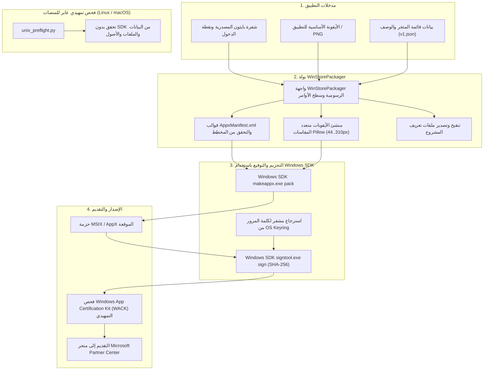
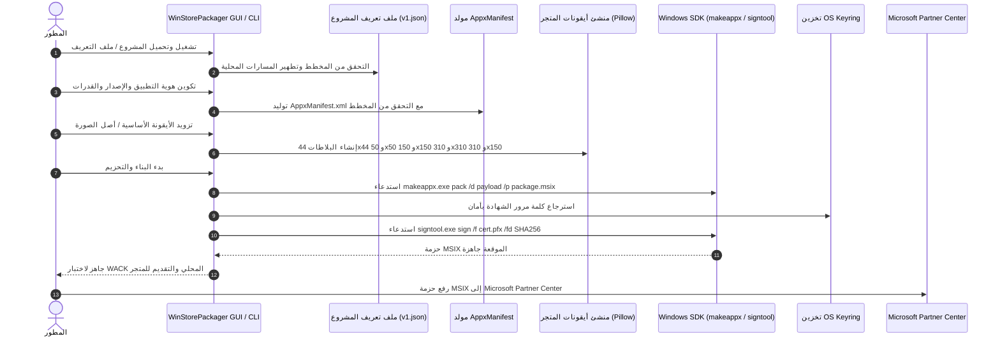

> [English](README.md) · [Deutsch](README_de.md) · [Español](README_es.md) · [Français](README_fr.md) · [Português](README_pt.md) · [Русский](README_ru.md) · [简体中文](README_zh.md) · [日本語](README_ja.md) · **العربية** · [हिन्दी](README_hi.md) · [বাংলা](README_bn.md)

<p align="center">
  
  
  
  
  
  
  
  
  
  
  
  
  
  
  
  
  
</p>

<h1 align="center">WinStorePackager</h1>

<h4 align="center">أداة محلية بواجهة رسومية وسطر أوامر لنظام Windows لإعداد تطبيقات بايثون لسطح المكتب للإرسال إلى متجر مايكروسوفت: AppxManifest وأيقونات المتجر وملفات تعريف المشروع ولقطات الشاشة وحزم MSIX</h4>

<p align="center">
  <a href="#quick-start">البدء السريع</a> •
  <a href="#features">المميزات</a> •
  <a href="#architecture--packaging-pipeline">البنية الهندسية</a> •
  <a href="#packaging-lifecycle-flow">دورة حياة التحزيم</a> •
  <a href="#governance--runtime-invariants">الحوكمة والثوابت</a> •
  <a href="#visual-showcase--store-assets">المعرض المرئي</a> •
  <a href="#project-profiles">ملفات تعريف المشروع</a> •
  <a href="#prerequisites--installation">التثبيت</a> •
  <a href="#sdk-free-unix-preflight">فحص Unix التمهيدي</a> •
  <a href="#local-data-and-security">البيانات المحلية والأمان</a> •
  <a href="#sibling-tools--ecosystem">أدوات المنظومة</a> •
  <a href="#comparison-with-alternatives">المقارنة</a> •
  <a href="#third-party-licenses--transparency">تراخيص الطرف الثالث</a> •
  <a href="#marketing--target-personas">التسويق والجمهور</a> •
  <a href="#documentation--license">التوثيق والترخيص</a>
</p>

> [!NOTE]
> **إشعار التكامل لوكلاء الذكاء الاصطناعي ونماذج اللغة (LLM)**: تم توثيق بنية المستودع العامة وحدود السياق في [`llms.txt`](llms.txt). يمكن للوكلاء الذكيين والأدوات الآلية فحص مخططات الحزم عبر [`PROJECT_PROFILE_FORMAT.md`](PROJECT_PROFILE_FORMAT.md) و [`winstorepackager-project-v1.json`](winstorepackager-project-v1.json).

---

<a id="quick-start"></a>
<a id="schnellstart"></a>
## البدء السريع

| أريد أن... | ابدأ بـ |
|---|---|
| تحزيم تطبيق بايثون لسطح المكتب لمتجر مايكروسوفت | تشغيل [`WindowsStorePublisher_3.py`](WindowsStorePublisher_3.py) أو `START.bat` على Windows |
| تشغيل الفحص التمهيدي على Unix (Linux/macOS) بدون Windows SDK | [`unix_preflight.py`](unix_preflight.py) |
| مشاركة بيانات المشروع الوصفية بدون كشف أسرار محلية | [`PROJECT_PROFILE_FORMAT.md`](PROJECT_PROFILE_FORMAT.md) |
| اختبار ملف تعريف متجر WinStorePackager الذاتي (Dogfooding) | [`winstorepackager-project-v1.json`](winstorepackager-project-v1.json) |
| التحقق من حدود الأمان والبيانات المحلية والخصوصية | [`SECURITY.md`](SECURITY.md) و [`PRIVACY_POLICY.md`](PRIVACY_POLICY.md) و [البيانات المحلية والأمان](#local-data-and-security) |

تم تصميم WinStorePackager للمطورين المستقلين والمبرمجين الأفراد والفرق البرمجية التي تحتاج إلى مسار عمل عملي ومباشر من بايثون إلى متجر مايكروسوفت دون الحاجة إلى إعداد مشاريع Visual Studio ضخمة لكل تطبيق. يركز البرنامج على الخطوات المتكررة: حقول بيان المتجر، وأحجام الأيقونات المطلوبة، وتجميع لقطات الشاشة، وتبادل ملفات التعريف، وأوامر تحزيم Windows SDK.

---

<a id="features"></a>
<a id="funktionen"></a>
## المميزات

| الميزة | الوصف |
|---|---|
| **مولد البيان** | إنشاء ملف `AppxManifest.xml` تلقائياً من حقول النموذج مع التحقق من صحة مخطط XML ومعالجة الرموز الخاصة |
| **مولد الأيقونات** | توليد جميع الأحجام المطلوبة للمتجر: 44×44 و 50×50 و 150×150 و 310×310 و 310×150 (عريض) باستخدام خوارزمية Lanczos |
| **واجهة بـ 6 لغات (i18n)** | دعم كامل للترجمة في واجهة المستخدم الرسومية (Tier 2 / P-006: الألمانية والإنجليزية والإسبانية والصينية واليابانية والروسية) مع إمكانية التبديل الفوري |
| **تكامل Keyring** | تخزين مشفر وآمن لكلمات مرور الشهادات عبر مدير بيانات اعتماد النظام (دون تخزين أي كلمات مرور بنص صريح على القرص) |
| **مساعد لقطات الشاشة** | التقاط لقطات شاشة التطبيق مباشرة عبر `pygetwindow` لإعداد أصول قائمة متجر مايكروسوفت |
| **11 تصنيفاً للمتجر** | تصنيفات قياسية معدة مسبقاً (أدوات المطورين، الإنتاجية، التعليم، الأدوات المساعدة، ...) |
| **التصنيفات العمرية** | تصنيفات عمرية من +3 إلى +18 مع التصريح المتوافق بالقدرات المطلوبة في البيان |
| **بناء وتوقيع حزم MSIX** | استدعاء تلقائي لأدوات `makeappx.exe` و `signtool.exe` من Windows SDK مع توقيع برمجي بمعيار SHA-256 |
| **حفظ الإعدادات محلياً** | تخزين الإعدادات بصيغة JSON محلياً خارج مستودع Git مع ضمانات التحديث الذري لمنع تلف الملفات |
| **فحص تمهيدي بدون SDK** | فحص والتحقق من صحة البيانات والبيانات الوصفية والأصول عبر منصات Linux و macOS |

---

<a id="architecture--packaging-pipeline"></a>
<a id="architektur--paketierungs-pipeline"></a>
## البنية الهندسية ومسار التحزيم



---

<a id="packaging-lifecycle-flow"></a>
<a id="paketierungs-lebenszyklus"></a>
## دورة حياة التحزيم



---

<a id="governance--runtime-invariants"></a>
<a id="governance--laufzeit-invarianten"></a>
## الحوكمة والثوابت أثناء التشغيل

يطبق WinStorePackager 10 قواعد صارمة للحوكمة وثوابت التشغيل عبر مراحل التطوير والتحزيم والتنفيذ:

| معرف الثابت | القاعدة والمبدأ | آلية التطبيق والضمان |
|---|---|---|
| **INV-LOCAL-01** | **تشغيل محلي 100% وبدون أي تدفق خارجي (Zero-Egress)** | يتم تجميع كل البيانات وتوليد الأيقونات والتحزيم والفحص بالكامل دون اتصال بالإنترنت. صفر بيانات تشخيصية أو تتبع سحابي. |
| **INV-SEC-02** | **حماية تشفيرية لكلمات المرور وبدون صلاحيات إدارية** | كلمات مرور شهادات التوقيع محفوظة حصراً في OS Keyring (Windows Credential Vault). يعمل التطبيق في مساحة المستخدم (`RunAsInvoker`) دون رفع صلاحيات. |
| **INV-STORE-03** | **الامتثال التام لمعايير بيان متجر مايكروسوفت** | تطبيق تحقق صارم من مخطط XML والتعامل الصحيح مع مساحات الأسماء وترميز الرموز الخاصة وفقاً لإرشادات Microsoft Partner Center. |
| **INV-ASSET-04** | **سلامة الأصول وتوليدها بمختلف المقاسات بدقة** | إعادة تحجيم حتمية عالية الجودة بخوارزمية Lanczos لتوليد أبعاد بلاطات متجر مايكروسوفت الدقيقة (44×44, 50×50, 150×150, 310×310, 310×150). |
| **INV-PROFILE-05** | **قابلية نقل ملفات التعريف المنقحة بأمان** | ملفات التعريف المشتركة (`winstorepackager-project-v1.json`) تحجب المسارات المحلية ومعرفات الناشر ومسارات الشهادات وكلمات المرور لتسهيل مشاركتها عبر أنظمة إدارة الإصدارات. |
| **INV-CROSS-06** | **تكافؤ الفحص التمهيدي عبر مختلف المنصات** | يقوم `unix_preflight.py` بإجراء فحص شامل للمعلومات الوصفية والقوائم والمخططات على Linux و macOS دون الحاجة لأدوات Windows SDK. |
| **INV-STATE-07** | **عزل الحالة محلياً والكتابة الذرية للملفات** | يتم حفظ الإعدادات وسجلات التدوير في `%LOCALAPPDATA%` خارج مستودع Git مع استخدام الاستبدال الذري للملفات (`os.replace`) لمنع التلف. |
| **INV-WACK-08** | **تقييم اعتماد WACK بطريقة حازمة (Fail-Closed)** | تحليل حتمي لتقارير أداة Windows App Certification Kit مع الرفض الفوري عند ظهور أي خطأ أو انهيار (`FAIL`, `FAILED`, `ERROR`, `CRASH`). |
| **INV-I18N-09** | **توطين واجهة المستخدم بست لغات عالمية** | دعم كامل للواجهة الرسومية بست لغات معتمدة (Tier 2: الألمانية، الإنجليزية، الإسبانية، الصينية، اليابانية، الروسية) مع تبديل فوري. |
| **INV-SLA-10** | **الحد الأدنى للأمان واتفاقية مستوى خدمة 48 ساعة** | فرض حدود دنيا لحزم التبعيات (Pillow>=12.3.0, keyring>=25.0.0, pytest>=9.1.1)، واستجابة أمنية أولية خلال 48 ساعة وتصنيف خلال 5 أيام. |

---

<a id="visual-showcase--store-assets"></a>
<a id="visuelle-showcase--store-assets"></a>
## المعرض المرئي وأصول المتجر

| ميزة المتجر | المعاينة المرئية |
|---|---|
| **الواجهة الرئيسية والتحزيم**<br>واجهة رسومية تفاعلية لتحديد هوية التطبيق ومسارات المصدر وأدوات Windows SDK. |  |
| **بيانات المتجر والتصنيفات**<br>تصنيفات المتجر المسبقة، والفئات العمرية، والقدرات، وروابط الدعم، وسياسات الخصوصية المترجمة. |  |
| **منشئ الأيقونات متعدد المقاسات**<br>توليد آلي ومعاينة لجميع تنسيقات الأيقونات المربعة والعريضة المطلوبة لمتجر مايكروسوفت. |  |
| **تحزيم وتوقيع MSIX**<br>بناء حزم MSIX بنقرة واحدة، ومصادقة الشهادات عبر OS Keyring وفحص WACK التمهيدي المدمج. |  |

يمكنك إعادة إنشاء المجموعة الكاملة للقطات شاشة متجر مايكروسوفت في أي وقت باستخدام:

```bash
python generate_store_screenshots.py
```

يقوم المنشئ بكتابة أربع صور بدقة 1920x1080 بصيغة PNG في المجلد `releases/windowsstore/screenshots/` باستخدام بيانات تجريبية محايدة دون كشف أي مسارات خاصة أو بيانات اعتماد أو معرفات ناشرين.

---

<a id="project-profiles"></a>
<a id="projektprofile"></a>
## ملفات تعريف المشروع

يوفر WinStorePackager تنسيقاً موحداً لملفات تعريف المشاريع: [`PROJECT_PROFILE_FORMAT.md`](PROJECT_PROFILE_FORMAT.md). يستطيع تطبيق سطح المكتب استيراد وتصدير ملف `winstorepackager-project-v1.json`، مما يتيح إعداد بيانات المتجر خارج بيئة Windows دون كشف معرفات الناشر المحلية أو مسارات SDK أو مسارات الشهادات أو كلمات المرور.

يتضمن هذا المستودع ملف تعريف مخصصاً لاختبار الأداة على نفسها (Dogfooding): [`winstorepackager-project-v1.json`](winstorepackager-project-v1.json). يمكنك تحميله في التطبيق لتحزيم WinStorePackager بنفسه أو التحقق منه دون Windows SDK:

```bash
python unix_preflight.py --project-root . --profile-path winstorepackager-project-v1.json
```

تم تصميم ملف التعريف بحيث يستبعد عمداً معرفات الناشر في Partner Center ومسارات الشهادات ومسارات SDK وكلمات المرور من Git. يرجى إضافة هذه القيم محلياً فقط قبل الشروع في بناء أو توقيع حزم MSIX.

---

<a id="prerequisites--installation"></a>
<a id="voraussetzungen--installation"></a>
## المتطلبات والتثبيت

- بايثون 3.9–3.13+
- Windows 10/11 (لبناء وتوقيع حزم MSIX) أو Linux/macOS (للفحص التمهيدي)
- [Windows SDK](https://developer.microsoft.com/en-us/windows/downloads/windows-sdk/) (لتوفير أداتي `makeappx.exe` و `signtool.exe`)
- حساب مطور في متجر مايكروسوفت (لتقديم التطبيق)

```bash
git clone https://github.com/file-bricks/WinStorePackager.git
cd WinStorePackager
pip install -r requirements.txt
python WindowsStorePublisher_3.py
```

أو على نظام Windows، انقر نقراً مزدوجاً فوق ملف `START.bat`.

---

<a id="sdk-free-unix-preflight"></a>
<a id="sdk-freier-unix-preflight"></a>
## فحص Unix التمهيدي بدون SDK

لمحطات العمل العاملة بنظام Linux/macOS أو لخطوط البناء المستمر (CI) التي تفتقر إلى Windows SDK، يتضمن المستودع فحصاً تمهيدياً يقتصر على البيانات الوصفية:

```bash
python unix_preflight.py --project-root .
python unix_preflight.py --project-root . --profile-path ./winstorepackager-project-v1.json
```

يقوم الفحص التمهيدي بالتحقق من هيكل المشروع، وملف `store_package.json`، وملف README، وسياسة الخصوصية، وقائمة المتجر، والأيقونات ولقطات الشاشة، وملفات التعريف المصدرة دون الحاجة لبناء حزم MSIX أو تشغيل برامج Windows التنفيذية.

---

<a id="local-data-and-security"></a>
<a id="lokale-daten-und-sicherheit"></a>
## البيانات المحلية والأمان

يعمل WinStorePackager حصرياً على ملفات المشروع المحلية:

- **أدلة التشغيل المحلية على الجهاز المضيف:** تحفظ الإعدادات الخاصة بالجهاز وسجلات التدوير خارج مستودع Git في `%LOCALAPPDATA%\WinStorePackager` (على Windows) أو `~/Library/Application Support/WinStorePackager` (على macOS) أو `${XDG_CONFIG_HOME:-~/.config}/winstorepackager` (على Linux).
- **التخزين المشفر في Keyring:** تظل كلمات مرور الشهادات محفوظة في نظام إدارة بيانات الاعتماد في نظام التشغيل ولا تتم كتابتها أبداً على القرص أو في ملفات JSON.
- **نظافة مستودع Git:** يتم استبعاد حزم MSIX المنشأة وملفات EXE والمجلدات المؤقتة والشهادات وحزم الإصدار بشكل صارم من Git.

نموذج ملف الإعدادات المحلية للجهاز المضيف (`settings_store_packager.json`):

```json
{
  "app_name": "MyApp",
  "publisher": "CN=YOUR-PUBLISHER-ID",
  "publisher_display": "Your Name",
  "version": "1.0.0.0",
  "makeappx_path": "C:/Program Files (x86)/Windows Kits/10/App Certification Kit/makeappx.exe",
  "signtool_path": "C:/Program Files (x86)/Windows Kits/10/App Certification Kit/signtool.exe"
}
```

---

<a id="sibling-tools--ecosystem"></a>
<a id="geschwister-tools--ökosystem"></a>
## أدوات المنظومة الشقيقة

يعد WinStorePackager جزءاً من عائلة البرمجيات مفتوحة المصدر **file-bricks** و **open-bricks**:

| الأداة | المنظومة | الغرض |
|---|---|---|
| **[ProSync](https://github.com/file-bricks/ProSync)** | `file-bricks` | مزامنة محلية للملفات مع حماية تكامل معاملات SQLite WAL |
| **[CleanMarkdown](https://github.com/doc-bricks/CleanMarkdown)** | `doc-bricks` | تطهير ملفات Markdown وإصلاح المسافات البيضاء وتنسيق المستندات |
| **[DokuZen](https://github.com/doc-bricks/DokuZen)** | `doc-bricks` | تنظيم سريع ومحلي للتوثيق الفني والمعرفة التقنية |
| **[UniversalDocsGrabber](https://github.com/doc-bricks/UniversalDocsGrabber)** | `doc-bricks` | استيعاب شامل للمستندات والتعرف الضوئي على الحروف ومحرك بحث |
| **[ellmos-filecommander-mcp](https://github.com/ellmos-ai/ellmos-filecommander-mcp)** | `ellmos-ai` | خادم بروتوكول MCP محلي لإدارة الملفات والبحث و OCR بأمان |
| **[open-bricks](https://github.com/open-bricks)** | `open-bricks` | منظمة مظلية لأدوات سطح المكتب والمطورين المعيارية |

---

<a id="comparison-with-alternatives"></a>
<a id="vergleich-mit-alternativen"></a>
## المقارنة مع البدائل

| الميزة | WinStorePackager | MSIX Packaging Tool | Visual Studio | Advanced Installer |
|---|:---:|:---:|:---:|:---:|
| واجهة مستخدم رسومية (GUI) | ✅ | ⚠️ | ✅ | ✅ |
| تركيز وتخصيص لبايثون | ✅ | ❌ | ❌ | ❌ |
| توليد الأيقونات آلياً (جميع المقاسات) | ✅ | ❌ | ⚠️ | ✅ |
| مولد بيان التطبيق (Manifest) | ✅ | ❌ | ✅ | ✅ |
| مجاني / مفتوح المصدر بالكامل | ✅ | ✅ | ⚠️ | ❌ |
| مساعد التقاط لقطات الشاشة | ✅ | ❌ | ❌ | ❌ |
| حماية أمنية عبر Keyring | ✅ | ❌ | ❌ | ❌ |
| واجهة محلية بـ 6 لغات (GUI) | ✅ | ❌ | ⚠️ | ⚠️ |
| فحص تمهيدي عابر للمنصات | ✅ | ❌ | ❌ | ❌ |

---

<a id="third-party-licenses--transparency"></a>
<a id="drittanbieter-lizenzen--transparenz"></a>
## تراخيص الطرف الثالث والشفافية

تم تدقيق WinStorePackager لضمان شفافية التراخيص بنسبة 100% والامتثال الكامل لنموذج Zero-Egress:

- **سجل الحزم الكامل:** تتوفر قوائم تفصيلية بالحزم المصدرية وتراخيصها وإشعاراتها في [`THIRD_PARTY_LICENSES.md`](THIRD_PARTY_LICENSES.md) و [`THIRD_PARTY_LICENSES.txt`](THIRD_PARTY_LICENSES.txt).
- **حزم وقت التشغيل:** تشمل Pillow (`HPND-sell-variant`) و keyring (`MIT`) و pygetwindow (`BSD-3-Clause`) مع فرض أدنى إصدارات أمان صارمة.
- **البناء والتحزيم:** تشمل PyInstaller (`GPL-2.0-or-later WITH Bootloader-exception`) و pyinstaller-hooks-contrib (`Apache-2.0`) و packaging (`Apache-2.0 OR BSD-2-Clause`).
- **ضمان الجودة والاختبار:** تشمل pytest (`MIT`, `>=9.1.1`) و pluggy (`MIT`) و ruff (`MIT OR Apache-2.0`).
- **المكتبة القياسية:** ترخيص مؤسسة بايثون للبرمجيات (`PSFL-2.0`). تظل الأدوات التنفيذية الخارجية لـ Windows SDK ملكية خاصة لشركة مايكروسوفت ويتم استدعاؤها عبر عمليات فرعية قياسية غير مميزة.

---

<a id="marketing--target-personas"></a>
<a id="marketing--zielgruppen"></a>
## التسويق والجمهور المستهدف

تم تحسين WinStorePackager لمحركات البحث وتوجيهه إلى أربع شرائح مطورين رئيسية:

### Target Personas

1. **مطورو تطبيقات بايثون لسطح المكتب المستقلون:** يبحثون عن مسار سهل لتحويل اسكربتات بايثون (Tkinter, PyQt, PySide, CustomTkinter) إلى متجر مايكروسوفت دون تعقيدات Visual Studio أو مخططات XML الصعبة.
2. **الشركات وبائعو البرمجيات التجاريون (ISV):** يطلبون مسارات تحزيم موثوقة وقابلة للأتمتة مع حماية قصوى لشهادات التوقيع في OS Keyring والتحقق الصارم من تقارير WACK.
3. **مشرفو المشاريع مفتوحة المصدر والفرق متعددة الأنظمة:** يطورون أساساً على Linux أو macOS ويحتاجون لفحص مسبق دون SDK في خطوط CI قبل الانتقال لأجهزة Windows.
4. **المطورون الحريصون على الخصوصية والعمل المحلي:** يشترطون تحزيماً محلياً 100% بدون أي تتبع أو إرسال بيانات، وتشغيلاً آمناً بدون صلاحيات إدارية `RunAsInvoker` ومشاركة آمنة لملفات المشاريع.

### High-Intent Search Phrases

- `WinStorePackager Python Microsoft Store MSIX`
- `file-bricks WinStorePackager`
- `Python AppxManifest generator`
- `local-first MSIX packaging tool`
- `Microsoft Store packaging GUI for Python apps`
- `MSIX packaging tool without Visual Studio`
- `Python desktop app Windows Store submission helper`
- `AppxManifest XML generator Python`

راجع [`MARKETING-LOG.txt`](MARKETING-LOG.txt) للاطلاع على سجل تصنيف الكلمات المفتاحية وتحليلات احتياجات الجمهور والتموضع التنافسي.

---

<a id="documentation--license"></a>
<a id="dokumentation--lizenz"></a>
## التوثيق والترخيص

- 📄 **سياسة الأمان:** [`SECURITY.md`](SECURITY.md) — إفصاح أمني ثنائي اللغة وضمانات العمل المحلي
- ⚖️ **إشعار النسبة:** [`NOTICE`](NOTICE) — حقوق النشر القياسية، والنسبة لمنظومة open-bricks ومراجع التبعيات
- 📝 **سجل التغييرات:** [`CHANGELOG.md`](CHANGELOG.md) — سجل الإصدارات وملاحظات النشر
- 🤖 **مرجع نماذج اللغة (LLM):** [`llms.txt`](llms.txt) — دليل معماري قابل للقراءة آلياً
- 📦 **تنسيق ملف التعريف:** [`PROJECT_PROFILE_FORMAT.md`](PROJECT_PROFILE_FORMAT.md) — مواصفات ملفات تعريف المشاريع القابلة للنقل
- 📜 **تراخيص الطرف الثالث:** [`THIRD_PARTY_LICENSES.md`](THIRD_PARTY_LICENSES.md) و [`THIRD_PARTY_LICENSES.txt`](THIRD_PARTY_LICENSES.txt)
- 📊 **سجل التسويق:** [`MARKETING-LOG.txt`](MARKETING-LOG.txt) — سجل الجمهور المستهدف وقابلية الاكتشاف

### License & Liability

Dieses Projekt steht unter der [MIT License](LICENSE).

Dieses Projekt ist eine **unentgeltliche Open-Source-Schenkung** im Sinne der §§ 516 ff. BGB. Die Haftung des Urhebers ist gemäß **§ 521 BGB** auf **Vorsatz und grobe Fahrlässigkeit** beschränkt. Ergänzend gilt der Haftungsausschluss der MIT License.

Nutzung auf eigenes Risiko. Keine Wartungszusage, keine Verfügbarkeitsgarantie, keine Gewähr für Fehlerfreiheit oder Eignung für einen bestimmten Zweck.

This project is an unpaid open-source donation. Liability is limited to intent and gross negligence (§ 521 German Civil Code). Use at your own risk. No warranty, no maintenance guarantee, no fitness-for-purpose assumed.
