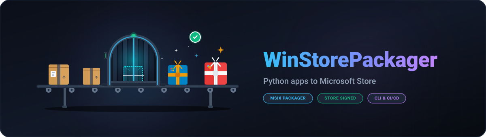
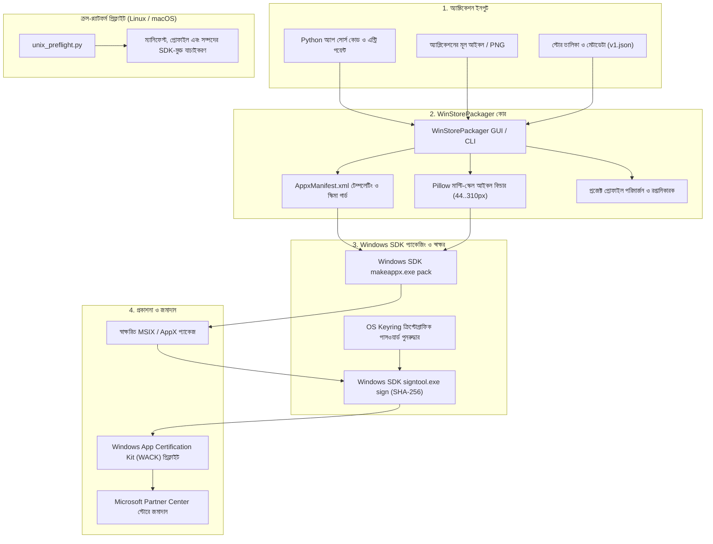
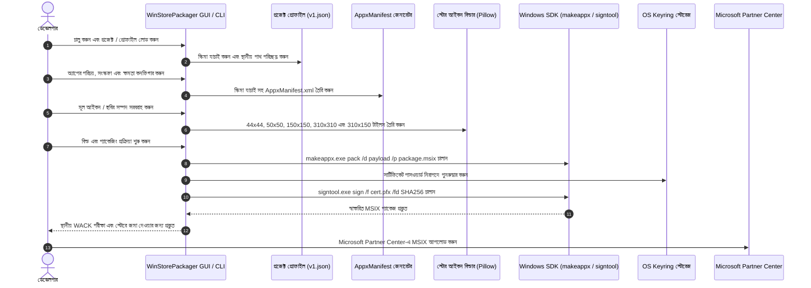

> [English](README.md) · [Deutsch](README_de.md) · [Español](README_es.md) · [Français](README_fr.md) · [Português](README_pt.md) · [Русский](README_ru.md) · [简体中文](README_zh.md) · [日本語](README_ja.md) · [العربية](README_ar.md) · [हिन्दी](README_hi.md) · **বাংলা**

<p align="center">
  
  
  
  
  
  
  
  
  
  
  
  
  
  
  
  
  
</p>

<h1 align="center">WinStorePackager</h1>

<h4 align="center">Microsoft Store-এ জমা দেওয়ার জন্য Python ডেস্কটপ অ্যাপ্লিকেশন প্রস্তুত করার লোকাল-ফার্স্ট Windows GUI ও CLI টুল: AppxManifest, স্টোর আইকন, প্রজেক্ট প্রোফাইল, স্ক্রিনশট এবং MSIX প্যাকেজিং</h4>

<p align="center">
  <a href="#quick-start">দ্রুত শুরু</a> •
  <a href="#features">বৈশিষ্ট্যসমূহ</a> •
  <a href="#architecture--packaging-pipeline">স্থাপত্য</a> •
  <a href="#packaging-lifecycle-flow">প্যাকেজিং জীবনচক্র</a> •
  <a href="#governance--runtime-invariants">পরিচালনা ও নিয়ম</a> •
  <a href="#visual-showcase--store-assets">ভিজ্যুয়াল শোকেস</a> •
  <a href="#project-profiles">প্রজেক্ট প্রোফাইল</a> •
  <a href="#prerequisites--installation">ইনস্টলেশন</a> •
  <a href="#sdk-free-unix-preflight">Unix প্রিফ্লাইট</a> •
  <a href="#local-data-and-security">স্থানীয় ডেটা ও নিরাপত্তা</a> •
  <a href="#sibling-tools--ecosystem">ইকোসিস্টেমের সহযোগী টুলস</a> •
  <a href="#comparison-with-alternatives">তুলনা</a> •
  <a href="#third-party-licenses--transparency">তৃতীয় পক্ষের লাইসেন্স</a> •
  <a href="#marketing--target-personas">বিপণন ও ব্যবহারকারী</a> •
  <a href="#documentation--license">ডকুমেন্টেশন ও লাইসেন্স</a>
</p>

> [!NOTE]
> **AI এজেন্ট এবং LLM ইন্টিগ্রেশন বিজ্ঞপ্তি**: রিপোজিটরির সামগ্রিক গঠন এবং প্রেক্ষাপটের সীমা [`llms.txt`](llms.txt)-এ নথিভুক্ত রয়েছে। LLM এজেন্ট এবং স্বয়ংক্রিয় টুলস [`PROJECT_PROFILE_FORMAT.md`](PROJECT_PROFILE_FORMAT.md) এবং [`winstorepackager-project-v1.json`](winstorepackager-project-v1.json)-এর মাধ্যমে প্যাকেজ স্কিমা পর্যবেক্ষণ করতে পারে।

---

<a id="quick-start"></a>
<a id="schnellstart"></a>
## দ্রুত শুরু

| আমার উদ্দেশ্য | শুরু করুন |
|---|---|
| Microsoft Store-এর জন্য Python ডেস্কটপ অ্যাপ তৈরি ও প্যাকেজ করা | Windows-এ [`WindowsStorePublisher_3.py`](WindowsStorePublisher_3.py) চালান বা `START.bat`-এ ডাবল ক্লিক করুন |
| Windows SDK ছাড়াই Linux/macOS-এ প্রিফ্লাইট যাচাইকরণ চালানো | [`unix_preflight.py`](unix_preflight.py) |
| স্থানীয় গোপন তথ্য প্রকাশ না করে প্রজেক্ট মেটাডেটা শেয়ার করা | [`PROJECT_PROFILE_FORMAT.md`](PROJECT_PROFILE_FORMAT.md) |
| WinStorePackager-এর নিজস্ব স্টোর প্রোফাইল পরীক্ষা করা (Dogfooding) | [`winstorepackager-project-v1.json`](winstorepackager-project-v1.json) |
| নিরাপত্তা, স্থানীয় ডেটা এবং গোপনীয়তার সীমা পরীক্ষা করা | [`SECURITY.md`](SECURITY.md), [`PRIVACY_POLICY.md`](PRIVACY_POLICY.md) এবং [স্থানীয় ডেটা ও নিরাপত্তা](#local-data-and-security) |

WinStorePackager একক ডেভেলপার, স্বাধীন নির্মাতা এবং ছোট দলগুলির জন্য তৈরি করা হয়েছে যাদের প্রতিটি অ্যাপ্লিকেশনের জন্য ভারী Visual Studio প্রজেক্ট সেট আপ না করেই Python থেকে Microsoft Store-এ একটি কার্যকর ওয়ার্কফ্লো প্রয়োজন। এটি পুনরাবৃত্তিমূলক পদক্ষেপগুলিতে গুরুত্ব দেয়: স্টোর ম্যানিফেস্ট ক্ষেত্র, প্রয়োজনীয় আইকন মাপ, স্ক্রিনশট সংগ্রহ, প্রোফাইল বিনিময় এবং Windows SDK প্যাকেজিং কমান্ড।

---

<a id="features"></a>
<a id="funktionen"></a>
## বৈশিষ্ট্যসমূহ

| বৈশিষ্ট্য | বিবরণ |
|---|---|
| **ম্যানিফেস্ট জেনারেটর** | ফর্ম ইনপুট থেকে XML স্কিমা যাচাইকরণ এবং অ্যাট্রিবিউট এস্কেপিং সহ স্বয়ংক্রিয়ভাবে `AppxManifest.xml` তৈরি করে |
| **আইকন জেনারেটর** | Lanczos রিস্যাম্পলিং সহ স্টোরের জন্য প্রয়োজনীয় সকল মাপ তৈরি করে: ৪৪×৪৪, ৫০×৫০, ১৫০×১৫০, ৩১০×৩১০ এবং ৩১০×১৫০ (প্রশস্ত) |
| **৬টি ভাষায় GUI (i18n)** | রানটাইম ভাষা পরিবর্তনের সুবিধাসহ সম্পূর্ণ বহুভাষিক GUI সমর্থন (Tier 2 / P-006: DE, EN, ES, ZH, JA, RU) |
| **Keyring নিরাপত্তা ইন্টিগ্রেশন** | অপারেটিং সিস্টেম Keyring-এর মাধ্যমে সার্টিফিকেট পাসওয়ার্ডের সুরক্ষিত সংরক্ষণ (ডিস্কে কোনো সাধারণ পাঠ্য পাসওয়ার্ড থাকে না) |
| **স্ক্রিনশট সহায়ক** | Microsoft Store তালিকার সম্পদের জন্য `pygetwindow`-এর মাধ্যমে সরাসরি অ্যাপের উইন্ডো ক্যাপচার করে |
| **১১টি স্টোর বিভাগ** | পূর্বনির্ধারিত বিভাগসমূহ (ডেভেলপার টুলস, উৎপাদনশীলতা, শিক্ষা, ইউটিলিটি, ইত্যাদি) |
| **বয়স নির্ধারণ মূল্যায়ন** | ম্যানিফেস্টের ক্ষমতার অনুগত ঘোষণা সহ ৩+ থেকে ১৮+ রেটিং সমর্থন |
| **MSIX তৈরি ও স্বাক্ষর** | SHA-256 কোড স্বাক্ষর সহ Windows SDK-এর `makeappx.exe` এবং `signtool.exe` আহ্বান করে |
| **সেটিংস স্থায়িত্ব** | ফাইল নষ্ট হওয়া রোধ করতে অ্যাটমিক ফাইল প্রতিস্থাপন সহ Git-এর বাইরে হোস্ট-স্থানীয় JSON কনফিগারেশন |
| **SDK-মুক্ত প্রিফ্লাইট** | Linux এবং macOS-এ ম্যানিফেস্ট, প্রোফাইল এবং স্টোর সম্পদের ক্রস-প্ল্যাটফর্ম যাচাইকরণ |

---

<a id="architecture--packaging-pipeline"></a>
<a id="architektur--paketierungs-pipeline"></a>
## স্থাপত্য ও প্যাকেজিং পাইপলাইন



---

<a id="packaging-lifecycle-flow"></a>
<a id="paketierungs-lebenszyklus"></a>
## প্যাকেজিং জীবনচক্র



---

<a id="governance--runtime-invariants"></a>
<a id="governance--laufzeit-invarianten"></a>
## পরিচালনা ও রানটাইম নিয়মাবলী

WinStorePackager উন্নয়ন, প্যাকেজিং এবং সঞ্চালনের সময় ১০টি কঠোর শাসন এবং রানটাইম অপরিবর্তনীয় নিয়ম প্রয়োগ করে:

| নিয়মের আইডি | নিয়ম ও নীতি | প্রয়োগ পদ্ধতি ও নিশ্চয়তা |
|---|---|---|
| **INV-LOCAL-01** | **১০০% লোকাল-ফার্স্ট এবং শূন্য ডেটা বহির্গমন (Zero-Egress)** | সমস্ত ম্যানিফেস্ট সংকলন, আইকন রেন্ডারিং, প্যাকেজিং এবং প্রিফ্লাইট পরীক্ষা সম্পূর্ণ অফলাইনে চলে। শূন্য আউটবাউন্ড টেলিমেট্রি বা ক্লাউড ট্র্যাকিং। |
| **INV-SEC-02** | **ক্রিপ্টোগ্রাফিক পাসওয়ার্ড সুরক্ষা ও নন-এলিভেশন** | স্বাক্ষর সার্টিফিকেট পাসওয়ার্ড শুধুমাত্র OS Keyring (Windows Credential Vault)-এ সংরক্ষিত থাকে। অ্যাপ্লিকেশনটি কোনো প্রশাসক অধিকার ছাড়াই ব্যবহারকারী স্তরে (`RunAsInvoker`) চলে। |
| **INV-STORE-03** | **Microsoft Store ম্যানিফেস্টের শর্তাবলী প্রতিপালন** | Microsoft Partner Center নির্দেশিকা অনুসারে কঠোর XML স্কিমা যাচাইকরণ, নেমস্পেস হ্যান্ডলিং এবং অ্যাট্রিবিউট এস্কেপিং প্রয়োগ করে। |
| **INV-ASSET-04** | **বহু-মাত্রিক গ্রাফিক্স অ্যাসেটের নির্ভুলতা** | সুনির্দিষ্ট উচ্চ-মানের Lanczos রিস্যাম্পলিং সঠিক Microsoft Store টাইল মাত্রা (৪৪×৪৪, ৫০×৫০, ১৫০×১৫০, ৩১০×৩১০, ৩১০×১৫০) তৈরি করে। |
| **INV-PROFILE-05** | **গোপনীয় তথ্যমুক্ত পোর্টেবল প্রজেক্ট প্রোফাইল** | শেয়ার করা প্রজেক্ট প্রোফাইল (`winstorepackager-project-v1.json`) ভার্সন কন্ট্রোলে নিরাপদ শেয়ারিংয়ের জন্য মেশিনের পাথ, প্রকাশক আইডি, সার্টিফিকেট পাথ এবং পাসওয়ার্ড বাদ দেয়। |
| **INV-CROSS-06** | **ক্রস-প্ল্যাটফর্ম প্রিফ্লাইট সমতা** | `unix_preflight.py` Windows SDK বাইনারি ছাড়াই Linux এবং macOS-এ সম্পূর্ণ মেটাডেটা, তালিকা এবং স্কিমা পরীক্ষা সম্পাদন করে। |
| **INV-STATE-07** | **হোস্ট-লোকাল স্টেট পৃথকীকরণ এবং অ্যাটমিক রাইট** | সেটিংস এবং আবর্তিত লগগুলি ফাইল নষ্ট হওয়া রোধ করতে অ্যাটমিক ফাইল প্রতিস্থাপনের (`os.replace`) মাধ্যমে Git চেকআউটের বাইরে `%LOCALAPPDATA%`-এ বজায় থাকে। |
| **INV-WACK-08** | **ফেইল-ক্লোজড (Fail-Closed) WACK সার্টিফিকেশন মূল্যায়ন** | ত্রুটি বা ক্র্যাশ (`FAIL`, `FAILED`, `ERROR`, `CRASH`) সনাক্ত হলে তাৎক্ষণিক প্রত্যাখ্যান সহ Windows App Certification Kit রিপোর্টের সুনির্দিষ্ট বিশ্লেষণ। |
| **INV-I18N-09** | **সর্বজনীন ৬টি ভাষায় GUI স্থানীয়করণ** | গতিশীল রানটাইম ভাষা পরিবর্তনের সুবিধাসহ সম্পূর্ণ Tier-2 বহুভাষিক GUI সমর্থন (DE, EN, ES, ZH, JA, RU)। |
| **INV-SLA-10** | **নির্ভরতা দুর্বলতা সুরক্ষা তল এবং ৪৮ ঘণ্টার নিরাপত্তা SLA** | নির্ভরতার ন্যূনতম সংস্করণ বাধ্যতামূলক (Pillow>=12.3.0, keyring>=25.0.0, pytest>=9.1.1), ৪৮ ঘণ্টার প্রাথমিক নিরাপত্তা প্রতিক্রিয়া SLA এবং ৫ দিনের ট্রাইয়েজ প্রতিশ্রুতি। |

---

<a id="visual-showcase--store-assets"></a>
<a id="visuelle-showcase--store-assets"></a>
## ভিজ্যুয়াল শোকেস ও স্টোর সম্পদ

| স্টোর বৈশিষ্ট্য | ভিজ্যুয়াল ওভারভিউ |
|---|---|
| **প্রধান দৃশ্য ও প্যাকেজিং**<br>অ্যাপের পরিচয়, উৎস পাথ এবং Windows SDK টুলচেন সেটআপের জন্য ইন্টারেক্টিভ ডেস্কটপ GUI। |  |
| **স্টোর মেটাডেটা ও রেটিং**<br>পূর্বনির্ধারিত স্টোর বিভাগ, বয়স রেটিং, প্রয়োজনীয় ক্ষমতা, সহায়তা URL এবং স্থানীয় গোপনীয়তা নীতি। |  |
| **মাল্টি-রেজোলিউশন আইকন বিল্ডার**<br>Microsoft Store-এর জন্য প্রয়োজনীয় সমস্ত বর্গাকার এবং প্রশস্ত টাইল আইকন ফরম্যাটের স্বয়ংক্রিয় তৈরি ও পূর্বরূপ। |  |
| **MSIX প্যাকেজিং ও স্বাক্ষর**<br>এক ক্লিকে MSIX প্যাকেজ সংকলন, OS Keyring সার্টিফিকেট প্রমাণীকরণ এবং সমন্বিত WACK প্রিফ্লাইট। |  |

যেকোনো সময় নিম্নলিখিত কমান্ডের মাধ্যমে Microsoft Store-এর স্ক্রিনশট সেট পুনরায় তৈরি করুন:

```bash
python generate_store_screenshots.py
```

জেনারেটরটি ব্যক্তিগত পাথ, শংসাপত্র বা প্রকাশক আইডি প্রকাশ না করে শুধুমাত্র নিরপেক্ষ ডেমো মেটাডেটা ব্যবহার করে `releases/windowsstore/screenshots/`-এ চারটি ১৯২০x১০৮০ PNG ফাইল লিখে।

---

<a id="project-profiles"></a>
<a id="projektprofile"></a>
## প্রজেক্ট প্রোফাইল

WinStorePackager একটি শেয়ারযোগ্য প্রজেক্ট প্রোফাইল ফরম্যাট প্রদান করে: [`PROJECT_PROFILE_FORMAT.md`](PROJECT_PROFILE_FORMAT.md)। ডেস্কটপ অ্যাপটি `winstorepackager-project-v1.json` আমদানি ও রপ্তানি করতে পারে যাতে স্থানীয় প্রকাশক আইডি, SDK পাথ, সার্টিফিকেট পাথ বা পাসওয়ার্ড প্রকাশ না করেই Windows-এর বাইরে স্টোর মেটাডেটা প্রস্তুত করা যায়।

এই রিপোজিটরিতে নিজস্ব স্ব-পরীক্ষণ (Dogfooding) প্রোফাইল অন্তর্ভুক্ত রয়েছে: [`winstorepackager-project-v1.json`](winstorepackager-project-v1.json)। WinStorePackager-কে নিজের সাথে প্যাকেজ করতে বা Windows SDK ছাড়াই যাচাই করতে এটি ডেস্কটপ অ্যাপে লোড করুন:

```bash
python unix_preflight.py --project-root . --profile-path winstorepackager-project-v1.json
```

এই প্রোফাইলটি Partner Center প্রকাশক আইডি, সার্টিফিকেট পাথ, SDK পাথ এবং পাসওয়ার্ডকে সচেতনভাবে Git-এর বাইরে রাখে। MSIX তৈরি বা স্বাক্ষর করার আগে শুধুমাত্র স্থানীয় সেটিংসে এই মানগুলি যোগ করুন।

---

<a id="prerequisites--installation"></a>
<a id="voraussetzungen--installation"></a>
## প্রয়োজনীয়তা ও ইনস্টলেশন

- Python 3.9–3.13+
- Windows 10/11 (MSIX তৈরি ও স্বাক্ষরের জন্য) অথবা Linux/macOS (প্রিফ্লাইট যাচাইয়ের জন্য)
- [Windows SDK](https://developer.microsoft.com/en-us/windows/downloads/windows-sdk/) (`makeappx.exe` এবং `signtool.exe`-এর জন্য)
- Microsoft Store ডেভেলপার অ্যাকাউন্ট (অ্যাপ জমা দেওয়ার জন্য)

```bash
git clone https://github.com/file-bricks/WinStorePackager.git
cd WinStorePackager
pip install -r requirements.txt
python WindowsStorePublisher_3.py
```

অথবা Windows-এ, `START.bat`-এ ডাবল ক্লিক করুন।

---

<a id="sdk-free-unix-preflight"></a>
<a id="sdk-freier-unix-preflight"></a>
## SDK-মুক্ত Unix প্রিফ্লাইট

Linux/macOS ওয়ার্কস্টেশন বা Windows SDK ছাড়া CI রানের জন্য, রিপোজিটরিতে শুধুমাত্র মেটাডেটা ভিত্তিক প্রিফ্লাইট অন্তর্ভুক্ত রয়েছে:

```bash
python unix_preflight.py --project-root .
python unix_preflight.py --project-root . --profile-path ./winstorepackager-project-v1.json
```

Unix প্রিফ্লাইট MSIX প্যাকেজ তৈরি না করেই বা Windows বাইনারি ছাড়াই প্রজেক্টের গঠন, `store_package.json`, README, গোপনীয়তা নীতি, স্টোর তালিকা, স্ক্রিনশট/আইকন এবং রপ্তানিকৃত প্রজেক্ট প্রোফাইল পরীক্ষা করে।

---

<a id="local-data-and-security"></a>
<a id="lokale-daten-und-sicherheit"></a>
## স্থানীয় ডেটা ও নিরাপত্তা

WinStorePackager শুধুমাত্র স্থানীয় প্রজেক্ট ফাইলের উপর কাজ করে:

- **হোস্ট-স্থানীয় রানটাইম ডিরেক্টরি:** মেশিন-নির্দিষ্ট সেটিংস এবং ঘূর্ণায়মান লগগুলি সোর্স চেকআউটের বাইরে `%LOCALAPPDATA%\WinStorePackager` (Windows), `~/Library/Application Support/WinStorePackager` (macOS), বা `${XDG_CONFIG_HOME:-~/.config}/winstorepackager` (Linux)-এ থাকে।
- **Keyring ক্রিপ্টোগ্রাফিক স্টোরেজ:** সার্টিফিকেট পাসওয়ার্ড অপারেটিং সিস্টেমের Keyring-এ থাকে এবং কখনও ডিস্কে বা JSON ফাইলে লেখা হয় না।
- **Git পরিচ্ছন্নতা:** তৈরি করা MSIX প্যাকেজ, EXE বিল্ড, অস্থায়ী স্টেজ ফোল্ডার, সার্টিফিকেট এবং রিলিজ বান্ডিলগুলি Git দ্বারা কঠোরভাবে উপেক্ষা করা হয়।

মেশিন-নির্দিষ্ট স্থানীয় সেটিংসের জন্য টেমপ্লেট (`settings_store_packager.json`):

```json
{
  "app_name": "MyApp",
  "publisher": "CN=YOUR-PUBLISHER-ID",
  "publisher_display": "Your Name",
  "version": "1.0.0.0",
  "makeappx_path": "C:/Program Files (x86)/Windows Kits/10/App Certification Kit/makeappx.exe",
  "signtool_path": "C:/Program Files (x86)/Windows Kits/10/App Certification Kit/signtool.exe"
}
```

---

<a id="sibling-tools--ecosystem"></a>
<a id="geschwister-tools--ökosystem"></a>
## সহযোগী টুলস ও ইকোসিস্টেম

WinStorePackager হল **file-bricks** এবং **open-bricks** ওপেন-সোর্স সফটওয়্যার পরিবারের অংশ:

| টুল | ইকোসিস্টেম | উদ্দেশ্য |
|---|---|---|
| **[ProSync](https://github.com/file-bricks/ProSync)** | `file-bricks` | লোকাল-ফার্স্ট ফাইল সিঙ্ক্রোনাইজেশন এবং SQLite WAL ধারাবাহিকতা রক্ষা |
| **[CleanMarkdown](https://github.com/doc-bricks/CleanMarkdown)** | `doc-bricks` | মার্কডাউন পরিচ্ছন্নতা, অতিরিক্ত ফাঁকা স্থান সংস্কার ও নথি ফরম্যাটিং |
| **[DokuZen](https://github.com/doc-bricks/DokuZen)** | `doc-bricks` | দ্রুত, লোকাল-ফার্স্ট প্রযুক্তিগত ডকুমেন্টেশন এবং জ্ঞান সংগঠক |
| **[UniversalDocsGrabber](https://github.com/doc-bricks/UniversalDocsGrabber)** | `doc-bricks` | সর্বজনীন নথি সংগ্রহ, OCR রূপান্তর এবং সার্চ ইঞ্জিন |
| **[ellmos-filecommander-mcp](https://github.com/ellmos-ai/ellmos-filecommander-mcp)** | `ellmos-ai` | নিরাপদ ফাইল পরিচালনা, OCR এবং অনুসন্ধানের জন্য স্থানীয় MCP সার্ভার |
| **[open-bricks](https://github.com/open-bricks)** | `open-bricks` | মডুলার ডেস্কটপ ও ডেভেলপার টুলের ছাতা সংস্থা |

---

<a id="comparison-with-alternatives"></a>
<a id="vergleich-mit-alternativen"></a>
## বিকল্পগুলির সাথে তুলনা

| বৈশিষ্ট্য | WinStorePackager | MSIX Packaging Tool | Visual Studio | Advanced Installer |
|---|:---:|:---:|:---:|:---:|
| GUI | ✅ | ⚠️ | ✅ | ✅ |
| Python কেন্দ্রিক | ✅ | ❌ | ❌ | ❌ |
| স্বয়ংক্রিয় আইকন (সকল মাপ) | ✅ | ❌ | ⚠️ | ✅ |
| ম্যানিফেস্ট জেনারেটর | ✅ | ❌ | ✅ | ✅ |
| সম্পূর্ণ বিনামূল্যে / ওপেন সোর্স | ✅ | ✅ | ⚠️ | ❌ |
| স্ক্রিনশট সহকারী | ✅ | ❌ | ❌ | ❌ |
| Keyring নিরাপত্তা | ✅ | ❌ | ❌ | ❌ |
| ৬টি ভাষায় স্থানীয়করণ (GUI) | ✅ | ❌ | ⚠️ | ⚠️ |
| ক্রস-প্ল্যাটফর্ম প্রিফ্লাইট | ✅ | ❌ | ❌ | ❌ |

---

<a id="third-party-licenses--transparency"></a>
<a id="drittanbieter-lizenzen--transparenz"></a>
## তৃতীয় পক্ষের লাইসেন্স ও স্বচ্ছতা

WinStorePackager ১০০% লাইসেন্স স্বচ্ছতা এবং Zero-Egress সম্মতি নিশ্চিত করার জন্য নিরীক্ষিত:

- **সম্পূর্ণ ইনভেন্টরি:** বিস্তারিত আপস্ট্রিম প্যাকেজ তালিকা, লাইসেন্স এবং নোটিশগুলি [`THIRD_PARTY_LICENSES.md`](THIRD_PARTY_LICENSES.md) এবং [`THIRD_PARTY_LICENSES.txt`](THIRD_PARTY_LICENSES.txt)-এ সংরক্ষিত রয়েছে।
- **রানটাইম প্যাকেজসমূহ:** কঠোর দুর্বলতা সীমা সহ Pillow (`HPND-sell-variant`), keyring (`MIT`), এবং pygetwindow (`BSD-3-Clause`) অন্তর্ভুক্ত।
- **বিল্ড এবং প্যাকেজিং:** PyInstaller (`GPL-2.0-or-later WITH Bootloader-exception`), pyinstaller-hooks-contrib (`Apache-2.0`), এবং packaging (`Apache-2.0 OR BSD-2-Clause`)।
- **মান নিশ্চিতকরণ ও পরীক্ষা:** pytest (`MIT`, `>=9.1.1`), pluggy (`MIT`), এবং ruff (`MIT OR Apache-2.0`)।
- **স্ট্যান্ডার্ড লাইব্রেরি:** Python Software Foundation License (`PSFL-2.0`)। বাহ্যিক Windows SDK বাইনারিগুলি Microsoft-এর মালিকানাধীন সফটওয়্যার এবং সাধারণ অপ্রাধিকারিত সাবপ্রসেস কার্যকলাপে আহ্বান করা হয়।

---

<a id="marketing--target-personas"></a>
<a id="marketing--zielgruppen"></a>
## বিপণন ও ব্যবহারকারী

WinStorePackager সহজে আবিষ্কারের জন্য অপ্টিমাইজ করা হয়েছে এবং চারটি প্রধান ডেভেলপার শ্রেণিকে লক্ষ্য করে:

### Target Personas

1. **একক Python ডেস্কটপ ডেভেলপার ও স্বাধীন নির্মাতা:** Visual Studio সেট আপ না করে বা জটিল XML স্কিমা না শিখে স্বতন্ত্র Python স্ক্রিপ্ট (Tkinter, PyQt, PySide, CustomTkinter) থেকে Microsoft Store-এ সহজে বিতরণের পথ চান।
2. **বাণিজ্যিক সফটওয়্যার কোম্পানি ও Python ISV:** পুনরুৎপাদনযোগ্য ও স্ক্রিপ্টযোগ্য প্যাকেজিং পাইপলাইন, স্বত্বাধিকারী কোড স্বাক্ষর সার্টিফিকেটের জন্য কঠোর OS Keyring নিরাপত্তা এবং সুরক্ষিত WACK বৈধতা প্রয়োজন।
3. **ওপেন সোর্স রক্ষণাবেক্ষণকারী ও মাল্টি-OS দল:** মূলত Linux বা macOS-এ কাজ করেন এবং Windows মেশিনে যাওয়ার আগে CI ওয়ার্কফ্লোতে SDK-মুক্ত যাচাইকরণ চান।
4. **গোপনীয়তা সচেতন এবং লোকাল-ফার্স্ট ডেভেলপার:** ১০০% অফলাইন প্যাকেজিং, শূন্য টেলিমেট্রি, `RunAsInvoker` প্রশাসক অধিকারহীন নিরাপত্তা এবং সংবেদনশীল তথ্যমুক্ত প্রজেক্ট প্রোফাইল চান।

### High-Intent Search Phrases

- `WinStorePackager Python Microsoft Store MSIX`
- `file-bricks WinStorePackager`
- `Python AppxManifest generator`
- `local-first MSIX packaging tool`
- `Microsoft Store packaging GUI for Python apps`
- `MSIX packaging tool without Visual Studio`
- `Python desktop app Windows Store submission helper`
- `AppxManifest XML generator Python`

সম্পূর্ণ কিওয়ার্ড র‌্যাঙ্কিং, ব্যবহারকারীর চাহিদা বিশ্লেষণ এবং প্রতিযোগিতামূলক অবস্থানের জন্য [`MARKETING-LOG.txt`](MARKETING-LOG.txt) দেখুন।

---

<a id="documentation--license"></a>
<a id="dokumentation--lizenz"></a>
## ডকুমেন্টেশন ও লাইসেন্স

- 📄 **নিরাপত্তা নীতি:** [`SECURITY.md`](SECURITY.md) — দ্বিভাষিক দুর্বলতা প্রকাশ এবং লোকাল-ফার্স্ট নিশ্চয়তা
- ⚖️ **স্বীকৃতি নোটিশ:** [`NOTICE`](NOTICE) — প্রামাণিক কপিরাইট, open-bricks ইকোসিস্টেম স্বীকৃতি এবং নির্ভরতা উল্লেখ
- 📝 **পরিবর্তন লগ:** [`CHANGELOG.md`](CHANGELOG.md) — সংস্করণের ইতিহাস এবং প্রকাশের নোট
- 🤖 **LLM রেফারেন্স:** [`llms.txt`](llms.txt) — মেশিনের পাঠযোগ্য স্থাপত্য গাইড
- 📦 **প্রোফাইল বিন্যাস:** [`PROJECT_PROFILE_FORMAT.md`](PROJECT_PROFILE_FORMAT.md) — বহনযোগ্য প্রজেক্ট প্রোফাইল স্পেসিফিকেশন
- 📜 **তৃতীয় পক্ষের লাইসেন্স:** [`THIRD_PARTY_LICENSES.md`](THIRD_PARTY_LICENSES.md) এবং [`THIRD_PARTY_LICENSES.txt`](THIRD_PARTY_LICENSES.txt)
- 📊 **বিপণন লগ:** [`MARKETING-LOG.txt`](MARKETING-LOG.txt) — ব্যবহারকারী এবং দৃশ্যমানতা রেজিস্ট্রি

### License & Liability

Dieses Projekt steht unter der [MIT License](LICENSE).

Dieses Projekt ist eine **unentgeltliche Open-Source-Schenkung** im Sinne der §§ 516 ff. BGB. Die Haftung des Urhebers ist gemäß **§ 521 BGB** auf **Vorsatz und grobe Fahrlässigkeit** beschränkt. Ergänzend gilt der Haftungsausschluss der MIT License.

Nutzung auf eigenes Risiko. Keine Wartungszusage, keine Verfügbarkeitsgarantie, keine Gewähr für Fehlerfreiheit oder Eignung für einen bestimmten Zweck.

This project is an unpaid open-source donation. Liability is limited to intent and gross negligence (§ 521 German Civil Code). Use at your own risk. No warranty, no maintenance guarantee, no fitness-for-purpose assumed.
