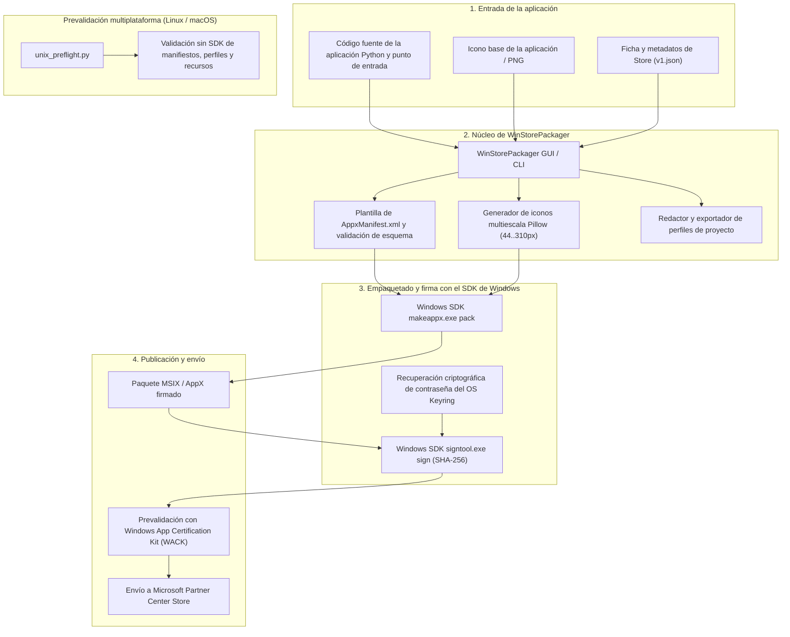
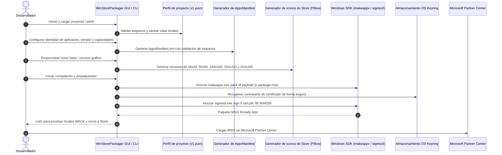

> [English](README.md) · [Deutsch](README_de.md) · **Español** · [Français](README_fr.md) · [Português](README_pt.md) · [Русский](README_ru.md) · [简体中文](README_zh.md) · [日本語](README_ja.md) · [العربية](README_ar.md) · [हिन्दी](README_hi.md) · [বাংলা](README_bn.md)

<p align="center">
  
  
  
  
  
  
  
  
  
  
  
  
  
  
  
  
</p>

<h1 align="center">WinStorePackager</h1>

<h4 align="center">Herramienta gráfica y de línea de comandos local para Windows para preparar aplicaciones de escritorio Python para Microsoft Store: AppxManifest, iconos de Store, perfiles de proyecto, capturas de pantalla y empaquetado MSIX</h4>

<p align="center">
  <a href="#quick-start">Inicio rápido</a> •
  <a href="#features">Funciones</a> •
  <a href="#architecture--packaging-pipeline">Arquitectura</a> •
  <a href="#packaging-lifecycle-flow">Flujo del ciclo de vida</a> •
  <a href="#governance--runtime-invariants">Gobernanza e invariantes</a> •
  <a href="#visual-showcase--store-assets">Muestra visual</a> •
  <a href="#project-profiles">Perfiles de proyecto</a> •
  <a href="#prerequisites--installation">Instalación</a> •
  <a href="#sdk-free-unix-preflight">Prevalidación Unix</a> •
  <a href="#local-data-and-security">Datos locales y seguridad</a> •
  <a href="#sibling-tools--ecosystem">Herramientas del ecosistema</a> •
  <a href="#comparison-with-alternatives">Comparativa</a> •
  <a href="#third-party-licenses--transparency">Licencias de terceros</a> •
  <a href="#marketing--target-personas">Marketing y perfiles</a> •
  <a href="#documentation--license">Documentación y licencia</a>
</p>

> [!NOTE]
> **Aviso de integración para agentes de IA y LLM**: La estructura general del repositorio y los límites del contexto se documentan en [`llms.txt`](llms.txt). Los agentes LLM y las herramientas automatizadas pueden consultar los esquemas de paquetes en [`PROJECT_PROFILE_FORMAT.md`](PROJECT_PROFILE_FORMAT.md) y [`winstorepackager-project-v1.json`](winstorepackager-project-v1.json).

---

<a id="quick-start"></a>
<a id="schnellstart"></a>
## Inicio rápido

| Quiero... | Empieza por... |
|---|---|
| Preparar una aplicación Python de escritorio para Microsoft Store | [`WindowsStorePublisher_3.py`](WindowsStorePublisher_3.py) o `START.bat` en Windows |
| Ejecutar la prevalidación de escritorio Unix (Linux/macOS) sin SDK | [`unix_preflight.py`](unix_preflight.py) |
| Compartir metadatos del proyecto sin secretos locales | [`PROJECT_PROFILE_FORMAT.md`](PROJECT_PROFILE_FORMAT.md) |
| Probar el perfil de Store de WinStorePackager (Dogfooding) | [`winstorepackager-project-v1.json`](winstorepackager-project-v1.json) |
| Consultar los límites de seguridad, datos locales y privacidad | [`SECURITY.md`](SECURITY.md), [`PRIVACY_POLICY.md`](PRIVACY_POLICY.md) y [Datos locales y seguridad](#local-data-and-security) |

WinStorePackager está pensado para desarrolladores individuales, creadores independientes y equipos que necesitan un flujo de trabajo práctico para llevar aplicaciones Python a Microsoft Store sin configurar proyectos pesados de Visual Studio para cada aplicación. Se centra en las tareas repetitivas: campos del manifiesto de Store, tamaños de icono requeridos, recopilación de capturas de pantalla, intercambio de perfiles y comandos de empaquetado del SDK de Windows.

---

<a id="features"></a>
<a id="funktionen"></a>
## Funciones

| Función | Descripción |
|---------|-------------|
| **Generador de manifiestos** | Crea automáticamente `AppxManifest.xml` a partir de los datos del formulario con validación de esquema XML y escape de atributos |
| **Generador de iconos** | Genera todos los tamaños requeridos por Store: 44×44, 50×50, 150×150, 310×310 y 310×150 (apaisado) con remuestreo Lanczos |
| **Interfaz gráfica en 6 idiomas (i18n)** | Soporte completo de localización en la GUI (Tier 2 / P-006: DE, EN, ES, ZH, JA, RU) con cambio de idioma en tiempo de ejecución |
| **Integración con Keyring** | Almacenamiento seguro de contraseñas de certificados mediante el llavero del sistema operativo (sin contraseñas en texto claro en disco) |
| **Asistente para capturas de pantalla** | Captura directamente pantallas de la aplicación mediante `pygetwindow` para los recursos de la ficha de Microsoft Store |
| **11 categorías de Store** | Categorías predefinidas (Herramientas para desarrolladores, Productividad, Educación, Utilidades, ...) |
| **Clasificación por edades** | Clasificaciones de 3+ a 18+ con declaración de capacidades conforme a los requisitos del manifiesto |
| **Compilación y firma de MSIX** | Invoca `makeappx.exe` y `signtool.exe` del SDK de Windows con firma de código SHA-256 |
| **Persistencia de ajustes** | Configuración JSON local al host fuera de Git con seguridad de migración atómica |
| **Prevalidación sin SDK** | Validación multiplataforma de manifiestos, perfiles y fichas en Linux y macOS |

---

<a id="architecture--packaging-pipeline"></a>
<a id="architektur--paketierungs-pipeline"></a>
## Arquitectura y flujo de empaquetado



---

<a id="packaging-lifecycle-flow"></a>
<a id="paketierungs-lebenszyklus"></a>
## Flujo del ciclo de empaquetado



---

<a id="governance--runtime-invariants"></a>
<a id="governance--laufzeit-invarianten"></a>
## Gobernanza y propiedades invariantes de ejecución

WinStorePackager aplica 10 estrictas reglas de gobernanza e invariantes en tiempo de ejecución en el desarrollo, empaquetado y ejecución:

| Invariant ID | Regla y principio | Mecanismo de aplicación y garantía |
|---|---|---|
| **INV-LOCAL-01** | **100% Local-First & Zero-Egress** | Toda la compilación de manifiestos, generación de iconos, empaquetado y prevalidación se ejecuta completamente sin conexión. Cero telemetría saliente o rastreo en la nube. |
| **INV-SEC-02** | **Protección criptográfica de contraseñas y no elevación** | Las contraseñas de certificados de firma residen exclusivamente en el OS Keyring (Windows Credential Vault). La aplicación se ejecuta en espacio de usuario (`RunAsInvoker`) sin elevación de privilegios de administrador. |
| **INV-STORE-03** | **Cumplimiento de manifiesto de Microsoft Store** | Aplica validación estricta de esquema XML, gestión de espacios de nombres y escape de atributos conforme a las directrices de Microsoft Partner Center. |
| **INV-ASSET-04** | **Integridad de recursos multiescala** | El remuestreo determinista Lanczos de alta calidad genera dimensiones exactas para mosaicos de Microsoft Store (44×44, 50×50, 150×150, 310×310, 310×150). |
| **INV-PROFILE-05** | **Portabilidad de perfiles redactados** | Los perfiles de proyecto compartidos (`winstorepackager-project-v1.json`) redactan rutas locales, Publisher IDs, rutas de certificados y secretos para compartir de forma segura en control de versiones. |
| **INV-CROSS-06** | **Paridad de prevalidación multiplataforma** | `unix_preflight.py` ejecuta comprobaciones completas de metadatos, fichas y esquemas en Linux y macOS sin requerir binarios del Windows SDK. |
| **INV-STATE-07** | **Aislamiento de estado local al host y escrituras atómicas** | La configuración y los registros rotativos se guardan en `%LOCALAPPDATA%` fuera de repositorios git mediante reemplazo atómico de archivos (`os.replace`) para evitar corrupción. |
| **INV-WACK-08** | **Evaluación de certificación WACK a prueba de fallos (Fail-Closed)** | Análisis determinista de informes de Windows App Certification Kit con rechazo automático ante errores o fallos (`FAIL`, `FAILED`, `ERROR`, `CRASH`). |
| **INV-I18N-09** | **Localización universal en 6 idiomas** | Soporte completo de interfaz de usuario multilingüe Tier-2 (DE, EN, ES, ZH, JA, RU) con cambio dinámico en tiempo de ejecución. |
| **INV-SLA-10** | **Nivel mínimo contra vulnerabilidades y SLA de seguridad de 48h** | Versiones mínimas obligatorias de dependencias (Pillow>=12.3.0, keyring>=25.0.0, pytest>=9.1.1), SLA de respuesta inicial de seguridad de 48 horas y compromiso de triaje de 5 días. |

---

<a id="visual-showcase--store-assets"></a>
<a id="visuelle-showcase--store-assets"></a>
## Muestra visual y recursos de Store

| Función de Store | Resumen visual |
|---|---|
| **Vista principal y empaquetado**<br>Interfaz gráfica interactiva de escritorio para identidad de la aplicación, rutas de origen y herramientas del Windows SDK. |  |
| **Metadatos de Store y clasificaciones**<br>Categorías predefinidas de Store, clasificaciones por edad, capacidades, URLs de soporte y políticas de privacidad localizadas. |  |
| **Generador de iconos multirresolución**<br>Generación y vista previa automatizada de todos los formatos de mosaico requeridos por Microsoft Store. |  |
| **Empaquetado y firma de MSIX**<br>Compilación de paquetes MSIX en un clic, autenticación de certificados mediante OS Keyring y prevalidación WACK. |  |

Reconstruya el conjunto seleccionado de capturas de pantalla de Microsoft Store en cualquier momento con:

```bash
python generate_store_screenshots.py
```

El generador escribe cuatro archivos PNG de 1920x1080 en `releases/windowsstore/screenshots/` y utiliza únicamente metadatos de demostración neutrales sin exponer rutas privadas, credenciales ni Publisher IDs.

---

<a id="project-profiles"></a>
<a id="projektprofile"></a>
## Perfiles de proyecto

WinStorePackager incluye un formato de perfil de proyecto compartido: [`PROJECT_PROFILE_FORMAT.md`](PROJECT_PROFILE_FORMAT.md). La aplicación de escritorio puede importar y exportar `winstorepackager-project-v1.json` para que los metadatos de Store se puedan preparar fuera de Windows sin exponer Publisher IDs locales, rutas de SDK, rutas de certificados o contraseñas.

Este repositorio incluye su propio perfil de prueba (Dogfooding), [`winstorepackager-project-v1.json`](winstorepackager-project-v1.json). Cárguelo en la aplicación de escritorio para empaquetar WinStorePackager con WinStorePackager, o valídelo sin el Windows SDK:

```bash
python unix_preflight.py --project-root . --profile-path winstorepackager-project-v1.json
```

El perfil mantiene intencionadamente los Publisher IDs de Partner Center, rutas de certificados, rutas de SDK y contraseñas fuera de Git. Añada esos valores únicamente en la configuración local antes de compilar o firmar un MSIX.

---

<a id="prerequisites--installation"></a>
<a id="voraussetzungen--installation"></a>
## Requisitos e instalación

- Python 3.9–3.13+
- Windows 10/11 (para compilación y firma de MSIX) o Linux/macOS (para validación de preflight)
- [Windows SDK](https://developer.microsoft.com/en-us/windows/downloads/windows-sdk/) (para `makeappx.exe` y `signtool.exe`)
- Cuenta de desarrollador de Microsoft Store (para el envío)

```bash
git clone https://github.com/file-bricks/WinStorePackager.git
cd WinStorePackager
pip install -r requirements.txt
python WindowsStorePublisher_3.py
```

O en Windows, haga doble clic en `START.bat`.

---

<a id="sdk-free-unix-preflight"></a>
<a id="sdk-freier-unix-preflight"></a>
## Prevalidación Unix sin SDK

Para estaciones de trabajo Linux/macOS o ejecuciones de CI sin el Windows SDK, el repositorio incluye una prevalidación de metadatos:

```bash
python unix_preflight.py --project-root .
python unix_preflight.py --project-root . --profile-path ./winstorepackager-project-v1.json
```

La prevalidación Unix comprueba la estructura del proyecto, `store_package.json`, README, política de privacidad, ficha de Store, recursos de capturas e iconos y perfiles de proyecto exportados sin compilar paquetes MSIX ni requerir binarios de Windows.

---

<a id="local-data-and-security"></a>
<a id="lokale-daten-und-sicherheit"></a>
## Datos locales y seguridad

WinStorePackager opera exclusivamente sobre archivos de proyecto locales:

- **Directorios de tiempo de ejecución locales al host:** La configuración específica del equipo y los registros rotativos se guardan fuera del repositorio en `%LOCALAPPDATA%\WinStorePackager` (Windows), `~/Library/Application Support/WinStorePackager` (macOS) o `${XDG_CONFIG_HOME:-~/.config}/winstorepackager` (Linux).
- **Almacenamiento criptográfico en Keyring:** Las contraseñas de certificados permanecen en el OS Keyring del sistema operativo y nunca se escriben en disco ni en archivos JSON.
- **Higiene de Git:** Los paquetes MSIX generados, ejecutables EXE, carpetas de preparación temporal, certificados y paquetes de versión son ignorados estrictamente por Git.

Plantilla para la configuración de tiempo de ejecución específica del equipo (`settings_store_packager.json`):

```json
{
  "app_name": "MyApp",
  "publisher": "CN=YOUR-PUBLISHER-ID",
  "publisher_display": "Your Name",
  "version": "1.0.0.0",
  "makeappx_path": "C:/Program Files (x86)/Windows Kits/10/App Certification Kit/makeappx.exe",
  "signtool_path": "C:/Program Files (x86)/Windows Kits/10/App Certification Kit/signtool.exe"
}
```

---

<a id="sibling-tools--ecosystem"></a>
<a id="geschwister-tools--ökosystem"></a>
## Herramientas del ecosistema

WinStorePackager forma parte de la familia de software de código abierto **file-bricks** y **open-bricks**:

| Herramienta | Ecosistema | Propósito |
|---|---|---|
| **[ProSync](https://github.com/file-bricks/ProSync)** | `file-bricks` | Sincronización de archivos local-first y protección de consistencia SQLite WAL |
| **[CleanMarkdown](https://github.com/doc-bricks/CleanMarkdown)** | `doc-bricks` | Saneamiento de Markdown, reparación de espacios en blanco y formato de documentos |
| **[DokuZen](https://github.com/doc-bricks/DokuZen)** | `doc-bricks` | Organizador rápido y local-first de documentación técnica y conocimiento |
| **[UniversalDocsGrabber](https://github.com/doc-bricks/UniversalDocsGrabber)** | `doc-bricks` | Ingesta universal de documentos, conversión OCR y motor de búsqueda |
| **[ellmos-filecommander-mcp](https://github.com/ellmos-ai/ellmos-filecommander-mcp)** | `ellmos-ai` | Servidor MCP local para gestión segura de archivos, OCR y búsqueda |
| **[open-bricks](https://github.com/open-bricks)** | `open-bricks` | Organización paraguas para herramientas modulares de escritorio y desarrollo |

---

<a id="comparison-with-alternatives"></a>
<a id="vergleich-mit-alternativen"></a>
## Comparativa con alternativas

| Función | WinStorePackager | MSIX Packaging Tool | Visual Studio | Advanced Installer |
|---------|:---:|:---:|:---:|:---:|
| GUI | ✅ | ⚠️ | ✅ | ✅ |
| Enfoque en Python | ✅ | ❌ | ❌ | ❌ |
| Iconos automáticos (todos los tamaños) | ✅ | ❌ | ⚠️ | ✅ |
| Generador de manifiestos | ✅ | ❌ | ✅ | ✅ |
| Gratuito / Código abierto | ✅ | ✅ | ⚠️ | ❌ |
| Asistente de capturas | ✅ | ❌ | ❌ | ❌ |
| Seguridad con Keyring | ✅ | ❌ | ❌ | ❌ |
| Localización en 6 idiomas (GUI) | ✅ | ❌ | ⚠️ | ⚠️ |
| Prevalidación multiplataforma | ✅ | ❌ | ❌ | ❌ |

---

<a id="third-party-licenses--transparency"></a>
<a id="drittanbieter-lizenzen--transparenz"></a>
## Licencias de terceros y transparencia

WinStorePackager está auditado para garantizar un 100% de transparencia de licencias y cumplimiento de Zero-Egress:

- **Inventario completo:** Los listados detallados de paquetes ascendentes, licencias y avisos se mantienen en [`THIRD_PARTY_LICENSES.md`](THIRD_PARTY_LICENSES.md) y [`THIRD_PARTY_LICENSES.txt`](THIRD_PARTY_LICENSES.txt).
- **Paquetes en tiempo de ejecución:** Incluye Pillow (`HPND-sell-variant`), keyring (`MIT`) y pygetwindow (`BSD-3-Clause`) con límites estrictos contra vulnerabilidades.
- **Compilación y empaquetado:** PyInstaller (`GPL-2.0-or-later WITH Bootloader-exception`), pyinstaller-hooks-contrib (`Apache-2.0`) y packaging (`Apache-2.0 OR BSD-2-Clause`).
- **Garantía de calidad y pruebas:** pytest (`MIT`, `>=9.1.1`), pluggy (`MIT`) y ruff (`MIT OR Apache-2.0`).
- **Biblioteca estándar:** Python Software Foundation License (`PSFL-2.0`). Los binarios externos del Windows SDK son propietarios de Microsoft y se invocan mediante ejecución estándar de subprocesos sin privilegios.

---

<a id="marketing--target-personas"></a>
<a id="marketing--zielgruppen"></a>
## Marketing y perfiles

WinStorePackager está optimizado para su visibilidad y orientado a cuatro segmentos principales de desarrolladores:

### Target Personas

1. **Desarrolladores individuales de escritorio Python y creadores indie:** Necesitan una vía sencilla desde scripts de Python independientes (Tkinter, PyQt, PySide, CustomTkinter) hacia la distribución en Microsoft Store sin configurar Visual Studio ni aprender esquemas XML complejos.
2. **Empresas y proveedores comerciales de software Python (ISV):** Requieren pipelines de empaquetado reproducibles y automatizables, protección estricta de credenciales en OS Keyring para certificados de firma de código propietarios y validación WACK fail-closed.
3. **Mantenedores de código abierto y equipos multiplataforma:** Desarrollan principalmente en Linux o macOS y exigen prevalidación sin SDK en flujos de CI antes de usar máquinas Windows.
4. **Desarrolladores orientados a la privacidad y local-first:** Exigen empaquetado 100% offline, cero telemetría, seguridad `RunAsInvoker` sin elevación y perfiles de proyecto redactados.

### High-Intent Search Phrases

- `WinStorePackager Python Microsoft Store MSIX`
- `file-bricks WinStorePackager`
- `Python AppxManifest generator`
- `local-first MSIX packaging tool`
- `Microsoft Store packaging GUI for Python apps`
- `MSIX packaging tool without Visual Studio`
- `Python desktop app Windows Store submission helper`
- `AppxManifest XML generator Python`

---

<a id="documentation--license"></a>
<a id="dokumentation--lizenz"></a>
## Documentación y licencia

- 📄 **Política de seguridad:** [`SECURITY.md`](SECURITY.md) — Divulgación bilingüe de vulnerabilidades y garantías local-first
- ⚖️ **Aviso de atribución:** [`NOTICE`](NOTICE) — Copyright canónico, atribución al ecosistema open-bricks y referencias a dependencias
- 📝 **Registro de cambios:** [`CHANGELOG.md`](CHANGELOG.md) — Historial de versiones y notas de versión
- 🤖 **Referencia LLM:** [`SKILL.md`](SKILL.md), [`llms.txt`](llms.txt) & [`llm.txt`](llm.txt) — Guía de arquitectura legible por máquinas
- 📦 **Formato de perfil:** [`PROJECT_PROFILE_FORMAT.md`](PROJECT_PROFILE_FORMAT.md) — Especificación de perfiles de proyecto portátiles
- 📜 **Licencias de terceros:** [`THIRD_PARTY_LICENSES.md`](THIRD_PARTY_LICENSES.md) & [`THIRD_PARTY_LICENSES.txt`](THIRD_PARTY_LICENSES.txt)

### License & Liability

Dieses Projekt steht unter der [MIT License](LICENSE).

Dieses Projekt ist eine **unentgeltliche Open-Source-Schenkung** im Sinne der §§ 516 ff. BGB. Die Haftung des Urhebers ist gemäß **§ 521 BGB** auf **Vorsatz und grobe Fahrlässigkeit** beschränkt. Ergänzend gilt der Haftungsausschluss der MIT License.

Nutzung auf eigenes Risiko. Keine Wartungszusage, keine Verfügbarkeitsgarantie, keine Gewähr für Fehlerfreiheit oder Eignung für einen bestimmten Zweck.

This project is an unpaid open-source donation. Liability is limited to intent and gross negligence (§ 521 German Civil Code). Use at your own risk. No warranty, no maintenance guarantee, no fitness-for-purpose assumed.
