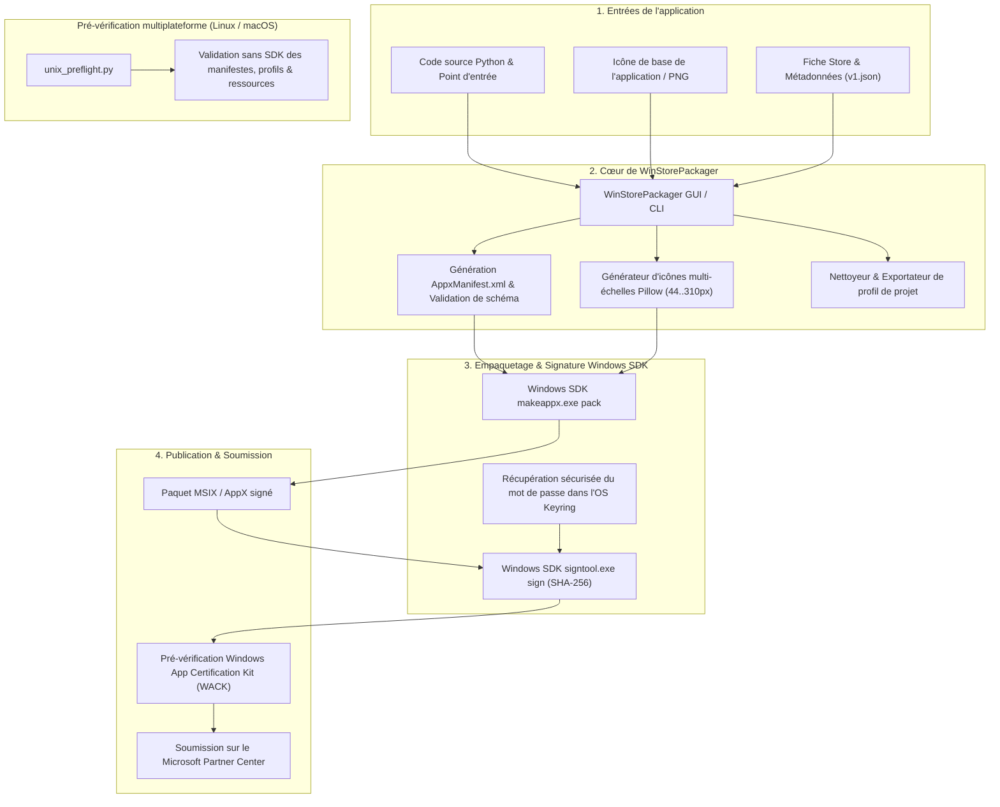
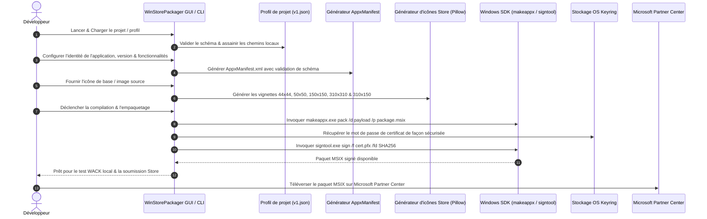

> [English](README.md) · [Deutsch](README_de.md) · [Español](README_es.md) · **Français** · [Português](README_pt.md) · [Русский](README_ru.md) · [简体中文](README_zh.md) · [日本語](README_ja.md) · [العربية](README_ar.md) · [हिन्दी](README_hi.md) · [বাংলা](README_bn.md)

<p align="center">
  
  
  
  
  
  
  
  
  
  
  
  
  
  
  
  
  
</p>

<h1 align="center">WinStorePackager</h1>

<h4 align="center">Outil graphique et CLI local sous Windows pour préparer les applications de bureau Python pour le Microsoft Store : AppxManifest, icônes Store, profils de projet, captures d'écran et empaquetage MSIX</h4>

<p align="center">
  <a href="#quick-start">Démarrage rapide</a> •
  <a href="#features">Fonctionnalités</a> •
  <a href="#architecture--packaging-pipeline">Architecture</a> •
  <a href="#packaging-lifecycle-flow">Cycle de vie</a> •
  <a href="#governance--runtime-invariants">Gouvernance & Invariants</a> •
  <a href="#visual-showcase--store-assets">Aperçu visuel</a> •
  <a href="#project-profiles">Profils de projet</a> •
  <a href="#prerequisites--installation">Installation</a> •
  <a href="#sdk-free-unix-preflight">Pré-vérification Unix</a> •
  <a href="#local-data-and-security">Données locales & Sécurité</a> •
  <a href="#sibling-tools--ecosystem">Outils de l'écosystème</a> •
  <a href="#comparison-with-alternatives">Comparatif</a> •
  <a href="#third-party-licenses--transparency">Licences tierces</a> •
  <a href="#marketing--target-personas">Marketing & Cibles</a> •
  <a href="#documentation--license">Documentation & Licence</a>
</p>

> [!NOTE]
> **Avis d'intégration pour agents IA et LLM** : La structure globale du dépôt et les limites de contexte sont documentées dans [`llms.txt`](llms.txt). Les agents LLM et les outils automatisés peuvent inspecter les schémas de paquets via [`PROJECT_PROFILE_FORMAT.md`](PROJECT_PROFILE_FORMAT.md) et [`winstorepackager-project-v1.json`](winstorepackager-project-v1.json).

---

<a id="quick-start"></a>
<a id="schnellstart"></a>
## Démarrage rapide

| Objectif | Point d'entrée |
|---|---|
| Préparer et empaqueter une application Python pour le Microsoft Store | [`WindowsStorePublisher_3.py`](WindowsStorePublisher_3.py) ou `START.bat` sous Windows |
| Exécuter la pré-vérification sans SDK Windows sous Unix (Linux/macOS) | [`unix_preflight.py`](unix_preflight.py) |
| Partager des métadonnées de projet sans secrets locaux | [`PROJECT_PROFILE_FORMAT.md`](PROJECT_PROFILE_FORMAT.md) |
| Tester le profil Store de WinStorePackager (Dogfooding) | [`winstorepackager-project-v1.json`](winstorepackager-project-v1.json) |
| Vérifier les limites de sécurité, de données locales et de confidentialité | [`SECURITY.md`](SECURITY.md), [`PRIVACY_POLICY.md`](PRIVACY_POLICY.md) et [Données locales & Sécurité](#local-data-and-security) |

WinStorePackager est conçu pour les développeurs indépendants, les créateurs solo et les équipes qui ont besoin d'un flux de travail pratique pour publier des applications Python sur le Microsoft Store sans avoir à configurer de lourds projets Visual Studio pour chaque application. Il se concentre sur les étapes répétitives : champs du manifeste Store, tailles d'icônes requises, collecte de captures d'écran, échange de profils et commandes d'empaquetage du Windows SDK.

---

<a id="features"></a>
<a id="funktionen"></a>
## Fonctionnalités

| Fonctionnalité | Description |
|---|---|
| **Générateur de manifeste** | Génère automatiquement `AppxManifest.xml` depuis les champs du formulaire avec validation de schéma XML et échappement d'attributs |
| **Générateur d'icônes** | Crée toutes les tailles requises par le Store : 44×44, 50×50, 150×150, 310×310 et 310×150 (large) avec rééchantillonnage Lanczos |
| **Interface en 6 langues (i18n)** | Prise en charge complète de la localisation de l'interface (Tier 2 / P-006 : DE, EN, ES, ZH, JA, RU) avec changement de langue à chaud |
| **Intégration Keyring** | Stockage sécurisé des mots de passe de certificats via le trousseau de clés de l'OS (aucun mot de passe en texte clair sur le disque) |
| **Assistant de captures d'écran** | Capture directement les fenêtres de l'application via `pygetwindow` pour les ressources du Microsoft Store |
| **11 catégories Store** | Catégories prédéfinies (Outils pour développeurs, Productivité, Éducation, Utilitaires, ...) |
| **Classifications d'âge** | Évaluations de 3+ à 18+ avec déclaration conforme des fonctionnalités requises dans le manifeste |
| **Compilation & signature MSIX** | Invoque `makeappx.exe` et `signtool.exe` du Windows SDK avec signature de code SHA-256 |
| **Persistance des paramètres** | Configuration JSON locale à la machine en dehors de Git avec sécurité de migration atomique |
| **Pré-vérification sans SDK** | Validation multiplateforme des manifestes, profils et fiches de magasin sous Linux et macOS |

---

<a id="architecture--packaging-pipeline"></a>
<a id="architektur--paketierungs-pipeline"></a>
## Architecture & Pipeline d'empaquetage



---

<a id="packaging-lifecycle-flow"></a>
<a id="paketierungs-lebenszyklus"></a>
## Cycle de vie de l'empaquetage



---

<a id="governance--runtime-invariants"></a>
<a id="governance--laufzeit-invarianten"></a>
## Gouvernance & Invariants d'exécution

WinStorePackager applique 10 règles strictes de gouvernance et d'invariants d'exécution tout au long du développement, de l'empaquetage et de l'exécution :

| Invariant ID | Règle & Principe | Mécanisme d'application & Garantie |
|---|---|---|
| **INV-LOCAL-01** | **100 % Local-First & Zéro fuite de données (Zero-Egress)** | Toute la compilation des manifestes, le rendu des icônes et les vérifications s'exécutent entièrement hors ligne. Zéro télémétrie sortante ou suivi cloud. |
| **INV-SEC-02** | **Protection cryptographique des mots de passe & Non-élévation** | Les mots de passe des certificats de signature résident exclusivement dans l'OS Keyring (Windows Credential Vault). L'application s'exécute dans l'espace utilisateur (`RunAsInvoker`) sans privilèges administrateur. |
| **INV-STORE-03** | **Conformité du manifeste Microsoft Store** | Applique une validation stricte du schéma XML, la gestion des espaces de noms et l'échappement des attributs conformément aux directives du Microsoft Partner Center. |
| **INV-ASSET-04** | **Intégrité des ressources multi-résolutions** | Un rééchantillonnage Lanczos de haute qualité déterministe génère les dimensions exactes des vignettes du Store (44×44, 50×50, 150×150, 310×310, 310×150). |
| **INV-PROFILE-05** | **Portabilité des profils de projet anonymisés** | Les profils partagés (`winstorepackager-project-v1.json`) excluent les chemins locaux, les identifiants d'éditeur (Publisher IDs), les certificats et les mots de passe pour un partage sûr sous contrôle de version. |
| **INV-CROSS-06** | **Parité de pré-vérification multiplateforme** | `unix_preflight.py` effectue toutes les vérifications de métadonnées, de fiches et de schémas sous Linux et macOS sans nécessiter les binaires du Windows SDK. |
| **INV-STATE-07** | **Isolation de l'état local & Écritures atomiques** | Les paramètres et journaux rotatifs persistent dans `%LOCALAPPDATA%` en dehors des dépôts Git via un remplacement atomique de fichier (`os.replace`) pour prévenir toute corruption. |
| **INV-WACK-08** | **Évaluation de certification WACK fail-closed** | Analyse déterministe des rapports du Windows App Certification Kit avec rejet automatique en cas d'erreur ou d'échec (`FAIL`, `FAILED`, `ERROR`, `CRASH`). |
| **INV-I18N-09** | **Localisation universelle de l'interface en 6 langues** | Prise en charge complète de l'interface en plusieurs langues (Tier 2 : DE, EN, ES, ZH, JA, RU) avec basculement dynamique à chaud. |
| **INV-SLA-10** | **Plancher de vulnérabilités & SLA de sécurité sous 48 h** | Versions minimales requises pour les dépendances (Pillow>=12.3.0, keyring>=25.0.0, pytest>=9.1.1), SLA de réponse initiale sous 48 h et engagement de triage en 5 jours. |

---

<a id="visual-showcase--store-assets"></a>
<a id="visuelle-showcase--store-assets"></a>
## Aperçu visuel & Ressources Store

| Fonctionnalité Store | Vue d'ensemble |
|---|---|
| **Vue principale & Empaquetage**<br>Interface graphique de bureau interactive pour l'identité de l'application, les chemins sources et la chaîne d'outils du Windows SDK. |  |
| **Métadonnées Store & Classifications**<br>Catégories Store prédéfinies, classifications d'âge, fonctionnalités requises, URLs de support et politiques de confidentialité localisées. |  |
| **Générateur d'icônes multi-résolutions**<br>Génération et prévisualisation automatisées de tous les formats d'icônes carrées et larges requis par le Microsoft Store. |  |
| **Empaquetage & Signature MSIX**<br>Compilation de paquets MSIX en un clic, authentification de certificat via l'OS Keyring et pré-vérification WACK intégrée. |  |

Générez à tout moment l'ensemble complet des captures d'écran pour le Microsoft Store avec :

```bash
python generate_store_screenshots.py
```

Le script produit quatre fichiers PNG en résolution 1920x1080 dans `releases/windowsstore/screenshots/` avec des métadonnées de démonstration neutres sans divulguer de chemins privés, de secrets ou de Publisher IDs.

---

<a id="project-profiles"></a>
<a id="projektprofile"></a>
## Profils de projet

WinStorePackager propose un format de profil de projet partagé : [`PROJECT_PROFILE_FORMAT.md`](PROJECT_PROFILE_FORMAT.md). L'application de bureau peut importer et exporter `winstorepackager-project-v1.json` afin que les métadonnées Store puissent être préparées en dehors de Windows sans exposer les identifiants d'éditeur locaux, les chemins du SDK, les chemins de certificats ou les mots de passe.

Ce dépôt inclut son propre profil de test (Dogfooding), [`winstorepackager-project-v1.json`](winstorepackager-project-v1.json). Chargez-le dans l'application de bureau pour empaqueter WinStorePackager avec lui-même, ou validez-le sans le Windows SDK :

```bash
python unix_preflight.py --project-root . --profile-path winstorepackager-project-v1.json
```

Le profil conserve intentionnellement les identifiants d'éditeur du Partner Center, les chemins de certificats, les chemins du SDK et les mots de passe en dehors de Git. Ajoutez ces valeurs uniquement dans la configuration locale avant de compiler ou signer un MSIX.

---

<a id="prerequisites--installation"></a>
<a id="voraussetzungen--installation"></a>
## Prérequis & Installation

- Python 3.9–3.13+
- Windows 10/11 (pour la compilation et la signature MSIX) ou Linux/macOS (pour la pré-vérification)
- [Windows SDK](https://developer.microsoft.com/en-us/windows/downloads/windows-sdk/) (pour `makeappx.exe` et `signtool.exe`)
- Compte développeur Microsoft Store (pour la soumission)

```bash
git clone https://github.com/file-bricks/WinStorePackager.git
cd WinStorePackager
pip install -r requirements.txt
python WindowsStorePublisher_3.py
```

Ou sous Windows, double-cliquez sur `START.bat`.

---

<a id="sdk-free-unix-preflight"></a>
<a id="sdk-freier-unix-preflight"></a>
## Pré-vérification Unix sans SDK

Pour les stations de travail sous Linux/macOS ou les pipelines CI sans Windows SDK, le dépôt inclut une pré-vérification basée sur les métadonnées :

```bash
python unix_preflight.py --project-root .
python unix_preflight.py --project-root . --profile-path ./winstorepackager-project-v1.json
```

La pré-vérification Unix valide la structure du projet, `store_package.json`, le README, la politique de confidentialité, la fiche du Store, les captures d'écran/icônes et les profils de projet exportés sans compiler de paquets MSIX ni requérir de binaires Windows.

---

<a id="local-data-and-security"></a>
<a id="lokale-daten-und-sicherheit"></a>
## Données locales & Sécurité

WinStorePackager opère exclusivement sur des fichiers de projet locaux :

- **Répertoires d'exécution locaux à l'hôte :** Les paramètres spécifiques à la machine et les journaux rotatifs résident en dehors de l'espace de travail Git dans `%LOCALAPPDATA%\WinStorePackager` (Windows), `~/Library/Application Support/WinStorePackager` (macOS) ou `${XDG_CONFIG_HOME:-~/.config}/winstorepackager` (Linux).
- **Stockage cryptographique Keyring :** Les mots de passe des certificats sont conservés dans le trousseau de clés de l'OS et ne sont jamais enregistrés sur le disque ou dans des fichiers JSON.
- **Hygiène Git :** Les paquets MSIX générés, les exécutables EXE, les dossiers de préparation temporaires, les certificats et les archives de publication sont strictement ignorés par Git.

Modèle pour les paramètres de configuration locaux (`settings_store_packager.json`) :

```json
{
  "app_name": "MyApp",
  "publisher": "CN=YOUR-PUBLISHER-ID",
  "publisher_display": "Your Name",
  "version": "1.0.0.0",
  "makeappx_path": "C:/Program Files (x86)/Windows Kits/10/App Certification Kit/makeappx.exe",
  "signtool_path": "C:/Program Files (x86)/Windows Kits/10/App Certification Kit/signtool.exe"
}
```

---

<a id="sibling-tools--ecosystem"></a>
<a id="geschwister-tools--ökosystem"></a>
## Outils de l'écosystème

WinStorePackager fait partie de la famille de logiciels libres **file-bricks** et **open-bricks** :

| Outil | Écosystème | Objectif |
|---|---|---|
| **[ProSync](https://github.com/file-bricks/ProSync)** | `file-bricks` | Synchronisation de fichiers local-first avec protection de cohérence SQLite WAL |
| **[CleanMarkdown](https://github.com/doc-bricks/CleanMarkdown)** | `doc-bricks` | Nettoyage de Markdown, réparation d'espaces blancs et formatage de documents |
| **[DokuZen](https://github.com/doc-bricks/DokuZen)** | `doc-bricks` | Organisateur local-first rapide de documentation technique et de connaissances |
| **[UniversalDocsGrabber](https://github.com/doc-bricks/UniversalDocsGrabber)** | `doc-bricks` | Ingestion universelle de documents, conversion OCR et moteur de recherche |
| **[ellmos-filecommander-mcp](https://github.com/ellmos-ai/ellmos-filecommander-mcp)** | `ellmos-ai` | Serveur MCP local pour la gestion sécurisée de fichiers, OCR et recherche |
| **[open-bricks](https://github.com/open-bricks)** | `open-bricks` | Organisation faîtière pour outils modulaires de bureau et de développement |

---

<a id="comparison-with-alternatives"></a>
<a id="vergleich-mit-alternativen"></a>
## Comparatif avec les alternatives

| Fonctionnalité | WinStorePackager | MSIX Packaging Tool | Visual Studio | Advanced Installer |
|---|:---:|:---:|:---:|:---:|
| Interface graphique (GUI) | ✅ | ⚠️ | ✅ | ✅ |
| Cœur ciblé sur Python | ✅ | ❌ | ❌ | ❌ |
| Icônes automatiques (toutes tailles) | ✅ | ❌ | ⚠️ | ✅ |
| Générateur de manifeste | ✅ | ❌ | ✅ | ✅ |
| Gratuit / Open Source | ✅ | ✅ | ⚠️ | ❌ |
| Assistant de captures d'écran | ✅ | ❌ | ❌ | ❌ |
| Sécurité Keyring intégrée | ✅ | ❌ | ❌ | ❌ |
| Localisation en 6 langues (GUI) | ✅ | ❌ | ⚠️ | ⚠️ |
| Pré-vérification multiplateforme | ✅ | ❌ | ❌ | ❌ |

---

<a id="third-party-licenses--transparency"></a>
<a id="drittanbieter-lizenzen--transparenz"></a>
## Licences tierces & Transparence

WinStorePackager est audité pour garantir une transparence totale des licences et la conformité au modèle Zero-Egress :

- **Inventaire complet :** Les listes détaillées des paquets amont, des licences et des avis sont tenues à jour dans [`THIRD_PARTY_LICENSES.md`](THIRD_PARTY_LICENSES.md) et [`THIRD_PARTY_LICENSES.txt`](THIRD_PARTY_LICENSES.txt).
- **Paquets d'exécution :** Inclut Pillow (`HPND-sell-variant`), keyring (`MIT`) et pygetwindow (`BSD-3-Clause`) avec des planchers stricts de vulnérabilité.
- **Compilation & Empaquetage :** PyInstaller (`GPL-2.0-or-later WITH Bootloader-exception`), pyinstaller-hooks-contrib (`Apache-2.0`) et packaging (`Apache-2.0 OR BSD-2-Clause`).
- **Assurance qualité & Tests :** pytest (`MIT`, `>=9.1.1`), pluggy (`MIT`) et ruff (`MIT OR Apache-2.0`).
- **Bibliothèque standard :** Python Software Foundation License (`PSFL-2.0`). Les binaires externes du Windows SDK sont la propriété exclusive de Microsoft et sont appelés par exécution de sous-processus sans privilèges.

---

<a id="marketing--target-personas"></a>
<a id="marketing--zielgruppen"></a>
## Marketing & Cibles

WinStorePackager est optimisé pour la découvrabilité et s'adresse à quatre segments clés de développeurs :

### Target Personas

1. **Développeurs Python indépendants & Créateurs solo :** Cherchent une voie simple et directe depuis des scripts Python autonomes (Tkinter, PyQt, PySide, CustomTkinter) vers la distribution sur le Microsoft Store sans configurer Visual Studio ni maîtriser de complexes schémas XML.
2. **Éditeurs de logiciels d'entreprise & ISV Python :** Ont besoin de pipelines d'empaquetage reproductibles et scriptables, d'une protection stricte des certificats via l'OS Keyring et d'une validation WACK fail-closed.
3. **Mainteneurs open source & Équipes multi-OS :** Développent principalement sous Linux ou macOS et requièrent une validation sans SDK dans leurs flux CI avant de déployer sur des machines Windows.
4. **Développeurs axés sur la confidentialité & le Local-First :** Exigent un empaquetage 100 % hors ligne, zéro télémétrie, une exécution sans privilèges `RunAsInvoker` et des profils de projet nettoyés.

### High-Intent Search Phrases

- `WinStorePackager Python Microsoft Store MSIX`
- `file-bricks WinStorePackager`
- `Python AppxManifest generator`
- `local-first MSIX packaging tool`
- `Microsoft Store packaging GUI for Python apps`
- `MSIX packaging tool without Visual Studio`
- `Python desktop app Windows Store submission helper`
- `AppxManifest XML generator Python`

Consultez [`MARKETING-LOG.txt`](MARKETING-LOG.txt) pour le classement complet des mots-clés, l'analyse des besoins des utilisateurs cibles et le positionnement concurrentiel.

---

<a id="documentation--license"></a>
<a id="dokumentation--lizenz"></a>
## Documentation & Licence

- 📄 **Politique de sécurité :** [`SECURITY.md`](SECURITY.md) — Déclaration bilingue des vulnérabilités et garanties local-first
- ⚖️ **Avis d'attribution :** [`NOTICE`](NOTICE) — Droit d'auteur canonique, attribution à l'écosystème open-bricks et références des dépendances
- 📝 **Journal des modifications :** [`CHANGELOG.md`](CHANGELOG.md) — Historique des versions et notes de publication
- 🤖 **Référence LLM :** [`llms.txt`](llms.txt) — Guide d'architecture compréhensible par les machines
- 📦 **Format de profil :** [`PROJECT_PROFILE_FORMAT.md`](PROJECT_PROFILE_FORMAT.md) — Spécification de profil de projet portable
- 📜 **Licences tierces :** [`THIRD_PARTY_LICENSES.md`](THIRD_PARTY_LICENSES.md) & [`THIRD_PARTY_LICENSES.txt`](THIRD_PARTY_LICENSES.txt)
- 📊 **Journal marketing :** [`MARKETING-LOG.txt`](MARKETING-LOG.txt) — Registre des cibles et de la découvrabilité

### License & Liability

Dieses Projekt steht unter der [MIT License](LICENSE).

Dieses Projekt ist eine **unentgeltliche Open-Source-Schenkung** im Sinne der §§ 516 ff. BGB. Die Haftung des Urhebers ist gemäß **§ 521 BGB** auf **Vorsatz und grobe Fahrlässigkeit** beschränkt. Ergänzend gilt der Haftungsausschluss der MIT License.

Nutzung auf eigenes Risiko. Keine Wartungszusage, keine Verfügbarkeitsgarantie, keine Gewähr für Fehlerfreiheit oder Eignung für einen bestimmten Zweck.

This project is an unpaid open-source donation. Liability is limited to intent and gross negligence (§ 521 German Civil Code). Use at your own risk. No warranty, no maintenance guarantee, no fitness-for-purpose assumed.
