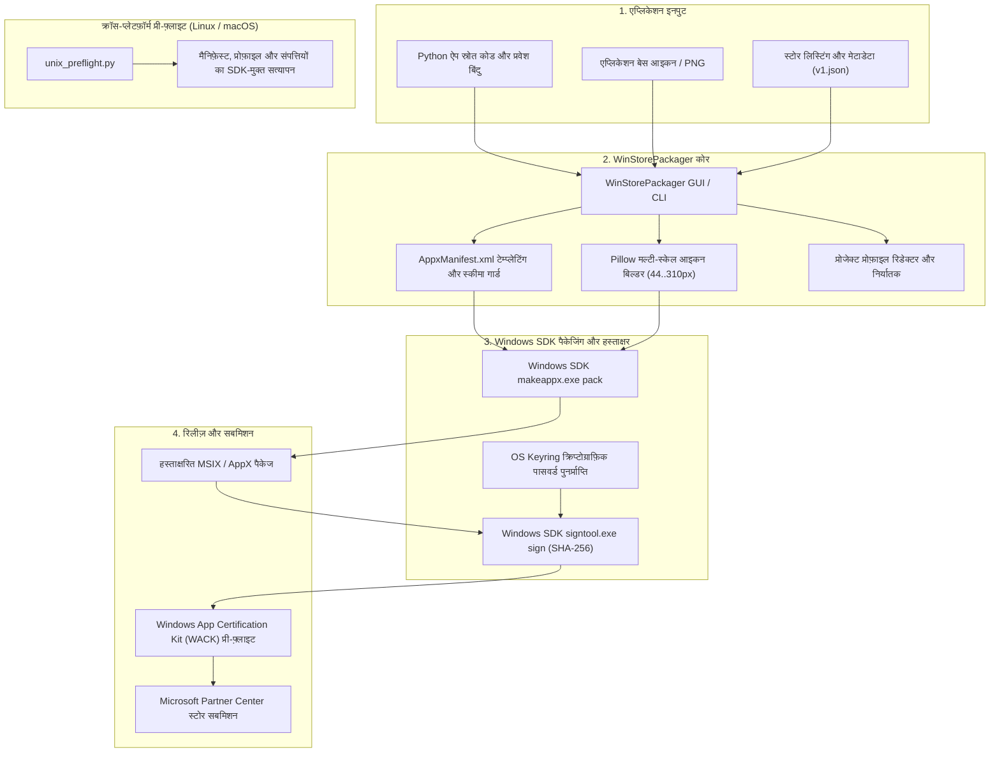
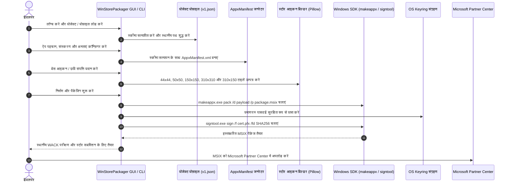
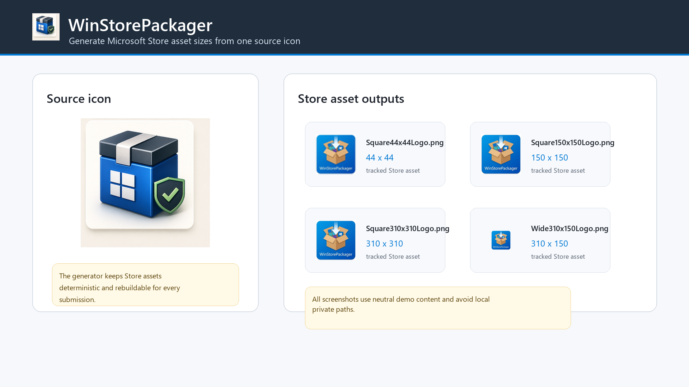

> [English](README.md) · [Deutsch](README_de.md) · [Español](README_es.md) · [Français](README_fr.md) · [Português](README_pt.md) · [Русский](README_ru.md) · [简体中文](README_zh.md) · [日本語](README_ja.md) · [العربية](README_ar.md) · **हिन्दी** · [বাংলা](README_bn.md)

<p align="center">
  
  
  
  
  
  
  
  
  
  
  
  
  
  
  
  
</p>

<h1 align="center">WinStorePackager</h1>

<h4 align="center">Microsoft Store में सबमिशन के लिए Python डेस्कटॉप ऐप्स तैयार करने हेतु लोकल-फ़र्स्ट Windows GUI और CLI टूल: AppxManifest, स्टोर आइकन, प्रोजेक्ट प्रोफ़ाइल, स्क्रीनशॉट और MSIX पैकेजिंग</h4>

<p align="center">
  <a href="#quick-start">त्वरित शुरुआत</a> •
  <a href="#features">विशेषताएं</a> •
  <a href="#architecture--packaging-pipeline">आर्किटेक्चर</a> •
  <a href="#packaging-lifecycle-flow">पैकेजिंग जीवनचक्र</a> •
  <a href="#governance--runtime-invariants">शासन और नियम</a> •
  <a href="#visual-showcase--store-assets">विज़ुअल शोकेस</a> •
  <a href="#project-profiles">प्रोजेक्ट प्रोफ़ाइल</a> •
  <a href="#prerequisites--installation">स्थापना</a> •
  <a href="#sdk-free-unix-preflight">Unix प्री-फ़्लाइट</a> •
  <a href="#local-data-and-security">डेटा और सुरक्षा</a> •
  <a href="#sibling-tools--ecosystem">इकोसिस्टम टूल्स</a> •
  <a href="#comparison-with-alternatives">तुलना</a> •
  <a href="#third-party-licenses--transparency">लाइसेंस और पारदर्शिता</a> •
  <a href="#marketing--target-personas">मार्केटिंग और लक्ष्य</a> •
  <a href="#documentation--license">दस्तावेज़ और लाइसेंस</a>
</p>

> [!NOTE]
> **AI एजेंट्स और LLM एकीकरण सूचना**: रिपॉजिटरी की समग्र संरचना और संदर्भ सीमाएं [`llms.txt`](llms.txt) में प्रलेखित हैं। LLM एजेंट्स और स्वचालित उपकरण [`PROJECT_PROFILE_FORMAT.md`](PROJECT_PROFILE_FORMAT.md) तथा [`winstorepackager-project-v1.json`](winstorepackager-project-v1.json) के माध्यम से पैकेज स्कीमा का निरीक्षण कर सकते हैं।

---

<a id="quick-start"></a>
<a id="schnellstart"></a>
## त्वरित शुरुआत

| मेरा उद्देश्य | शुरुआत करें |
|---|---|
| Microsoft Store के लिए Python डेस्कटॉप ऐप तैयार और पैकेज करना | Windows पर [`WindowsStorePublisher_3.py`](WindowsStorePublisher_3.py) चलाएं या `START.bat` पर डबल-क्लिक करें |
| Linux/macOS पर बिना Windows SDK प्री-फ़्लाइट सत्यापन चलाना | [`unix_preflight.py`](unix_preflight.py) |
| स्थानीय गुप्त विवरणों के बिना प्रोजेक्ट मेटाडेटा साझा करना | [`PROJECT_PROFILE_FORMAT.md`](PROJECT_PROFILE_FORMAT.md) |
| WinStorePackager के स्वयं के स्टोर प्रोफ़ाइल का परीक्षण (Dogfooding) | [`winstorepackager-project-v1.json`](winstorepackager-project-v1.json) |
| सुरक्षा, स्थानीय डेटा और गोपनीयता सीमाओं की समीक्षा करना | [`SECURITY.md`](SECURITY.md), [`PRIVACY_POLICY.md`](PRIVACY_POLICY.md) और [डेटा और सुरक्षा](#local-data-and-security) |

WinStorePackager एकल डेवलपर्स, स्वतंत्र निर्माताओं और छोटी टीमों के लिए बनाया गया है, जिन्हें प्रत्येक ऐप के लिए भारी Visual Studio प्रोजेक्ट सेटअप किए बिना Python से Microsoft Store तक एक व्यावहारिक वर्कफ़्लो की आवश्यकता होती है। यह दोहराव वाले कार्यों को स्वचालित करता है: स्टोर मैनिफ़ेस्ट फ़ील्ड, आवश्यक आइकन आकार, स्क्रीनशॉट संग्रह, प्रोफ़ाइल विनिमय और Windows SDK पैकेजिंग कमांड।

---

<a id="features"></a>
<a id="funktionen"></a>
## विशेषताएं

| विशेषता | विवरण |
|---|---|
| **मैनिफ़ेस्ट जनरेटर** | फ़ॉर्म इनपुट से XML स्कीमा सत्यापन और एट्रिब्यूट एस्केपिंग के साथ स्वचालित रूप से `AppxManifest.xml` बनाता है |
| **आइकन जनरेटर** | Lanczos रीसैंपलिंग के साथ स्टोर के लिए आवश्यक सभी आकार बनाता है: 44×44, 50×50, 150×150, 310×310 और 310×150 (वाइड) |
| **6-भाषा GUI (i18n)** | रनटाइम स्विचिंग के साथ संपूर्ण बहुभाषी GUI समर्थन (Tier 2 / P-006: DE, EN, ES, ZH, JA, RU) |
| **Keyring सुरक्षा एकीकरण** | OS Keyring के माध्यम से प्रमाणपत्र पासवर्ड का सुरक्षित भंडारण (डिस्क पर कोई प्लेनटेक्स्ट पासवर्ड नहीं) |
| **स्क्रीनशॉट सहायक** | Microsoft Store लिस्टिंग संपत्तियों के लिए `pygetwindow` के माध्यम से सीधे ऐप विंडो कैप्चर करता है |
| **11 स्टोर श्रेणियां** | पूर्वनिर्धारित श्रेणियां (डेवलपर टूल्स, उत्पादकता, शिक्षा, उपयोगिताएं, आदि) |
| **आयु रेटिंग** | अनुपालन मैनिफ़ेस्ट क्षमताओं की घोषणा के साथ 3+ से 18+ रेटिंग समर्थन |
| **MSIX निर्माण और हस्ताक्षर** | SHA-256 कोड हस्ताक्षर के साथ Windows SDK से `makeappx.exe` और `signtool.exe` को आमंत्रित करता है |
| **सेटिंग्स स्थायित्व** | फ़ाइल भ्रष्टाचार को रोकने के लिए परमाणु माइग्रेशन सुरक्षा के साथ Git के बाहर होस्ट-स्थानीय JSON कॉन्फ़िगरेशन |
| **SDK-मुक्त प्री-फ़्लाइट** | Linux और macOS पर मैनिफ़ेस्ट, प्रोफ़ाइल और स्टोर संपत्तियों का क्रॉस-प्लेटफ़ॉर्म सत्यापन |

---

<a id="architecture--packaging-pipeline"></a>
<a id="architektur--paketierungs-pipeline"></a>
## आर्किटेक्चर और पैकेजिंग पाइपलाइन



---

<a id="packaging-lifecycle-flow"></a>
<a id="paketierungs-lebenszyklus"></a>
## पैकेजिंग जीवनचक्र



---

<a id="governance--runtime-invariants"></a>
<a id="governance--laufzeit-invarianten"></a>
## शासन और रनटाइम नियम

WinStorePackager विकास, पैकेजिंग और निष्पादन के दौरान 10 सख्त शासन और रनटाइम नियमों का पालन करता है:

| नियम ID | नियम और सिद्धांत | प्रवर्तन तंत्र और गारंटी |
|---|---|---|
| **INV-LOCAL-01** | **100% लोकल-फ़र्स्ट और शून्य बाह्य प्रवाह (Zero-Egress)** | सभी मैनिफ़ेस्ट संकलन, आइकन प्रतिपादन, पैकेजिंग और प्री-फ़्लाइट जांच पूरी तरह से ऑफ़लाइन चलती हैं। शून्य आउटबाउंड टेलीमेट्री या क्लाउड ट्रैकिंग। |
| **INV-SEC-02** | **क्रिप्टोग्राफ़िक पासवर्ड सुरक्षा और Non-Elevation** | हस्ताक्षर प्रमाणपत्र पासवर्ड विशेष रूप से OS Keyring (Windows Credential Vault) में रहते हैं। ऐप उपयोगकर्ता स्पेस (`RunAsInvoker`) में बिना व्यवस्थापक अनुमतियों के चलता है। |
| **INV-STORE-03** | **Microsoft Store मैनिफ़ेस्ट अनुपालन** | Microsoft Partner Center दिशानिर्देशों के अनुरूप सख्त XML स्कीमा सत्यापन, नेमस्पेस प्रबंधन और एट्रिब्यूट एस्केपिंग लागू करता है। |
| **INV-ASSET-04** | **मल्टी-स्केल एसेट अखंडता** | नियतात्मक उच्च-गुणवत्ता Lanczos रीसैंपलिंग सटीक Microsoft Store टाइल आयाम (44×44, 50×50, 150×150, 310×310, 310×150) उत्पन्न करता है। |
| **INV-PROFILE-05** | **संवेदनशील विवरण रहित पोर्टेबल प्रोजेक्ट प्रोफ़ाइल** | साझा प्रोजेक्ट प्रोफ़ाइल (`winstorepackager-project-v1.json`) संस्करण नियंत्रण में सुरक्षित साझाकरण के लिए मशीन पथ, प्रकाशक ID, प्रमाणपत्र पथ और पासवर्ड हटा देती हैं। |
| **INV-CROSS-06** | **क्रॉस-प्लेटफ़ॉर्म प्री-फ़्लाइट समानता** | `unix_preflight.py` Windows SDK बायनेरिज़ की आवश्यकता के बिना Linux और macOS पर पूर्ण मेटाडेटा, लिस्टिंग और स्कीमा जांच करता है। |
| **INV-STATE-07** | **होस्ट-स्थानीय स्थिति अलगाव और परमाणु लेखन** | सेटिंग्स और घूर्णन लॉग फ़ाइल भ्रष्टाचार को रोकने के लिए परमाणु फ़ाइल प्रतिस्थापन (`os.replace`) के माध्यम से Git चेकआउट के बाहर `%LOCALAPPDATA%` में बने रहते हैं। |
| **INV-WACK-08** | **फ़ेल-क्लोज़्ड WACK प्रमाणन मूल्यांकन** | त्रुटियों या क्रैश (`FAIL`, `FAILED`, `ERROR`, `CRASH`) पर तुरंत अस्वीकृति के साथ Windows App Certification Kit रिपोर्ट का नियतात्मक विश्लेषण। |
| **INV-I18N-09** | **सार्वभौमिक 6-भाषा GUI स्थानीयकरण** | गतिशील रनटाइम स्विचिंग के साथ पूर्ण Tier-2 बहुभाषी GUI समर्थन (DE, EN, ES, ZH, JA, RU)। |
| **INV-SLA-10** | **निर्भरता भेद्यता सुरक्षा सीमा और 48 घंटे का सुरक्षा SLA** | निर्भरताओं के न्यूनतम संस्करण अनिवार्य (Pillow>=12.3.0, keyring>=25.0.0, pytest>=9.1.1), 48 घंटे की प्रारंभिक सुरक्षा प्रतिक्रिया SLA और 5-दिवसीय ट्राइएज प्रतिबद्धता। |

---

<a id="visual-showcase--store-assets"></a>
<a id="visuelle-showcase--store-assets"></a>
## विज़ुअल शोकेस और स्टोर संपत्तियां

| स्टोर सुविधा | विज़ुअल अवलोकन |
|---|---|
| **मुख्य स्क्रीन और पैकेजिंग**<br>ऐप पहचान, स्रोत पथ और Windows SDK टूलचेन सेटअप के लिए इंटरैक्टिव डेस्कटॉप GUI। |  |
| **स्टोर मेटाडेटा और रेटिंग**<br>पूर्वनिर्धारित स्टोर श्रेणियां, आयु रेटिंग, क्षमताएं, समर्थन URL और स्थानीयकृत गोपनीयता नीतियां। |  |
| **मल्टी-रिज़ॉल्यूशन आइकन बिल्डर**<br>Microsoft Store के लिए आवश्यक सभी चौकोर और विस्तृत टाइल आइकन प्रारूपों का स्वचालित निर्माण और पूर्वावलोकन। |  |
| **MSIX पैकेजिंग और हस्ताक्षर**<br>एक-क्लिक MSIX संकलन, OS Keyring प्रमाणपत्र प्रमाणीकरण और एकीकृत WACK प्री-फ़्लाइट। |  |

Microsoft Store स्क्रीनशॉट सेट को किसी भी समय इस कमांड से पुनः उत्पन्न करें:

```bash
python generate_store_screenshots.py
```

जनरेटर निजी पथों, क्रेडेंशियल्स या प्रकाशक ID को उजागर किए बिना केवल तटस्थ डेमो मेटाडेटा का उपयोग करके `releases/windowsstore/screenshots/` में चार 1920x1080 PNG लिखता है।

---

<a id="project-profiles"></a>
<a id="projektprofile"></a>
## प्रोजेक्ट प्रोफ़ाइल

WinStorePackager एक साझा प्रोजेक्ट प्रोफ़ाइल प्रारूप के साथ आता है: [`PROJECT_PROFILE_FORMAT.md`](PROJECT_PROFILE_FORMAT.md)। डेस्कटॉप ऐप `winstorepackager-project-v1.json` को आयात और निर्यात कर सकता है ताकि स्टोर मेटाडेटा को स्थानीय प्रकाशक ID, SDK पथ, प्रमाणपत्र पथ या पासवर्ड उजागर किए बिना Windows के बाहर तैयार किया जा सके।

इस रिपॉजिटरी में इसका अपना स्व-परीक्षण (Dogfooding) प्रोफ़ाइल शामिल है: [`winstorepackager-project-v1.json`](winstorepackager-project-v1.json)। WinStorePackager को स्वयं पैकेज करने के लिए इसे डेस्कटॉप ऐप में लोड करें, या Windows SDK के बिना सत्यापित करें:

```bash
python unix_preflight.py --project-root . --profile-path winstorepackager-project-v1.json
```

यह प्रोफ़ाइल जानबूझकर Partner Center प्रकाशक ID, प्रमाणपत्र पथ, SDK पथ और पासवर्ड को Git से बाहर रखती है। MSIX के निर्माण या हस्ताक्षर करने से पहले इन मानों को केवल स्थानीय सेटिंग्स में जोड़ें।

---

<a id="prerequisites--installation"></a>
<a id="voraussetzungen--installation"></a>
## आवश्यकताएं और स्थापना

- Python 3.9–3.13+
- Windows 10/11 (MSIX निर्माण और हस्ताक्षर के लिए) या Linux/macOS (सत्यापन के लिए)
- [Windows SDK](https://developer.microsoft.com/en-us/windows/downloads/windows-sdk/) (`makeappx.exe` और `signtool.exe` के लिए)
- Microsoft Store डेवलपर खाता (सबमिशन के लिए)

```bash
git clone https://github.com/file-bricks/WinStorePackager.git
cd WinStorePackager
pip install -r requirements.txt
python WindowsStorePublisher_3.py
```

या Windows पर, `START.bat` पर डबल-क्लिक करें।

---

<a id="sdk-free-unix-preflight"></a>
<a id="sdk-freier-unix-preflight"></a>
## Unix प्री-फ़्लाइट (बिना SDK)

Linux/macOS वर्कस्टेशन या बिना Windows SDK के CI रनों के लिए, रिपॉजिटरी में मेटाडेटा-केवल प्री-फ़्लाइट शामिल है:

```bash
python unix_preflight.py --project-root .
python unix_preflight.py --project-root . --profile-path ./winstorepackager-project-v1.json
```

Unix प्री-फ़्लाइट MSIX पैकेज बनाए बिना या Windows बायनेरिज़ की आवश्यकता के बिना प्रोजेक्ट संरचना, `store_package.json`, README, गोपनीयता नीति, स्टोर लिस्टिंग, स्क्रीनशॉट/आइकन और निर्यातित प्रोजेक्ट प्रोफ़ाइल की जांच करता है।

---

<a id="local-data-and-security"></a>
<a id="lokale-daten-und-sicherheit"></a>
## डेटा और सुरक्षा

WinStorePackager केवल स्थानीय प्रोजेक्ट फ़ाइलों पर काम करता है:

- **होस्ट-स्थानीय रनटाइम निर्देशिकाएं:** मशीन-विशिष्ट सेटिंग्स और घूर्णन लॉग स्रोत चेकआउट के बाहर `%LOCALAPPDATA%\WinStorePackager` (Windows), `~/Library/Application Support/WinStorePackager` (macOS), या `${XDG_CONFIG_HOME:-~/.config}/winstorepackager` (Linux) में रहते हैं।
- **Keyring क्रिप्टोग्राफ़िक संग्रहण:** प्रमाणपत्र पासवर्ड ऑपरेटिंग-सिस्टम कीरिंग में रहते हैं और कभी भी डिस्क या JSON फ़ाइलों पर नहीं लिखे जाते हैं।
- **Git स्वच्छता:** उत्पन्न MSIX पैकेज, EXE बिल्ड, अस्थायी स्टेजिंग फ़ोल्डर, प्रमाणपत्र और रिलीज़ बंडल Git द्वारा पूरी तरह से उपेक्षित हैं।

मशीन-विशिष्ट स्थानीय सेटिंग्स के लिए टेम्प्लेट (`settings_store_packager.json`):

```json
{
  "app_name": "MyApp",
  "publisher": "CN=YOUR-PUBLISHER-ID",
  "publisher_display": "Your Name",
  "version": "1.0.0.0",
  "makeappx_path": "C:/Program Files (x86)/Windows Kits/10/App Certification Kit/makeappx.exe",
  "signtool_path": "C:/Program Files (x86)/Windows Kits/10/App Certification Kit/signtool.exe"
}
```

---

<a id="sibling-tools--ecosystem"></a>
<a id="geschwister-tools--ökosystem"></a>
## इकोसिस्टम टूल्स

WinStorePackager **file-bricks** और **open-bricks** ओपन-सोर्स सॉफ़्टवेयर परिवार का हिस्सा है:

| टूल | इकोसिस्टम | उद्देश्य |
|---|---|---|
| **[ProSync](https://github.com/file-bricks/ProSync)** | `file-bricks` | स्थानीय फ़ाइल सिंक्रनाइज़ेशन और SQLite WAL स्थिरता सुरक्षा |
| **[CleanMarkdown](https://github.com/doc-bricks/CleanMarkdown)** | `doc-bricks` | मार्कडाउन स्वच्छता, व्हाइटस्पेस सुधार और दस्तावेज़ फ़ॉर्मेटिंग |
| **[DokuZen](https://github.com/doc-bricks/DokuZen)** | `doc-bricks` | तेज़, लोकल-फ़र्स्ट तकनीकी दस्तावेज़ीकरण और ज्ञान प्रबंधक |
| **[UniversalDocsGrabber](https://github.com/doc-bricks/UniversalDocsGrabber)** | `doc-bricks` | सार्वभौमिक दस्तावेज़ अंतर्ग्रहण, OCR रूपांतरण और खोज इंजन |
| **[ellmos-filecommander-mcp](https://github.com/ellmos-ai/ellmos-filecommander-mcp)** | `ellmos-ai` | सुरक्षित फ़ाइल प्रबंधन, OCR और खोज के लिए स्थानीय MCP सर्वर |
| **[open-bricks](https://github.com/open-bricks)** | `open-bricks` | मॉड्यूलर डेस्कटॉप और डेवलपर टूल्स के लिए अंब्रेला संगठन |

---

<a id="comparison-with-alternatives"></a>
<a id="vergleich-mit-alternativen"></a>
## विकल्पों के साथ तुलना

| विशेषता | WinStorePackager | MSIX Packaging Tool | Visual Studio | Advanced Installer |
|---|:---:|:---:|:---:|:---:|
| GUI | ✅ | ⚠️ | ✅ | ✅ |
| Python पर ध्यान | ✅ | ❌ | ❌ | ❌ |
| स्वचालित आइकन (सभी आकार) | ✅ | ❌ | ⚠️ | ✅ |
| मैनिफ़ेस्ट जनरेटर | ✅ | ❌ | ✅ | ✅ |
| मुफ़्त / ओपन सोर्स | ✅ | ✅ | ⚠️ | ❌ |
| स्क्रीनशॉट सहायक | ✅ | ❌ | ❌ | ❌ |
| Keyring सुरक्षा | ✅ | ❌ | ❌ | ❌ |
| 6-भाषा स्थानीयकरण (GUI) | ✅ | ❌ | ⚠️ | ⚠️ |
| क्रॉस-प्लेटफ़ॉर्म प्री-फ़्लाइट | ✅ | ❌ | ❌ | ❌ |

---

<a id="third-party-licenses--transparency"></a>
<a id="drittanbieter-lizenzen--transparenz"></a>
## लाइसेंस और पारदर्शिता

WinStorePackager का 100% लाइसेंस पारदर्शिता और Zero-Egress अनुपालन सुनिश्चित करने के लिए ऑडिट किया गया है:

- **पूर्ण इन्वेंट्री:** विस्तृत अपस्ट्रीम पैकेज सूचियां, लाइसेंस और नोटिस [`THIRD_PARTY_LICENSES.md`](THIRD_PARTY_LICENSES.md) और [`THIRD_PARTY_LICENSES.txt`](THIRD_PARTY_LICENSES.txt) में बनाए रखे गए हैं।
- **रनटाइम पैकेज:** सख्त भेद्यता सीमा के साथ Pillow (`HPND-sell-variant`), keyring (`MIT`), और pygetwindow (`BSD-3-Clause`) शामिल हैं।
- **निर्माण और पैकेजिंग:** PyInstaller (`GPL-2.0-or-later WITH Bootloader-exception`), pyinstaller-hooks-contrib (`Apache-2.0`), और packaging (`Apache-2.0 OR BSD-2-Clause`)।
- **गुणवत्ता आश्वासन और परीक्षण:** pytest (`MIT`, `>=9.1.1`), pluggy (`MIT`), और ruff (`MIT OR Apache-2.0`)।
- **मानक लाइब्रेरी:** Python Software Foundation License (`PSFL-2.0`)। बाहरी Windows SDK बायनेरिज़ Microsoft के मालिकाना सॉफ़्टवेयर हैं और मानक अप्रतिबंधित उप-प्रक्रिया निष्पादन के माध्यम से कॉल किए जाते हैं।

---

<a id="marketing--target-personas"></a>
<a id="marketing--zielgruppen"></a>
## मार्केटिंग और लक्ष्य वर्ग

WinStorePackager खोज योग्यता के लिए अनुकूलित है और चार प्रमुख डेवलपर वर्गों को लक्षित करता है:

### Target Personas

1. **एकल Python डेस्कटॉप डेवलपर्स और इंडी निर्माता:** Visual Studio स्थापित किए बिना या जटिल XML स्कीमा विनिर्देशों को सीखे बिना स्टैंडअलोन Python स्क्रिप्ट (Tkinter, PyQt, PySide, CustomTkinter) से Microsoft Store वितरण के लिए एक सहज मार्ग की आवश्यकता है।
2. **उद्यम और वाणिज्यिक Python ISV:** प्रतिलिपि प्रस्तुत करने योग्य, स्क्रिप्ट योग्य पैकेजिंग पाइपलाइन, मालिकाना कोड हस्ताक्षर प्रमाणपत्रों के लिए सख्त OS Keyring क्रेडेंशियल सुरक्षा, और सुरक्षित WACK सत्यापन की आवश्यकता है।
3. **ओपन-सोर्स मेंटेनर्स और मल्टी-OS टीमें:** मुख्य रूप से Linux या macOS पर विकसित करते हैं और Windows मशीनों को छूने से पहले CI वर्कफ़्लो में SDK-मुक्त प्री-फ़्लाइट सत्यापन की मांग करते हैं।
4. **गोपनीयता-सचेत और लोकल-फ़र्स्ट निर्माता:** 100% ऑफ़लाइन पैकेजिंग, शून्य टेलीमेट्री, बिना प्रशासनिक अनुमतियों के `RunAsInvoker` सुरक्षा, और संपादित प्रोजेक्ट प्रोफ़ाइल की आवश्यकता है।

### High-Intent Search Phrases

- `WinStorePackager Python Microsoft Store MSIX`
- `file-bricks WinStorePackager`
- `Python AppxManifest generator`
- `local-first MSIX packaging tool`
- `Microsoft Store packaging GUI for Python apps`
- `MSIX packaging tool without Visual Studio`
- `Python desktop app Windows Store submission helper`
- `AppxManifest XML generator Python`

---

<a id="documentation--license"></a>
<a id="dokumentation--lizenz"></a>
## दस्तावेज़ और लाइसेंस

- 📄 **सुरक्षा नीति:** [`SECURITY.md`](SECURITY.md) — द्विभाषी भेद्यता प्रकटीकरण और स्थानीय-प्रथम गारंटी
- ⚖️ **एट्रिब्यूशन नोटिस:** [`NOTICE`](NOTICE) — विहित कॉपीराइट, open-bricks इकोसिस्टम एट्रिब्यूशन और निर्भरता संदर्भ
- 📝 **परिवर्तन लॉग:** [`CHANGELOG.md`](CHANGELOG.md) — संस्करण इतिहास और रिलीज़ नोट्स
- 🤖 **LLM संदर्भ:** [`SKILL.md`](SKILL.md), [`llms.txt`](llms.txt) & [`llm.txt`](llm.txt) — मशीन-पठनीय वास्तुशिल्प गाइड
- 📦 **प्रोफ़ाइल प्रारूप:** [`PROJECT_PROFILE_FORMAT.md`](PROJECT_PROFILE_FORMAT.md) — पोर्टेबल प्रोजेक्ट प्रोफ़ाइल विनिर्देश
- 📜 **थर्ड-पार्टी लाइसेंस:** [`THIRD_PARTY_LICENSES.md`](THIRD_PARTY_LICENSES.md) और [`THIRD_PARTY_LICENSES.txt`](THIRD_PARTY_LICENSES.txt)

### License & Liability

Dieses Projekt steht unter der [MIT License](LICENSE).

Dieses Projekt ist eine **unentgeltliche Open-Source-Schenkung** im Sinne der §§ 516 ff. BGB. Die Haftung des Urhebers ist gemäß **§ 521 BGB** auf **Vorsatz und grobe Fahrlässigkeit** beschränkt. Ergänzend gilt der Haftungsausschluss der MIT License.

Nutzung auf eigenes Risiko. Keine Wartungszusage, keine Verfügbarkeitsgarantie, keine Gewähr für Fehlerfreiheit oder Eignung für einen bestimmten Zweck.

This project is an unpaid open-source donation. Liability is limited to intent and gross negligence (§ 521 German Civil Code). Use at your own risk. No warranty, no maintenance guarantee, no fitness-for-purpose assumed.
