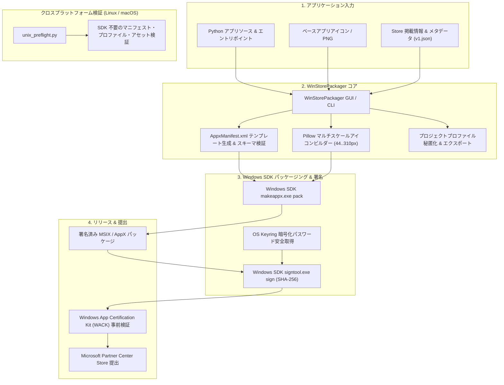
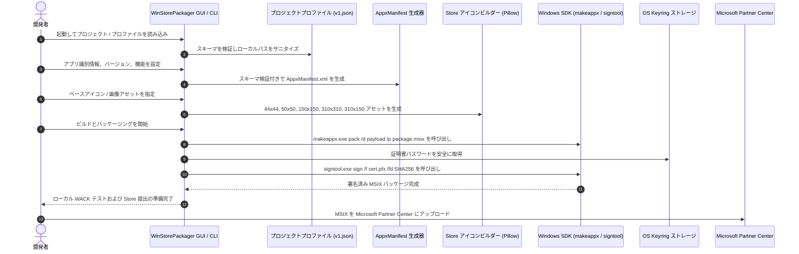
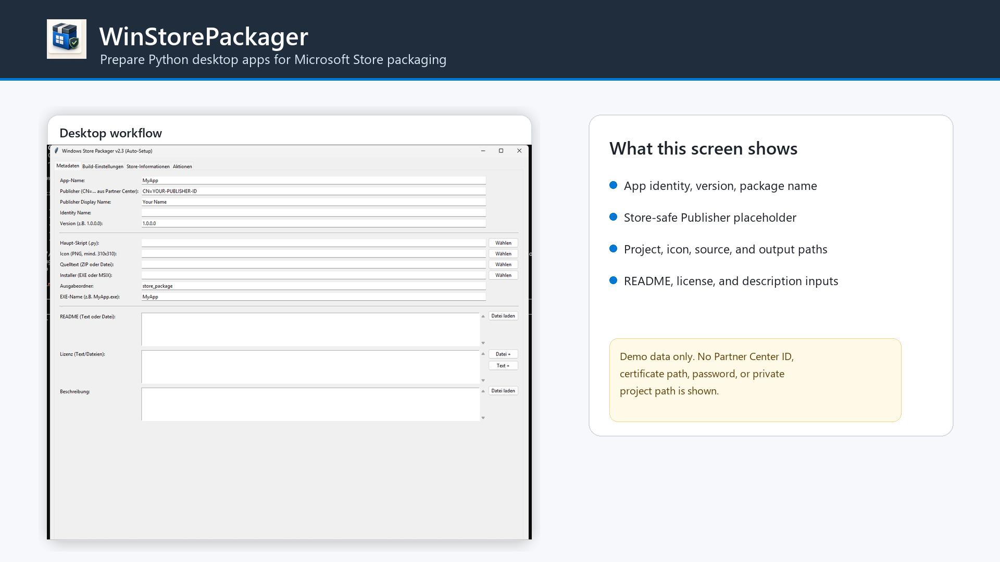
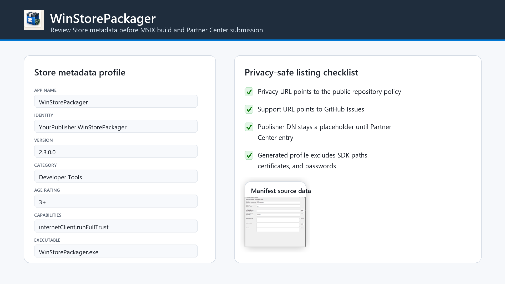

> [English](README.md) · [Deutsch](README_de.md) · [Español](README_es.md) · [Français](README_fr.md) · [Português](README_pt.md) · [Русский](README_ru.md) · [简体中文](README_zh.md) · **日本語** · [العربية](README_ar.md) · [हिन्दी](README_hi.md) · [বাংলা](README_bn.md)

<p align="center">
  
  
  
  
  
  
  
  
  
  
  
  
  
  
  
  
</p>

<h1 align="center">WinStorePackager</h1>

<h4 align="center">Microsoft Store 提出向け Python デスクトップアプリの準備を行うローカルファーストな Windows GUI & CLI ツール：AppxManifest、ストアアイコン、プロジェクトプロファイル、スクリーンショット、MSIX パッケージング</h4>

<p align="center">
  <a href="#quick-start">クイックスタート</a> •
  <a href="#features">主な機能</a> •
  <a href="#architecture--packaging-pipeline">アーキテクチャ</a> •
  <a href="#packaging-lifecycle-flow">ライフサイクルフロー</a> •
  <a href="#governance--runtime-invariants">ガバナンスと不変条件</a> •
  <a href="#visual-showcase--store-assets">ビジュアルショーケース</a> •
  <a href="#project-profiles">プロジェクトプロファイル</a> •
  <a href="#prerequisites--installation">前提条件とインストール</a> •
  <a href="#sdk-free-unix-preflight">Unix プリフライト</a> •
  <a href="#local-data-and-security">ローカルデータとセキュリティ</a> •
  <a href="#sibling-tools--ecosystem">エコシステムツール</a> •
  <a href="#comparison-with-alternatives">比較</a> •
  <a href="#third-party-licenses--transparency">サードパーティライセンス</a> •
  <a href="#marketing--target-personas">マーケティングとターゲット</a> •
  <a href="#documentation--license">ドキュメントとライセンス</a>
</p>

> [!NOTE]
> **AI エージェントおよび LLM 向け統合通知**: リポジトリ全体の構造とコンテキスト境界は [`llms.txt`](llms.txt) に記載されています。LLM エージェントや自動化ツールは、[`PROJECT_PROFILE_FORMAT.md`](PROJECT_PROFILE_FORMAT.md) および [`winstorepackager-project-v1.json`](winstorepackager-project-v1.json) を通じてパッケージスキーマを確認できます。

---

<a id="quick-start"></a>
<a id="schnellstart"></a>
## クイックスタート

| 目的 | 開始方法 |
|---|---|
| Microsoft Store 向けに Python デスクトップアプリをパッケージ化 | Windows 上で [`WindowsStorePublisher_3.py`](WindowsStorePublisher_3.py) を実行、または `START.bat` を起動 |
| Linux/macOS 上で Windows SDK を使わずに事前検証を実行 | [`unix_preflight.py`](unix_preflight.py) |
| ローカル機密情報を除外してプロジェクトメタデータを共有 | [`PROJECT_PROFILE_FORMAT.md`](PROJECT_PROFILE_FORMAT.md) |
| WinStorePackager 自身の Store プロファイルをテスト (Dogfooding) | [`winstorepackager-project-v1.json`](winstorepackager-project-v1.json) |
| セキュリティ、ローカルデータ、プライバシーの境界を確認 | [`SECURITY.md`](SECURITY.md)、[`PRIVACY_POLICY.md`](PRIVACY_POLICY.md) および [ローカルデータとセキュリティ](#local-data-and-security) |

WinStorePackager は、アプリごとに重厚な Visual Studio プロジェクトを構成することなく、Python から Microsoft Store への実用的なワークフローを必要とする個人開発者、インディー開発者、ソフトウェアチーム向けに設計されています。Store マニフェスト項目、必須アイコンサイズ、スクリーンショット収集、プロファイル交換、Windows SDK パッケージングコマンドといった反復的な作業に焦点を当てています。

---

<a id="features"></a>
<a id="funktionen"></a>
## 主な機能

| 機能 | 説明 |
|---|---|
| **マニフェストジェネレーター** | フォーム入力から XML スキーマ検証と属性エスケープを備えた `AppxManifest.xml` を自動生成 |
| **アイコンジェネレーター** | Store 必須の全サイズ（44×44, 50×50, 150×150, 310×310, 310×150 ワイド）を Lanczos リサンプリングで自動生成 |
| **6 言語対応 GUI (i18n)** | 完全な多言語 GUI サポート（Tier 2 / P-006: DE, EN, ES, ZH, JA, RU）と実行時の動的言語切り替え |
| **Keyring 統合** | OS の資格情報管理（Keyring）による証明書パスワードの安全な暗号化保管（平文パスワードはディスクに保存しません） |
| **スクリーンショットアシスタント** | `pygetwindow` を介してアプリウィンドウを直接キャプチャし、Store 掲載用の高解像度画像を生成 |
| **11 の Store カテゴリ** | 定義済みカテゴリ（開発者ツール、生産性、教育、ユーティリティなど）の標準サポート |
| **年齢区分評価** | 3+ から 18+ までの評価と、マニフェスト要件に準拠したアプリ機能宣言の作成 |
| **MSIX ビルド & 署名** | Windows SDK の `makeappx.exe` および `signtool.exe` を呼び出し、SHA-256 コード署名を実行 |
| **設定の永続化** | Git 除外のホストローカル JSON 設定とアトミックファイル置換による移行安全性 |
| **SDK 不要のプリフライト** | Linux および macOS 上でマニフェスト、プロファイル、アセットをクロスプラットフォーム検証 |

---

<a id="architecture--packaging-pipeline"></a>
<a id="architektur--paketierungs-pipeline"></a>
## アーキテクチャとパッケージングパイプライン



---

<a id="packaging-lifecycle-flow"></a>
<a id="paketierungs-lebenszyklus"></a>
## ライフサイクルフロー



---

<a id="governance--runtime-invariants"></a>
<a id="governance--laufzeit-invarianten"></a>
## ガバナンスと不変条件

WinStorePackager は、開発、パッケージング、実行の全体にわたり、厳格な 10 項目のガバナンスおよび実行時不変条件を適用します：

| 不変条件 ID | ルールと原則 | 適用メカニズムと保証 |
|---|---|---|
| **INV-LOCAL-01** | **100% ローカルファースト & ゼロ外部送信 (Zero-Egress)** | マニフェスト生成、アイコン描画、パッケージング、事前検証はすべて完全にオフラインで実行されます。外部へのテレメトリやクラウドアナリティクスは一切ありません。 |
| **INV-SEC-02** | **暗号化パスワード保護と非昇格実行 (Non-Elevation)** | 署名用証明書のパスワードは OS Keyring（Windows Credential Vault）内にのみ保持されます。アプリは管理者特権を要求せずユーザー権限（`RunAsInvoker`）で実行されます。 |
| **INV-STORE-03** | **Microsoft Store マニフェスト準拠** | Microsoft Partner Center ガイドラインに従い、厳格な XML スキーマ検証、名前空間処理、属性エスケープを実施します。 |
| **INV-ASSET-04** | **マルチスケールアセットの整合性** | 決定論的な高品質 Lanczos リサンプリングにより、Microsoft Store が要求する正確なタイル解像度（44×44, 50×50, 150×150, 310×310, 310×150）を生成します。 |
| **INV-PROFILE-05** | **機密除外プロファイルのポータビリティ** | 共有用プロジェクトプロファイル（`winstorepackager-project-v1.json`）は、バージョン管理での安全な共有のため、ローカルパス、Publisher ID、証明書パス、パスワードを自動除外します。 |
| **INV-CROSS-06** | **クロスプラットフォームプリフライトの同等性** | `unix_preflight.py` は、Windows SDK バイナリを必要とせず、Linux および macOS 上でメタデータ、掲載情報、スキーマの完全なチェックを実行します。 |
| **INV-STATE-07** | **ホストローカルな状態分離とアトミック書き込み** | 設定とローテーションログは Git 外部の `%LOCALAPPDATA%` に保存され、アトミック置換（`os.replace`）によりファイル破損を防ぎます。 |
| **INV-WACK-08** | **フェイルクローズな WACK 認定評価** | Windows App Certification Kit レポートを決定論的に解析し、エラーやクラッシュ（`FAIL`, `FAILED`, `ERROR`, `CRASH`）が検出された場合は直ちに拒否します。 |
| **INV-I18N-09** | **ユニバーサルな 6 言語 GUI ローカライゼーション** | 動的言語切り替えを備えた Tier 2 多言語 GUI（独、英、西、中、日、露）を完全サポートします。 |
| **INV-SLA-10** | **脆弱性下限と 48 時間セキュリティ SLA** | 依存関係の最低バージョンを強制（Pillow>=12.3.0, keyring>=25.0.0, pytest>=9.1.1）、48 時間以内の初回セキュリティ対応および 5 日以内のトリアージを約束します。 |

---

<a id="visual-showcase--store-assets"></a>
<a id="visuelle-showcase--store-assets"></a>
## ビジュアルショーケースと Store アセット

| 機能概要 | 画面プレビュー |
|---|---|
| **メイン画面とパッケージング**<br>アプリケーション識別情報、ソースパス、Windows SDK ツールチェーンを設定する対話型デスクトップ GUI。 |  |
| **Store メタデータと評価情報**<br>定義済み Store カテゴリ、年齢区分、機能宣言、サポート URL、ローカライズされたプライバシーポリシー。 |  |
| **マルチ解像度アイコンビルダー**<br>Microsoft Store が要求する正方形およびワイドタイルの全アイコン形式を自動生成・プレビュー。 |  |
| **MSIX パッケージング & 署名**<br>ワンクリックでの MSIX パッケージ構築、OS Keyring による証明書認証、および WACK 事前検証。 |  |

以下のコマンドにより、いつでも Microsoft Store 向けの高解像度スクリーンショット一式を再生成できます：

```bash
python generate_store_screenshots.py
```

ジェネレーターは `releases/windowsstore/screenshots/` に 4 枚の 1920x1080 PNG 画像を出力し、秘密のパスや資格情報、Publisher ID を含めない中立的なデモデータのみを使用します。

---

<a id="project-profiles"></a>
<a id="projektprofile"></a>
## プロジェクトプロファイル

WinStorePackager には共通プロジェクトプロファイル形式が付属しています：[`PROJECT_PROFILE_FORMAT.md`](PROJECT_PROFILE_FORMAT.md)。デスクトップアプリは `winstorepackager-project-v1.json` のインポートとエクスポートに対応しており、ローカルの Publisher ID、SDK パス、証明書パス、パスワードを公開することなく、Windows 環境外で Store メタデータを準備できます。

本リポジトリには自前検証用プロファイル [`winstorepackager-project-v1.json`](winstorepackager-project-v1.json) が含まれています。アプリに読み込んで WinStorePackager 自体をパッケージ化するか、Windows SDK を使わずに検証できます：

```bash
python unix_preflight.py --project-root . --profile-path winstorepackager-project-v1.json
```

このプロファイルは、Partner Center の Publisher ID、証明書パス、SDK パス、パスワードを意図的に除外しています。MSIX のビルドや署名を行う直前に、ローカル環境の設定としてこれらの値を追加してください。

---

<a id="prerequisites--installation"></a>
<a id="voraussetzungen--installation"></a>
## 前提条件とインストール

- Python 3.9–3.13+
- Windows 10/11（MSIX ビルドおよび署名用）または Linux/macOS（事前検証用）
- [Windows SDK](https://developer.microsoft.com/en-us/windows/downloads/windows-sdk/)（`makeappx.exe` および `signtool.exe` 用）
- Microsoft Store 開発者アカウント（提出用）

```bash
git clone https://github.com/file-bricks/WinStorePackager.git
cd WinStorePackager
pip install -r requirements.txt
python WindowsStorePublisher_3.py
```

Windows の場合は、`START.bat` をダブルクリックして起動することもできます。

---

<a id="sdk-free-unix-preflight"></a>
<a id="sdk-freier-unix-preflight"></a>
## Unix プリフライト

Linux/macOS ワークステーションや Windows SDK のない CI 環境向けに、メタデータ専用の事前検証ツールが含まれています：

```bash
python unix_preflight.py --project-root .
python unix_preflight.py --project-root . --profile-path ./winstorepackager-project-v1.json
```

Unix プリフライトは、MSIX パッケージのビルドや Windows バイナリの実行を必要とせず、プロジェクト構成、`store_package.json`、README、プライバシーポリシー、Store 掲載文、スクリーンショット/アイコン、エクスポートされたプロファイルを検証します。

---

<a id="local-data-and-security"></a>
<a id="lokale-daten-und-sicherheit"></a>
## ローカルデータとセキュリティ

WinStorePackager はローカルプロジェクトファイル上でのみ動作します：

- **ホストローカルな実行時ディレクトリ**: マシン固有の設定とローテーションログは、Git リポジトリ外部の `%LOCALAPPDATA%\WinStorePackager`（Windows）、`~/Library/Application Support/WinStorePackager`（macOS）、または `${XDG_CONFIG_HOME:-~/.config}/winstorepackager`（Linux）に保存されます。
- **Keyring による暗号化保管**: 証明書のパスワードは OS の資格情報管理に保持され、ディスクや JSON ファイルに書き込まれることはありません。
- **Git の清潔性**: 生成された MSIX パッケージ、EXE ビルド、一時ステージングフォルダ、証明書、リリース成果物は Git の追跡から完全に除外されています。

マシン固有のローカル設定テンプレート（`settings_store_packager.json`）：

```json
{
  "app_name": "MyApp",
  "publisher": "CN=YOUR-PUBLISHER-ID",
  "publisher_display": "Your Name",
  "version": "1.0.0.0",
  "makeappx_path": "C:/Program Files (x86)/Windows Kits/10/App Certification Kit/makeappx.exe",
  "signtool_path": "C:/Program Files (x86)/Windows Kits/10/App Certification Kit/signtool.exe"
}
```

---

<a id="sibling-tools--ecosystem"></a>
<a id="geschwister-tools--ökosystem"></a>
## エコシステムツール

WinStorePackager は、**file-bricks** および **open-bricks** オープンソースソフトウェアファミリーの一員です：

| ツール | エコシステム | 用途 |
|---|---|---|
| **[ProSync](https://github.com/file-bricks/ProSync)** | `file-bricks` | ローカルファーストなファイル同期および SQLite WAL 整合性保護 |
| **[CleanMarkdown](https://github.com/doc-bricks/CleanMarkdown)** | `doc-bricks` | Markdown サニタイズ、空白補正、ドキュメント整形 |
| **[DokuZen](https://github.com/doc-bricks/DokuZen)** | `doc-bricks` | 高速なローカルファースト技術文書・ナレッジ管理ツール |
| **[UniversalDocsGrabber](https://github.com/doc-bricks/UniversalDocsGrabber)** | `doc-bricks` | ユニバーサルドキュメント取り込み、OCR 変換、検索エンジン |
| **[ellmos-filecommander-mcp](https://github.com/ellmos-ai/ellmos-filecommander-mcp)** | `ellmos-ai` | 安全なファイル管理、OCR、検索機能を提供するローカル MCP サーバー |
| **[open-bricks](https://github.com/open-bricks)** | `open-bricks` | モジュール型デスクトップ＆開発ツールの傘組織 |

---

<a id="comparison-with-alternatives"></a>
<a id="vergleich-mit-alternativen"></a>
## 他の選択肢との比較

| 機能 | WinStorePackager | MSIX Packaging Tool | Visual Studio | Advanced Installer |
|---|:---:|:---:|:---:|:---:|
| GUI | ✅ | ⚠️ | ✅ | ✅ |
| Python 特化 | ✅ | ❌ | ❌ | ❌ |
| アイコン自動生成（全サイズ） | ✅ | ❌ | ⚠️ | ✅ |
| マニフェストジェネレーター | ✅ | ❌ | ✅ | ✅ |
| 無料 / オープンソース | ✅ | ✅ | ⚠️ | ❌ |
| スクリーンショットアシスタント | ✅ | ❌ | ❌ | ❌ |
| Keyring セキュリティ | ✅ | ❌ | ❌ | ❌ |
| 6 言語ローカライズ (GUI) | ✅ | ❌ | ⚠️ | ⚠️ |
| クロスプラットフォーム検証 | ✅ | ❌ | ❌ | ❌ |

---

<a id="third-party-licenses--transparency"></a>
<a id="drittanbieter-lizenzen--transparenz"></a>
## サードパーティライセンスと透明性

WinStorePackager は、100% のライセンス透明性とゼロ外部送信（Zero-Egress）の遵守について監査されています：

- **完全なインベントリ**: アップストリームパッケージの詳細、ライセンス、通知は [`THIRD_PARTY_LICENSES.md`](THIRD_PARTY_LICENSES.md) および [`THIRD_PARTY_LICENSES.txt`](THIRD_PARTY_LICENSES.txt) に記録されています。
- **実行時パッケージ**: 厳格な脆弱性下限を備えた Pillow（`HPND-sell-variant`）、keyring（`MIT`）、pygetwindow（`BSD-3-Clause`）を含みます。
- **ビルド＆パッケージング**: PyInstaller（`GPL-2.0-or-later WITH Bootloader-exception`）、pyinstaller-hooks-contrib（`Apache-2.0`）、packaging（`Apache-2.0 OR BSD-2-Clause`）。
- **品質保証とテスト**: pytest（`MIT`, `>=9.1.1`）、pluggy（`MIT`）、ruff（`MIT OR Apache-2.0`）。
- **標準ライブラリ**: Python Software Foundation License（`PSFL-2.0`）。外部 Windows SDK バイナリは Microsoft の独自ソフトウェアであり、非特権サブプロセスとして呼び出されます。

---

<a id="marketing--target-personas"></a>
<a id="marketing--zielgruppen"></a>
## マーケティングとターゲット

WinStorePackager は発見性が最適化されており、主に 4 つの開発者層を対象としています：

### Target Personas

1. **個人 Python デスクトップ開発者 & インディー開発者**: Visual Studio を構成したり複雑な XML スキーマを学ぶことなく、単独の Python スクリプト（Tkinter, PyQt, PySide, CustomTkinter）から Microsoft Store への円滑な配布経路を必要とする開発者。
2. **商用企業および Python ISV**: 再現可能でスクリプト化可能なパッケージングパイプライン、独自証明書の厳格な OS Keyring 保護、および確実な WACK 合否判定を必要とする企業。
3. **オープンソースメンテナー & マルチ OS チーム**: 主に Linux または macOS 上で開発し、Windows マシンに移行する前に CI ワークフローで SDK 不要の検証を行いたいチーム。
4. **プライバシー重視のローカルファースト開発者**: 100% オフラインでのパッケージング、テレメトリの完全排除、管理者権限を要求しない `RunAsInvoker` 実行、および機密除外されたプロジェクトプロファイルを必要とする開発者。

### High-Intent Search Phrases

- `WinStorePackager Python Microsoft Store MSIX`
- `file-bricks WinStorePackager`
- `Python AppxManifest generator`
- `local-first MSIX packaging tool`
- `Microsoft Store packaging GUI for Python apps`
- `MSIX packaging tool without Visual Studio`
- `Python desktop app Windows Store submission helper`
- `AppxManifest XML generator Python`

---

<a id="documentation--license"></a>
<a id="dokumentation--lizenz"></a>
## ドキュメントとライセンス

- 📄 **セキュリティポリシー**: [`SECURITY.md`](SECURITY.md) — 2 言語による脆弱性開示とローカルファースト保証
- ⚖️ **帰属通知**: [`NOTICE`](NOTICE) — 正式な著作権表示、open-bricks エコシステムへの帰属、依存関係の参照
- 📝 **変更履歴**: [`CHANGELOG.md`](CHANGELOG.md) — バージョン履歴とリリースノート
- 🤖 **LLM リファレンス**: [`SKILL.md`](SKILL.md), [`llms.txt`](llms.txt) & [`llm.txt`](llm.txt) — 機械可読なアーキテクチャガイド
- 📦 **プロファイル仕様**: [`PROJECT_PROFILE_FORMAT.md`](PROJECT_PROFILE_FORMAT.md) — ポータブルプロジェクトプロファイル仕様
- 📜 **サードパーティライセンス**: [`THIRD_PARTY_LICENSES.md`](THIRD_PARTY_LICENSES.md) & [`THIRD_PARTY_LICENSES.txt`](THIRD_PARTY_LICENSES.txt)

### License & Liability

Dieses Projekt steht unter der [MIT License](LICENSE).

Dieses Projekt ist eine **unentgeltliche Open-Source-Schenkung** im Sinne der §§ 516 ff. BGB. Die Haftung des Urhebers ist gemäß **§ 521 BGB** auf **Vorsatz und grobe Fahrlässigkeit** beschränkt. Ergänzend gilt der Haftungsausschluss der MIT License.

Nutzung auf eigenes Risiko. Keine Wartungszusage, keine Verfügbarkeitsgarantie, keine Gewähr für Fehlerfreiheit oder Eignung für einen bestimmten Zweck.

This project is an unpaid open-source donation. Liability is limited to intent and gross negligence (§ 521 German Civil Code). Use at your own risk. No warranty, no maintenance guarantee, no fitness-for-purpose assumed.
