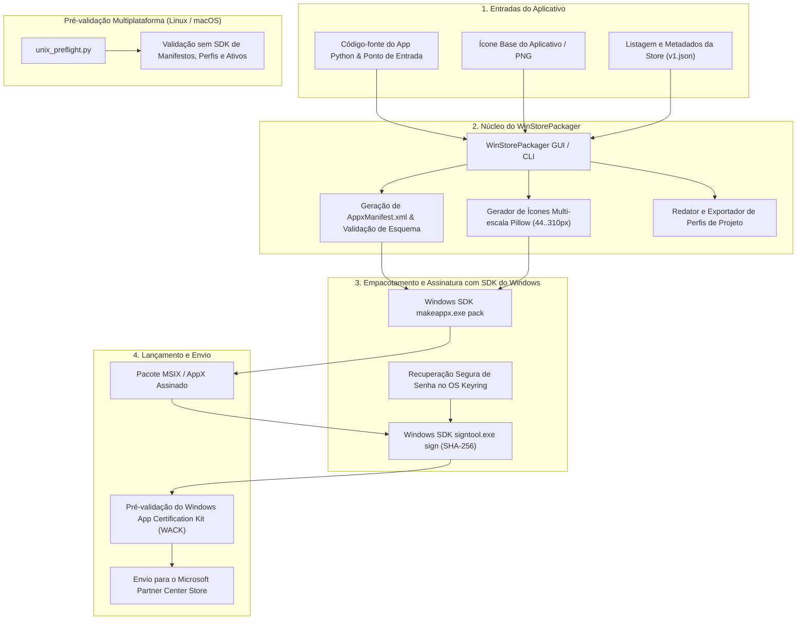
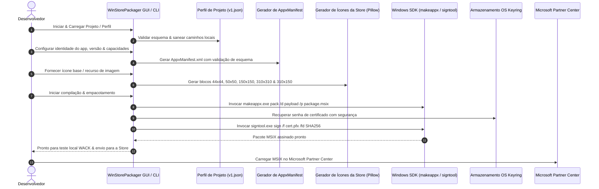

> [English](README.md) · [Deutsch](README_de.md) · [Español](README_es.md) · [Français](README_fr.md) · **Português** · [Русский](README_ru.md) · [简体中文](README_zh.md) · [日本語](README_ja.md) · [العربية](README_ar.md) · [हिन्दी](README_hi.md) · [বাংলা](README_bn.md)

<p align="center">
  
  
  
  
  
  
  
  
  
  
  
  
  
  
  
  
</p>

<h1 align="center">WinStorePackager</h1>

<h4 align="center">Ferramenta GUI e CLI local para Windows para preparar aplicativos desktop Python para envio à Microsoft Store: AppxManifest, ícones da Store, perfis de projeto, capturas de tela e empacotamento MSIX</h4>

<p align="center">
  <a href="#quick-start">Início Rápido</a> •
  <a href="#features">Recursos</a> •
  <a href="#architecture--packaging-pipeline">Arquitetura</a> •
  <a href="#packaging-lifecycle-flow">Ciclo de Vida</a> •
  <a href="#governance--runtime-invariants">Governança e Invariantes</a> •
  <a href="#visual-showcase--store-assets">Demonstração Visual</a> •
  <a href="#project-profiles">Perfis de Projeto</a> •
  <a href="#prerequisites--installation">Instalação</a> •
  <a href="#sdk-free-unix-preflight">Pré-validação Unix</a> •
  <a href="#local-data-and-security">Dados Locais e Segurança</a> •
  <a href="#sibling-tools--ecosystem">Ferramentas Irmãs</a> •
  <a href="#comparison-with-alternatives">Comparação</a> •
  <a href="#third-party-licenses--transparency">Licenças de Terceiros</a> •
  <a href="#marketing--target-personas">Marketing e Personas</a> •
  <a href="#documentation--license">Documentação e Licença</a>
</p>

> [!NOTE]
> **Aviso de integração para agentes de IA e LLMs**: A estrutura geral do repositório e os limites de contexto estão documentados em [`llms.txt`](llms.txt). Agentes de LLM e ferramentas automatizadas podem inspecionar esquemas de pacotes em [`PROJECT_PROFILE_FORMAT.md`](PROJECT_PROFILE_FORMAT.md) e [`winstorepackager-project-v1.json`](winstorepackager-project-v1.json).

---

<a id="quick-start"></a>
<a id="schnellstart"></a>
## Início Rápido

| Objetivo | Comece com |
|---|---|
| Preparar e empacotar um aplicativo Python para a Microsoft Store | [`WindowsStorePublisher_3.py`](WindowsStorePublisher_3.py) ou `START.bat` no Windows |
| Executar pré-validação Unix (Linux/macOS) sem SDK do Windows | [`unix_preflight.py`](unix_preflight.py) |
| Compartilhar metadados do projeto sem segredos locais | [`PROJECT_PROFILE_FORMAT.md`](PROJECT_PROFILE_FORMAT.md) |
| Testar o perfil da Store do WinStorePackager (Dogfooding) | [`winstorepackager-project-v1.json`](winstorepackager-project-v1.json) |
| Verificar limites de segurança, dados locais e privacidade | [`SECURITY.md`](SECURITY.md), [`PRIVACY_POLICY.md`](PRIVACY_POLICY.md) e [Dados Locais e Segurança](#local-data-and-security) |

O WinStorePackager foi criado para desenvolvedores individuais, criadores independentes e equipes que precisam de um fluxo de trabalho prático do Python para a Microsoft Store sem configurar projetos pesados no Visual Studio para cada aplicativo. Ele se concentra nas etapas repetitivas: campos de manifesto da Store, tamanhos de ícones necessários, coleta de capturas de tela, troca de perfis e comandos de empacotamento do SDK do Windows.

---

<a id="features"></a>
<a id="funktionen"></a>
## Recursos

| Recurso | Descrição |
|---|---|
| **Gerador de Manifesto** | Cria automaticamente `AppxManifest.xml` a partir dos dados do formulário com validação de esquema XML e escape de atributos |
| **Gerador de Ícones** | Gera todos os tamanhos exigidos pela Store: 44×44, 50×50, 150×150, 310×310 e 310×150 (largo) com reamostragem Lanczos |
| **Interface em 6 Idiomas (i18n)** | Suporte completo de localização na interface gráfica (Tier 2 / P-006: DE, EN, ES, ZH, JA, RU) com alternância dinâmica em tempo de execução |
| **Integração com Keyring** | Armazenamento seguro de senhas de certificados através do chaveiro do sistema operacional (sem senhas em texto puro no disco) |
| **Assistente de Captura de Tela** | Captura telas do aplicativo diretamente via `pygetwindow` para ativos da listagem da Microsoft Store |
| **11 Categorias da Store** | Categorias pré-definidas (Ferramentas de Desenvolvedor, Produtividade, Educação, Utilitários, ...) |
| **Classificação Etária** | Classificações de 3+ a 18+ com declaração de capacidades de manifesto em total conformidade |
| **Compilação e Assinatura MSIX** | Invoca `makeappx.exe` e `signtool.exe` do SDK do Windows com assinatura de código SHA-256 |
| **Persistência de Ajustes** | Configuração JSON local do host fora do Git com segurança de migração atômica |
| **Pré-validação sem SDK** | Validação multiplataforma de manifestos, perfis e listagens de Store no Linux e macOS |

---

<a id="architecture--packaging-pipeline"></a>
<a id="architektur--paketierungs-pipeline"></a>
## Arquitetura e Pipeline de Empacotamento



---

<a id="packaging-lifecycle-flow"></a>
<a id="paketierungs-lebenszyklus"></a>
## Ciclo de Vida do Empacotamento



---

<a id="governance--runtime-invariants"></a>
<a id="governance--laufzeit-invarianten"></a>
## Governança e Invariantes de Execução

O WinStorePackager aplica 10 regras estritas de governança e invariantes em tempo de execução durante o desenvolvimento, empacotamento e execução:

| Invariant ID | Regra e Princípio | Mecanismo de Aplicação e Garantia |
|---|---|---|
| **INV-LOCAL-01** | **100% Local-First & Zero-Egress** | Toda a compilação de manifestos, renderização de ícones, empacotamento e pré-validações são executados totalmente offline. Zero telemetria de saída ou rastreamento em nuvem. |
| **INV-SEC-02** | **Proteção Criptográfica de Senhas e Não-Elevação** | As senhas de certificados de assinatura residem exclusivamente no OS Keyring (Windows Credential Vault). O aplicativo roda no espaço do usuário (`RunAsInvoker`) sem privilégios de administrador. |
| **INV-STORE-03** | **Conformidade de Manifesto com a Microsoft Store** | Aplica validação rigorosa de esquema XML, tratamento de namespaces e escape de atributos de acordo com as diretrizes do Microsoft Partner Center. |
| **INV-ASSET-04** | **Integridade de Ativos em Múltiplas Escalas** | A reamostragem Lanczos determinística e de alta qualidade gera dimensões exatas de blocos para a Microsoft Store (44×44, 50×50, 150×150, 310×310, 310×150). |
| **INV-PROFILE-05** | **Portabilidade de Perfis Redigidos** | Perfis de projeto compartilhados (`winstorepackager-project-v1.json`) omitem caminhos locais, Publisher IDs, certificados e segredos para compartilhamento seguro em controle de versão. |
| **INV-CROSS-06** | **Paridade de Pré-validação Multiplataforma** | `unix_preflight.py` executa verificações completas de metadados, listagens e esquemas no Linux e macOS sem exigir binários do SDK do Windows. |
| **INV-STATE-07** | **Isolamento de Estado Local e Gravações Atômicas** | Configurações e logs rotativos persistem em `%LOCALAPPDATA%` fora de repositórios git através de substituição atômica de arquivos (`os.replace`) para evitar corrupção. |
| **INV-WACK-08** | **Avaliação de Certificação WACK Fail-Closed** | Análise determinística de relatórios do Windows App Certification Kit com rejeição automática em caso de erros ou falhas (`FAIL`, `FAILED`, `ERROR`, `CRASH`). |
| **INV-I18N-09** | **Localização Universal da Interface em 6 Idiomas** | Suporte completo a múltiplos idiomas na GUI (Tier 2: DE, EN, ES, ZH, JA, RU) com alternância dinâmica em tempo de execução. |
| **INV-SLA-10** | **Piso de Vulnerabilidade e SLA de Segurança de 48h** | Limites mínimos de versões de dependências (Pillow>=12.3.0, keyring>=25.0.0, pytest>=9.1.1), SLA de resposta inicial de segurança de 48 horas e triagem em até 5 dias. |

---

<a id="visual-showcase--store-assets"></a>
<a id="visuelle-showcase--store-assets"></a>
## Demonstração Visual e Ativos da Store

| Recurso da Store | Visão Geral Visual |
|---|---|
| **Visão Principal e Empacotamento**<br>Interface gráfica desktop interativa para identidade do aplicativo, caminhos de origem e ferramentas do Windows SDK. |  |
| **Metadados da Store e Classificações**<br>Categorias pré-definidas da Store, classificações etárias, capacidades, URLs de suporte e políticas de privacidade localizadas. |  |
| **Gerador de Ícones Multirresolução**<br>Geração e pré-visualização automatizadas de todos os formatos de blocos quadrados e largos exigidos pela Microsoft Store. |  |
| **Empacotamento e Assinatura MSIX**<br>Compilação de pacotes MSIX em um clique, autenticação de certificados via OS Keyring e pré-validação WACK integrada. |  |

Reconstrua o conjunto selecionado de capturas de tela da Microsoft Store a qualquer momento com:

```bash
python generate_store_screenshots.py
```

O gerador grava quatro arquivos PNG de 1920x1080 em `releases/windowsstore/screenshots/` e usa apenas metadados neutros de demonstração, sem expor caminhos privados, credenciais ou Publisher IDs.

---

<a id="project-profiles"></a>
<a id="projektprofile"></a>
## Perfis de Projeto

O WinStorePackager inclui um formato de perfil de projeto compartilhado: [`PROJECT_PROFILE_FORMAT.md`](PROJECT_PROFILE_FORMAT.md). O aplicativo desktop pode importar e exportar `winstorepackager-project-v1.json` para que os metadados da Store possam ser preparados fora do Windows sem expor Publisher IDs locais, caminhos de SDK, certificados ou senhas.

Este repositório inclui seu próprio perfil de teste (Dogfooding), [`winstorepackager-project-v1.json`](winstorepackager-project-v1.json). Carregue-o no aplicativo de desktop para empacotar o WinStorePackager com ele mesmo, ou valide-o sem o Windows SDK:

```bash
python unix_preflight.py --project-root . --profile-path winstorepackager-project-v1.json
```

O perfil mantém deliberadamente Publisher IDs do Partner Center, caminhos de certificados, caminhos do SDK e senhas fora do Git. Adicione esses valores apenas nas configurações locais antes de compilar ou assinar um MSIX.

---

<a id="prerequisites--installation"></a>
<a id="voraussetzungen--installation"></a>
## Pré-requisitos e Instalação

- Python 3.9–3.13+
- Windows 10/11 (para compilação e assinatura de MSIX) ou Linux/macOS (para pré-validação)
- [Windows SDK](https://developer.microsoft.com/en-us/windows/downloads/windows-sdk/) (para `makeappx.exe` e `signtool.exe`)
- Conta de desenvolvedor da Microsoft Store (para envio)

```bash
git clone https://github.com/file-bricks/WinStorePackager.git
cd WinStorePackager
pip install -r requirements.txt
python WindowsStorePublisher_3.py
```

Ou no Windows, clique duas vezes em `START.bat`.

---

<a id="sdk-free-unix-preflight"></a>
<a id="sdk-freier-unix-preflight"></a>
## Pré-validação Unix sem SDK

Para estações de trabalho Linux/macOS ou execuções em CI sem o Windows SDK, o repositório inclui uma pré-validação baseada apenas em metadados:

```bash
python unix_preflight.py --project-root .
python unix_preflight.py --project-root . --profile-path ./winstorepackager-project-v1.json
```

A pré-validação Unix verifica a estrutura do projeto, `store_package.json`, README, política de privacidade, listagem da Store, capturas de tela/ícones e perfis de projeto exportados sem compilar pacotes MSIX ou exigir binários do Windows.

---

<a id="local-data-and-security"></a>
<a id="lokale-daten-und-sicherheit"></a>
## Dados Locais e Segurança

O WinStorePackager opera exclusivamente em arquivos de projeto locais:

- **Diretórios de Execução Locais do Host:** Configurações específicas da máquina e logs rotativos residem fora do repositório em `%LOCALAPPDATA%\WinStorePackager` (Windows), `~/Library/Application Support/WinStorePackager` (macOS) ou `${XDG_CONFIG_HOME:-~/.config}/winstorepackager` (Linux).
- **Armazenamento Criptográfico em Keyring:** As senhas dos certificados permanecem no chaveiro do sistema operacional e nunca são gravadas no disco ou em arquivos JSON.
- **Higiene do Git:** Pacotes MSIX gerados, executáveis EXE, pastas de preparo temporárias, certificados e pacotes de versão são estritamente ignorados pelo Git.

Modelo para configurações locais específicas da máquina (`settings_store_packager.json`):

```json
{
  "app_name": "MyApp",
  "publisher": "CN=YOUR-PUBLISHER-ID",
  "publisher_display": "Your Name",
  "version": "1.0.0.0",
  "makeappx_path": "C:/Program Files (x86)/Windows Kits/10/App Certification Kit/makeappx.exe",
  "signtool_path": "C:/Program Files (x86)/Windows Kits/10/App Certification Kit/signtool.exe"
}
```

---

<a id="sibling-tools--ecosystem"></a>
<a id="geschwister-tools--ökosystem"></a>
## Ferramentas Irmãs e Ecossistema

O WinStorePackager faz parte da família de softwares de código aberto **file-bricks** e **open-bricks**:

| Ferramenta | Ecossistema | Propósito |
|---|---|---|
| **[ProSync](https://github.com/file-bricks/ProSync)** | `file-bricks` | Sincronização local-first de arquivos e guarda de consistência SQLite WAL |
| **[CleanMarkdown](https://github.com/doc-bricks/CleanMarkdown)** | `doc-bricks` | Higienização de Markdown, correção de espaços em branco e formatação |
| **[DokuZen](https://github.com/doc-bricks/DokuZen)** | `doc-bricks` | Organizador ágil e local-first de documentação técnica e conhecimento |
| **[UniversalDocsGrabber](https://github.com/doc-bricks/UniversalDocsGrabber)** | `doc-bricks` | Ingestão universal de documentos, conversão OCR e mecanismo de busca |
| **[ellmos-filecommander-mcp](https://github.com/ellmos-ai/ellmos-filecommander-mcp)** | `ellmos-ai` | Servidor MCP local para gerenciamento seguro de arquivos, OCR e pesquisa |
| **[open-bricks](https://github.com/open-bricks)** | `open-bricks` | Organização guarda-chuva para ferramentas modulares de desktop e desenvolvedores |

---

<a id="comparison-with-alternatives"></a>
<a id="vergleich-mit-alternativen"></a>
## Comparação com Alternativas

| Recurso | WinStorePackager | MSIX Packaging Tool | Visual Studio | Advanced Installer |
|---|:---:|:---:|:---:|:---:|
| Interface Gráfica (GUI) | ✅ | ⚠️ | ✅ | ✅ |
| Foco em Python | ✅ | ❌ | ❌ | ❌ |
| Ícones Automáticos (Todos os Tamanhos) | ✅ | ❌ | ⚠️ | ✅ |
| Gerador de Manifesto | ✅ | ❌ | ✅ | ✅ |
| Gratuito / Código Aberto | ✅ | ✅ | ⚠️ | ❌ |
| Assistente de Captura de Tela | ✅ | ❌ | ❌ | ❌ |
| Segurança com Keyring | ✅ | ❌ | ❌ | ❌ |
| Localização em 6 Idiomas (GUI) | ✅ | ❌ | ⚠️ | ⚠️ |
| Pré-validação Multiplataforma | ✅ | ❌ | ❌ | ❌ |

---

<a id="third-party-licenses--transparency"></a>
<a id="drittanbieter-lizenzen--transparenz"></a>
## Licenças de Terceiros e Transparência

O WinStorePackager é auditado para garantir 100% de transparência de licenças e conformidade Zero-Egress:

- **Inventário Completo:** Listagens detalhadas de pacotes upstream, licenças e avisos são mantidas em [`THIRD_PARTY_LICENSES.md`](THIRD_PARTY_LICENSES.md) e [`THIRD_PARTY_LICENSES.txt`](THIRD_PARTY_LICENSES.txt).
- **Pacotes de Execução:** Inclui Pillow (`HPND-sell-variant`), keyring (`MIT`) e pygetwindow (`BSD-3-Clause`) com limites rígidos contra vulnerabilidades.
- **Compilação e Empacotamento:** PyInstaller (`GPL-2.0-or-later WITH Bootloader-exception`), pyinstaller-hooks-contrib (`Apache-2.0`) e packaging (`Apache-2.0 OR BSD-2-Clause`).
- **Garantia de Qualidade e Testes:** pytest (`MIT`, `>=9.1.1`), pluggy (`MIT`) e ruff (`MIT OR Apache-2.0`).
- **Biblioteca Padrão:** Python Software Foundation License (`PSFL-2.0`). Os binários externos do SDK do Windows são propriedade exclusiva da Microsoft e invocados por execução padrão de subprocessos sem privilégios.

---

<a id="marketing--target-personas"></a>
<a id="marketing--zielgruppen"></a>
## Marketing e Personas

O WinStorePackager é otimizado para facilidade de descoberta e direcionado a quatro segmentos principais de desenvolvedores:

### Target Personas

1. **Desenvolvedores Python Solo & Criadores Indie:** Precisam de um caminho simples de scripts Python independentes (Tkinter, PyQt, PySide, CustomTkinter) para distribuição na Microsoft Store sem configurar o Visual Studio ou aprender esquemas XML complexos.
2. **Empresas e ISVs Python Comerciais:** Exigem pipelines de empacotamento reproduzíveis e automatizáveis, proteção estrita de credenciais no OS Keyring para certificados proprietários e validação WACK fail-closed.
3. **Mantenedores de Código Aberto e Equipes Multi-OS:** Desenvolvem principalmente no Linux ou macOS e demandam validação sem SDK em fluxos de CI antes de tocar em máquinas Windows.
4. **Desenvolvedores Focados em Privacidade e Local-First:** Exigem empacotamento 100% offline, zero telemetria, execução sem elevação de privilégios `RunAsInvoker` e perfis de projeto redigidos.

### High-Intent Search Phrases

- `WinStorePackager Python Microsoft Store MSIX`
- `file-bricks WinStorePackager`
- `Python AppxManifest generator`
- `local-first MSIX packaging tool`
- `Microsoft Store packaging GUI for Python apps`
- `MSIX packaging tool without Visual Studio`
- `Python desktop app Windows Store submission helper`
- `AppxManifest XML generator Python`

---

<a id="documentation--license"></a>
<a id="dokumentation--lizenz"></a>
## Documentação e Licença

- 📄 **Política de Segurança:** [`SECURITY.md`](SECURITY.md) — Divulgação bilíngue de vulnerabilidades e garantias local-first
- ⚖️ **Aviso de Atribuição:** [`NOTICE`](NOTICE) — Direitos autorais canônicos, atribuição ao ecossistema open-bricks e referências a dependências
- 📝 **Registro de Alterações:** [`CHANGELOG.md`](CHANGELOG.md) — Histórico de versões e notas de lançamento
- 🤖 **Referência para LLM:** [`SKILL.md`](SKILL.md), [`llms.txt`](llms.txt) & [`llm.txt`](llm.txt) — Guia de arquitetura legível por máquina
- 📦 **Formato de Perfil:** [`PROJECT_PROFILE_FORMAT.md`](PROJECT_PROFILE_FORMAT.md) — Especificação de perfil de projeto portátil
- 📜 **Licenças de Terceiros:** [`THIRD_PARTY_LICENSES.md`](THIRD_PARTY_LICENSES.md) & [`THIRD_PARTY_LICENSES.txt`](THIRD_PARTY_LICENSES.txt)

### License & Liability

Dieses Projekt steht unter der [MIT License](LICENSE).

Dieses Projekt ist eine **unentgeltliche Open-Source-Schenkung** im Sinne der §§ 516 ff. BGB. Die Haftung des Urhebers ist gemäß **§ 521 BGB** auf **Vorsatz und grobe Fahrlässigkeit** beschränkt. Ergänzend gilt der Haftungsausschluss der MIT License.

Nutzung auf eigenes Risiko. Keine Wartungszusage, keine Verfügbarkeitsgarantie, keine Gewähr für Fehlerfreiheit oder Eignung für einen bestimmten Zweck.

This project is an unpaid open-source donation. Liability is limited to intent and gross negligence (§ 521 German Civil Code). Use at your own risk. No warranty, no maintenance guarantee, no fitness-for-purpose assumed.
