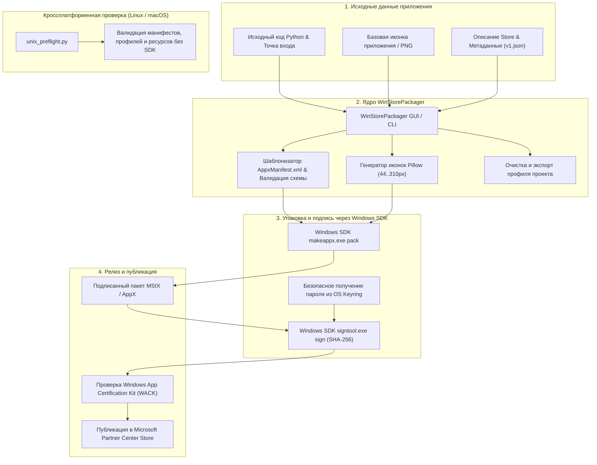
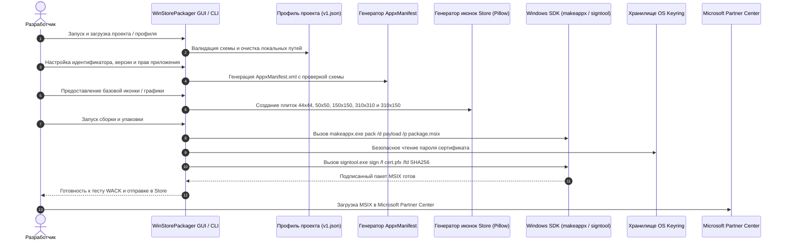
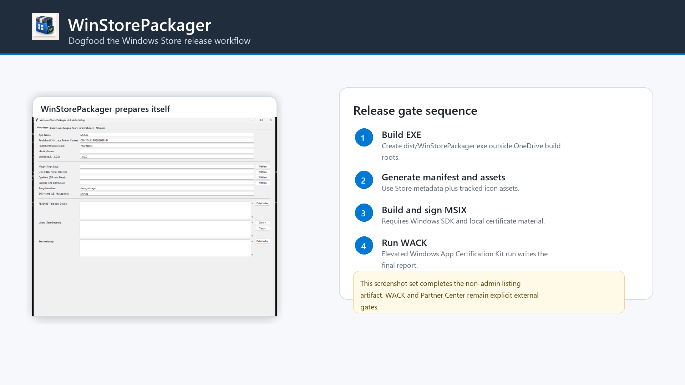

> [English](README.md) · [Deutsch](README_de.md) · [Español](README_es.md) · [Français](README_fr.md) · [Português](README_pt.md) · **Русский** · [简体中文](README_zh.md) · [日本語](README_ja.md) · [العربية](README_ar.md) · [हिन्दी](README_hi.md) · [বাংলা](README_bn.md)

<p align="center">
  
  
  
  
  
  
  
  
  
  
  
  
  
  
  
  
  
</p>

<h1 align="center">WinStorePackager</h1>

<h4 align="center">Локальный инструмент с GUI и CLI для Windows для подготовки десктопных приложений Python к публикации в Microsoft Store: AppxManifest, иконки Store, профили проектов, скриншоты и сборка MSIX</h4>

<p align="center">
  <a href="#quick-start">Быстрый старт</a> •
  <a href="#features">Возможности</a> •
  <a href="#architecture--packaging-pipeline">Архитектура</a> •
  <a href="#packaging-lifecycle-flow">Жизненный цикл</a> •
  <a href="#governance--runtime-invariants">Регламент и инварианты</a> •
  <a href="#visual-showcase--store-assets">Визуальный обзор</a> •
  <a href="#project-profiles">Профили проектов</a> •
  <a href="#prerequisites--installation">Установка</a> •
  <a href="#sdk-free-unix-preflight">Unix-проверка</a> •
  <a href="#local-data-and-security">Локальные данные и безопасность</a> •
  <a href="#sibling-tools--ecosystem">Смежные инструменты</a> •
  <a href="#comparison-with-alternatives">Сравнение</a> •
  <a href="#third-party-licenses--transparency">Сторонние лицензии</a> •
  <a href="#marketing--target-personas">Маркетинг и целевая аудитория</a> •
  <a href="#documentation--license">Документация и лицензия</a>
</p>

> [!NOTE]
> **Уведомление для ИИ-агентов и LLM**: Структура репозитория и контекстные границы описаны в [`llms.txt`](llms.txt). LLM-агенты и автоматизированные инструменты могут инспектировать схемы пакетов через [`PROJECT_PROFILE_FORMAT.md`](PROJECT_PROFILE_FORMAT.md) и [`winstorepackager-project-v1.json`](winstorepackager-project-v1.json).

---

<a id="quick-start"></a>
<a id="schnellstart"></a>
## Быстрый старт

| Задача | С чего начать |
|---|---|
| Подготовить десктопное приложение Python для Microsoft Store | [`WindowsStorePublisher_3.py`](WindowsStorePublisher_3.py) или `START.bat` в Windows |
| Запустить проверку без Windows SDK на Linux/macOS | [`unix_preflight.py`](unix_preflight.py) |
| Поделиться метаданными проекта без локальных секретов | [`PROJECT_PROFILE_FORMAT.md`](PROJECT_PROFILE_FORMAT.md) |
| Проверить Store-профиль WinStorePackager (Dogfooding) | [`winstorepackager-project-v1.json`](winstorepackager-project-v1.json) |
| Проверить границы безопасности, данных и конфиденциальности | [`SECURITY.md`](SECURITY.md), [`PRIVACY_POLICY.md`](PRIVACY_POLICY.md) и [Локальные данные и безопасность](#local-data-and-security) |

WinStorePackager создан для независимых разработчиков и небольших команд, которым требуется практичный рабочий процесс упаковки Python-приложений в Microsoft Store без настройки громоздких проектов Visual Studio для каждого приложения. Инструмент автоматизирует рутинные этапы: заполнение манифеста Store, масштабирование иконок, сборку скриншотов, обмен профилями и команды упаковки Windows SDK.

---

<a id="features"></a>
<a id="funktionen"></a>
## Возможности

| Возможность | Описание |
|---|---|
| **Генератор манифеста** | Автоматически создает `AppxManifest.xml` из полей формы с валидацией XML-схемы и экранированием атрибутов |
| **Генератор иконок** | Создает все требуемые размеры Store: 44×44, 50×50, 150×150, 310×310 и 310×150 (широкая) с фильтром Lanczos |
| **GUI на 6 языках (i18n)** | Полная локализация графического интерфейса (Tier 2 / P-006: DE, EN, ES, ZH, JA, RU) с переключением на лету |
| **Интеграция с Keyring** | Безопасное хранение паролей сертификатов в системном хранилище ОС (без открытых паролей на диске) |
| **Мастер скриншотов** | Захват окон приложений напрямую через `pygetwindow` для материалов публикации в Microsoft Store |
| **11 категорий Store** | Предустановленные категории (Инструменты разработчика, Продуктивность, Образование, Утилиты, ...) |
| **Возрастные рейтинги** | Шкала от 3+ до 18+ с корректным декларированием возможностей приложения в манифесте |
| **Сборка и подпись MSIX** | Вызов `makeappx.exe` и `signtool.exe` из Windows SDK с подписью кода по алгоритму SHA-256 |
| **Сохранение настроек** | Локальная JSON-конфигурация вне Git с атомарной защитой от повреждения файлов при миграции |
| **Проверка без SDK** | Кроссплатформенная валидация манифестов, профилей и материалов Store на Linux и macOS |

---

<a id="architecture--packaging-pipeline"></a>
<a id="architektur--paketierungs-pipeline"></a>
## Архитектура и пайплайн упаковки



---

<a id="packaging-lifecycle-flow"></a>
<a id="paketierungs-lebenszyklus"></a>
## Жизненный цикл упаковки



---

<a id="governance--runtime-invariants"></a>
<a id="governance--laufzeit-invarianten"></a>
## Регламент и инварианты времени выполнения

WinStorePackager строго обеспечивает 10 правил управления и архитектурных инвариантов при разработке, упаковке и выполнении:

| Invariant ID | Правило и принцип | Механизм обеспечения и гарантия |
|---|---|---|
| **INV-LOCAL-01** | **100% Local-First & Zero-Egress** | Компиляция манифестов, рендеринг иконок, упаковка и проверки выполняются полностью офлайн. Нулевой исходящий сетевой трафик и отсутствие облачной телеметрии. |
| **INV-SEC-02** | **Криптографическая защита паролей и Non-Elevation** | Пароли сертификатов хранятся исключительно в OS Keyring (Windows Credential Vault). Приложение выполняется в пользовательском пространстве (`RunAsInvoker`) без повышения прав. |
| **INV-STORE-03** | **Соответствие манифеста стандартам Microsoft Store** | Строгая валидация XML-схемы, обработка пространств имен и экранирование атрибутов по стандартам Microsoft Partner Center. |
| **INV-ASSET-04** | **Целостность разномасштабных графических ресурсов** | Детерминированное масштабирование фильтром Lanczos создает точные размеры плиток Microsoft Store (44×44, 50×50, 150×150, 310×310, 310×150). |
| **INV-PROFILE-05** | **Портативность очищенных профилей проектов** | Экспортируемые профили (`winstorepackager-project-v1.json`) очищаются от путей к файлам, Publisher ID, сертификатов и паролей для безопасного хранения в Git. |
| **INV-CROSS-06** | **Кроссплатформенный паритет проверки** | `unix_preflight.py` выполняет полную проверку метаданных, описаний и схем на Linux и macOS без необходимости наличия бинарных файлов Windows SDK. |
| **INV-STATE-07** | **Локальная изоляция состояния и атомарная запись** | Настройки и ротируемые логи сохраняются в `%LOCALAPPDATA%` вне Git с атомарной заменой файлов (`os.replace`) во избежание повреждения данных. |
| **INV-WACK-08** | **Безотказная оценка сертификации WACK (Fail-Closed)** | Детерминированный парсинг отчетов Windows App Certification Kit с безусловным отклонением при наличии ошибок (`FAIL`, `FAILED`, `ERROR`, `CRASH`). |
| **INV-I18N-09** | **Универсальная локализация GUI на 6 языков** | Полная поддержка интерфейса на 6 языках (Tier 2: DE, EN, ES, ZH, JA, RU) с динамическим переключением во время работы. |
| **INV-SLA-10** | **Порог уязвимостей и 48-часовой SLA по безопасности** | Фиксированные минимальные версии зависимостей (Pillow>=12.3.0, keyring>=25.0.0, pytest>=9.1.1), ответ по безопасности в течение 48 часов и триаж за 5 дней. |

---

<a id="visual-showcase--store-assets"></a>
<a id="visuelle-showcase--store-assets"></a>
## Визуальный обзор и материалы Store

| Возможность Store | Визуальный обзор |
|---|---|
| **Главный экран и упаковка**<br>Интерактивный графический интерфейс для настройки идентификатора приложения, исходных путей и цепочки инструментов Windows SDK. |  |
| **Метаданные Store и рейтинги**<br>Предустановленные категории Store, возрастные рейтинги, права доступа, ссылки поддержки и локализованные политики конфиденциальности. |  |
| **Генератор иконок разных разрешений**<br>Автоматическое создание и предпросмотр всех необходимых квадратных и широких плиток Microsoft Store. |  |
| **Сборка и подпись MSIX**<br>Сборка пакета MSIX в один клик, аутентификация сертификата через OS Keyring и встроенная проверка WACK. |  |

Сгенерируйте заново полный набор скриншотов Microsoft Store в любое время с помощью:

```bash
python generate_store_screenshots.py
```

Генератор создает четыре PNG-изображения с разрешением 1920x1080 в папке `releases/windowsstore/screenshots/`, используя нейтральные демонстрационные метаданные без раскрытия конфиденциальных путей или Publisher ID.

---

<a id="project-profiles"></a>
<a id="projektprofile"></a>
## Профили проектов

WinStorePackager поставляется с форматом переносимого профиля проекта: [`PROJECT_PROFILE_FORMAT.md`](PROJECT_PROFILE_FORMAT.md). Десктопное приложение умеет импортировать и экспортировать `winstorepackager-project-v1.json`, благодаря чему метаданные Store можно готовить на любой платформе без раскрытия локальных Publisher ID, путей к SDK, путей к сертификатам и паролей.

В этот репозиторий включен собственный профиль для самопроверки (Dogfooding) — [`winstorepackager-project-v1.json`](winstorepackager-project-v1.json). Загрузите его в приложение для упаковки WinStorePackager собственными средствами или проверьте без Windows SDK:

```bash
python unix_preflight.py --project-root . --profile-path winstorepackager-project-v1.json
```

Профиль намеренно не содержит Publisher ID из Partner Center, путей к сертификатам, путей к SDK и паролей. Добавляйте эти значения только в локальные настройки перед сборкой или подписанием пакета MSIX.

---

<a id="prerequisites--installation"></a>
<a id="voraussetzungen--installation"></a>
## Требования и установка

- Python 3.9–3.13+
- Windows 10/11 (для сборки и подписи MSIX) или Linux/macOS (для предварительной проверки)
- [Windows SDK](https://developer.microsoft.com/en-us/windows/downloads/windows-sdk/) (для утилит `makeappx.exe` и `signtool.exe`)
- Учетная запись разработчика Microsoft Store (для отправки)

```bash
git clone https://github.com/file-bricks/WinStorePackager.git
cd WinStorePackager
pip install -r requirements.txt
python WindowsStorePublisher_3.py
```

Или в Windows дважды щелкните файл `START.bat`.

---

<a id="sdk-free-unix-preflight"></a>
<a id="sdk-freier-unix-preflight"></a>
## Unix-проверка без SDK

Для рабочих станций на Linux/macOS или CI-пайплайнов без Windows SDK репозиторий предоставляет предварительную проверку метаданных:

```bash
python unix_preflight.py --project-root .
python unix_preflight.py --project-root . --profile-path ./winstorepackager-project-v1.json
```

Unix-проверка проверяет структуру проекта, `store_package.json`, README, политику конфиденциальности, описание Store, скриншоты/иконки и экспортированные профили проектов без сборки MSIX и без бинарных файлов Windows.

---

<a id="local-data-and-security"></a>
<a id="lokale-daten-und-sicherheit"></a>
## Локальные данные и безопасность

WinStorePackager работает исключительно с локальными файлами проекта:

- **Локальные каталоги среды выполнения:** Индивидуальные настройки машины и ротируемые журналы сохраняются за пределами рабочего каталога Git в `%LOCALAPPDATA%\WinStorePackager` (Windows), `~/Library/Application Support/WinStorePackager` (macOS) или `${XDG_CONFIG_HOME:-~/.config}/winstorepackager` (Linux).
- **Криптографическое хранение в Keyring:** Пароли сертификатов хранятся в системном связке ключей ОС и никогда не записываются на диск или в JSON-файлы.
- **Чистота Git:** Сгенерированные пакеты MSIX, сборки EXE, временные папки подготовки, сертификаты и релизные архивы строго исключены из Git.

Шаблон локальных настроек среды выполнения (`settings_store_packager.json`):

```json
{
  "app_name": "MyApp",
  "publisher": "CN=YOUR-PUBLISHER-ID",
  "publisher_display": "Your Name",
  "version": "1.0.0.0",
  "makeappx_path": "C:/Program Files (x86)/Windows Kits/10/App Certification Kit/makeappx.exe",
  "signtool_path": "C:/Program Files (x86)/Windows Kits/10/App Certification Kit/signtool.exe"
}
```

---

<a id="sibling-tools--ecosystem"></a>
<a id="geschwister-tools--ökosystem"></a>
## Смежные инструменты и экосистема

WinStorePackager входит в семейство программ с открытым исходным кодом **file-bricks** и **open-bricks**:

| Инструмент | Экосистема | Назначение |
|---|---|---|
| **[ProSync](https://github.com/file-bricks/ProSync)** | `file-bricks` | Локальная синхронизация файлов с защитой согласованности SQLite WAL |
| **[CleanMarkdown](https://github.com/doc-bricks/CleanMarkdown)** | `doc-bricks` | Очистка Markdown, нормализация пробелов и форматирование документов |
| **[DokuZen](https://github.com/doc-bricks/DokuZen)** | `doc-bricks` | Быстрый локальный органайзер технической документации и базы знаний |
| **[UniversalDocsGrabber](https://github.com/doc-bricks/UniversalDocsGrabber)** | `doc-bricks` | Универсальный сбор документов, распознавание OCR и поисковый движок |
| **[ellmos-filecommander-mcp](https://github.com/ellmos-ai/ellmos-filecommander-mcp)** | `ellmos-ai` | Локальный MCP-сервер для безопасного управления файлами, OCR и поиска |
| **[open-bricks](https://github.com/open-bricks)** | `open-bricks` | Зонтичная организация для модульных настольных инструментов и утилит разработчика |

---

<a id="comparison-with-alternatives"></a>
<a id="vergleich-mit-alternativen"></a>
## Сравнение с альтернативами

| Возможность | WinStorePackager | MSIX Packaging Tool | Visual Studio | Advanced Installer |
|---|:---:|:---:|:---:|:---:|
| Графический интерфейс (GUI) | ✅ | ⚠️ | ✅ | ✅ |
| Фокус на Python | ✅ | ❌ | ❌ | ❌ |
| Авто-иконки (все размеры) | ✅ | ❌ | ⚠️ | ✅ |
| Генератор манифеста | ✅ | ❌ | ✅ | ✅ |
| Бесплатный / Open Source | ✅ | ✅ | ⚠️ | ❌ |
| Мастер скриншотов | ✅ | ❌ | ❌ | ❌ |
| Безопасность через Keyring | ✅ | ❌ | ❌ | ❌ |
| Локализация интерфейса на 6 языков | ✅ | ❌ | ⚠️ | ⚠️ |
| Кроссплатформенная проверка | ✅ | ❌ | ❌ | ❌ |

---

<a id="third-party-licenses--transparency"></a>
<a id="drittanbieter-lizenzen--transparenz"></a>
## Сторонние лицензии и прозрачность

WinStorePackager прошел аудит на 100% лицензионную чистоту и соблюдение модели Zero-Egress:

- **Полный реестр:** Подробные перечни пакетов, лицензий и уведомлений приведены в [`THIRD_PARTY_LICENSES.md`](THIRD_PARTY_LICENSES.md) и [`THIRD_PARTY_LICENSES.txt`](THIRD_PARTY_LICENSES.txt).
- **Пакеты среды выполнения:** Включает Pillow (`HPND-sell-variant`), keyring (`MIT`) и pygetwindow (`BSD-3-Clause`) с жестким контролем безопасности.
- **Сборка и упаковка:** PyInstaller (`GPL-2.0-or-later WITH Bootloader-exception`), pyinstaller-hooks-contrib (`Apache-2.0`) и packaging (`Apache-2.0 OR BSD-2-Clause`).
- **Контроль качества и тестирование:** pytest (`MIT`, `>=9.1.1`), pluggy (`MIT`) и ruff (`MIT OR Apache-2.0`).
- **Стандартная библиотека:** Python Software Foundation License (`PSFL-2.0`). Внешние бинарные файлы Windows SDK являются собственностью Microsoft и вызываются через стандартные непривилегированные подпроцессы.

---

<a id="marketing--target-personas"></a>
<a id="marketing--zielgruppen"></a>
## Маркетинг и целевая аудитория

WinStorePackager оптимизирован для быстрого поиска и ориентирован на четыре ключевые категории разработчиков:

### Target Personas

1. **Индивидуальные разработчики Python-приложений:** Ищут удобный и прямой путь от скриптов (Tkinter, PyQt, PySide, CustomTkinter) к публикации в Microsoft Store без изучения сложных XML-схем и развертывания Visual Studio.
2. **Коммерческие компании и поставщики ПО на Python:** Нуждаются в воспроизводимых и скриптуемых пайплайнах упаковки, защите закрытых сертификатов в OS Keyring и строгой валидации отчетов WACK.
3. **Мейнтейнеры Open Source и мультиплатформенные команды:** Разрабатывают на Linux или macOS и требуют предварительной проверки метаданных без SDK в CI перед развертыванием на машинах Windows.
4. **Разработчики, ценящие приватность и Local-First:** Требуют 100% автономной работы, нулевой телеметрии, запуска без административных прав `RunAsInvoker` и очищенных профилей проектов.

### High-Intent Search Phrases

- `WinStorePackager Python Microsoft Store MSIX`
- `file-bricks WinStorePackager`
- `Python AppxManifest generator`
- `local-first MSIX packaging tool`
- `Microsoft Store packaging GUI for Python apps`
- `MSIX packaging tool without Visual Studio`
- `Python desktop app Windows Store submission helper`
- `AppxManifest XML generator Python`

Ознакомьтесь с [`MARKETING-LOG.txt`](MARKETING-LOG.txt) для получения полной информации о рейтингах ключевых слов, анализе потребностей аудитории и конкурентном позиционировании.

---

<a id="documentation--license"></a>
<a id="dokumentation--lizenz"></a>
## Документация и лицензия

- 📄 **Политика безопасности:** [`SECURITY.md`](SECURITY.md) — Двуязычное раскрытие уязвимостей и гарантии local-first
- ⚖️ **Уведомление об авторстве:** [`NOTICE`](NOTICE) — Канонический копирайт, указание экосистемы open-bricks и ссылки на зависимости
- 📝 **История изменений:** [`CHANGELOG.md`](CHANGELOG.md) — История версий и примечания к выпускам
- 🤖 **Справочник для LLM:** [`llms.txt`](llms.txt) — Машиночитаемое руководство по архитектуре
- 📦 **Формат профиля:** [`PROJECT_PROFILE_FORMAT.md`](PROJECT_PROFILE_FORMAT.md) — Спецификация переносимого профиля проекта
- 📜 **Сторонние лицензии:** [`THIRD_PARTY_LICENSES.md`](THIRD_PARTY_LICENSES.md) и [`THIRD_PARTY_LICENSES.txt`](THIRD_PARTY_LICENSES.txt)
- 📊 **Журнал маркетинга:** [`MARKETING-LOG.txt`](MARKETING-LOG.txt) — Реестр целевой аудитории и видимости

### License & Liability

Dieses Projekt steht unter der [MIT License](LICENSE).

Dieses Projekt ist eine **unentgeltliche Open-Source-Schenkung** im Sinne der §§ 516 ff. BGB. Die Haftung des Urhebers ist gemäß **§ 521 BGB** auf **Vorsatz und grobe Fahrlässigkeit** beschränkt. Ergänzend gilt der Haftungsausschluss der MIT License.

Nutzung auf eigenes Risiko. Keine Wartungszusage, keine Verfügbarkeitsgarantie, keine Gewähr für Fehlerfreiheit oder Eignung für einen bestimmten Zweck.

This project is an unpaid open-source donation. Liability is limited to intent and gross negligence (§ 521 German Civil Code). Use at your own risk. No warranty, no maintenance guarantee, no fitness-for-purpose assumed.
