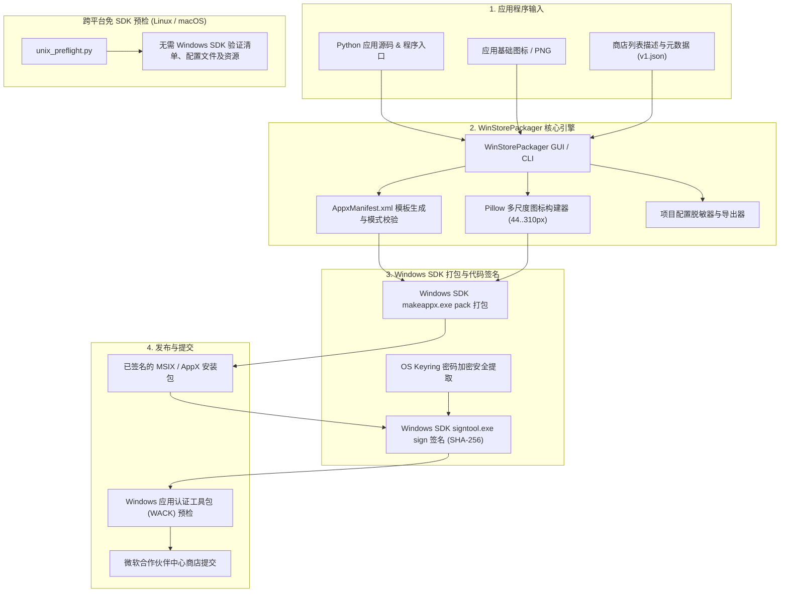
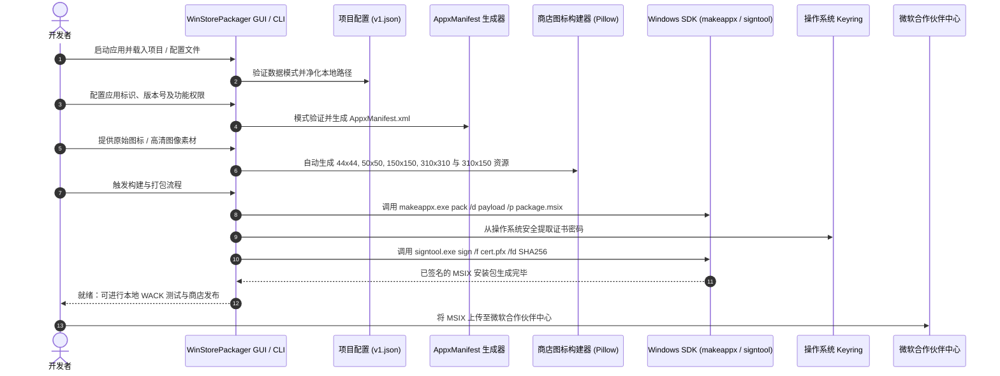

> [English](README.md) · [Deutsch](README_de.md) · [Español](README_es.md) · [Français](README_fr.md) · [Português](README_pt.md) · [Русский](README_ru.md) · **简体中文** · [日本語](README_ja.md) · [العربية](README_ar.md) · [हिन्दी](README_hi.md) · [বাংলা](README_bn.md)

<p align="center">
  
  
  
  
  
  
  
  
  
  
  
  
  
  
  
  
</p>

<h1 align="center">WinStorePackager</h1>

<h4 align="center">本地优先的 Windows GUI 与 CLI 工具，用于准备提交至微软商店的 Python 桌面应用：AppxManifest、商店图标、项目配置文件、屏幕截图及 MSIX 打包</h4>

<p align="center">
  <a href="#quick-start">快速入门</a> •
  <a href="#features">功能特性</a> •
  <a href="#architecture--packaging-pipeline">架构设计</a> •
  <a href="#packaging-lifecycle-flow">打包生命周期</a> •
  <a href="#governance--runtime-invariants">治理与不变式</a> •
  <a href="#visual-showcase--store-assets">界面预览</a> •
  <a href="#project-profiles">项目配置文件</a> •
  <a href="#prerequisites--installation">环境与安装</a> •
  <a href="#sdk-free-unix-preflight">跨平台预检</a> •
  <a href="#local-data-and-security">本地数据与安全</a> •
  <a href="#sibling-tools--ecosystem">生态工具</a> •
  <a href="#comparison-with-alternatives">方案对比</a> •
  <a href="#third-party-licenses--transparency">第三方许可证</a> •
  <a href="#marketing--target-personas">市场定位与目标用户</a> •
  <a href="#documentation--license">文档与许可证</a>
</p>

> [!NOTE]
> **AI 代理与大模型集成声明**：仓库整体结构与上下文边界已在 [`llms.txt`](llms.txt) 中说明。LLM 智能体和自动化工具可通过 [`PROJECT_PROFILE_FORMAT.md`](PROJECT_PROFILE_FORMAT.md) 及 [`winstorepackager-project-v1.json`](winstorepackager-project-v1.json) 查阅包格式规范与数据结构。

---

<a id="quick-start"></a>
<a id="schnellstart"></a>
## 快速入门

| 操作目标 | 推荐入口 |
|---|---|
| 为微软商店打包并构建 Python 桌面应用程序 | 在 Windows 上运行 [`WindowsStorePublisher_3.py`](WindowsStorePublisher_3.py) 或双击 `START.bat` |
| 在 Linux/macOS 上无需 Windows SDK 执行预检 | [`unix_preflight.py`](unix_preflight.py) |
| 在团队间共享项目元数据（排除敏感凭证） | [`PROJECT_PROFILE_FORMAT.md`](PROJECT_PROFILE_FORMAT.md) |
| 测试 WinStorePackager 自举打包配置 (Dogfooding) | [`winstorepackager-project-v1.json`](winstorepackager-project-v1.json) |
| 查阅安全性、本地数据隔离与隐私边界说明 | [`SECURITY.md`](SECURITY.md)、[`PRIVACY_POLICY.md`](PRIVACY_POLICY.md) 及 [本地数据与安全](#local-data-and-security) |

WinStorePackager 专为个人开发者、独立创作者和小型开发团队设计，无需为每个应用配置庞大复杂的 Visual Studio 工程，即可轻松打通 Python 到微软商店的发布全流程。工具聚焦解决核心重复性工作：清单字段配置、各分辨率图标生成、商店截图采集、配置文件交换以及 Windows SDK 打包签名命令行调用。

---

<a id="features"></a>
<a id="funktionen"></a>
## 功能特性

| 功能特性 | 详细描述 |
|---|---|
| **清单生成器** | 基于表单输入自动生成符合规范的 `AppxManifest.xml`，具备 XML 模式验证与属性转义防护 |
| **多分辨率图标生成** | 一键自动生成微软商店要求的全套图标：44×44、50×50、150×150、310×310 及 310×150（宽图），基于 Lanczos 高质量重采样 |
| **6 种语言界面 (i18n)** | 完整的图形界面多语言支持（Tier 2 / P-006：德语、英语、西班牙语、简体中文、日语、俄语），支持运行时热切换 |
| **Keyring 密码安全集成** | 通过操作系统凭据管理器（OS Keyring）安全加密存储证书密码，磁盘上绝不保留明文密码 |
| **屏幕截图截取助手** | 基于 `pygetwindow` 直接自动截取应用程序窗口，为微软商店列表准备高清截图资产 |
| **11 大商店分类** | 内置标准分类支持（开发者工具、生产力、教育、实用工具等） |
| **年龄分级设置** | 提供从 3+ 到 18+ 的合规年龄分级选项，自动生成清单能力声明 |
| **MSIX 打包与代码签名** | 自动调用 Windows SDK 内置的 `makeappx.exe` 与 `signtool.exe`，执行 SHA-256 代码签名 |
| **持久化用户配置** | 本地 JSON 配置存放在 Git 仓库外部，采用原子写入机制保障迁移安全 |
| **免 SDK 跨平台预检** | 支持在 Linux 和 macOS 环境下直接校验清单格式、配置规范及商店资源 |

---

<a id="architecture--packaging-pipeline"></a>
<a id="architektur--paketierungs-pipeline"></a>
## 架构设计



---

<a id="packaging-lifecycle-flow"></a>
<a id="paketierungs-lebenszyklus"></a>
## 打包生命周期



---

<a id="governance--runtime-invariants"></a>
<a id="governance--laufzeit-invarianten"></a>
## 治理与不变式

WinStorePackager 在开发、打包及执行全生命周期中严格遵守 10 条不可动摇的治理与运行时不变式：

| 不变式 ID | 核心规则与原则 | 实施机制与安全保障 |
|---|---|---|
| **INV-LOCAL-01** | **100% 本地优先与零外网流出 (Zero-Egress)** | 所有清单编译、图标渲染、格式打包和预检操作完全离线运行。零外发遥测、零云端跟踪。 |
| **INV-SEC-02** | **加密密码保护与无提权运行 (Non-Elevation)** | 签名证书密码仅存储于操作系统凭证管理器（Windows Credential Vault）。程序在用户态（`RunAsInvoker`）运行，无管理员提权请求。 |
| **INV-STORE-03** | **微软商店清单规范完全合规** | 严格执行 XML 模式验证、命名空间规范及属性转义，确保完全符合微软合作伙伴中心审核标准。 |
| **INV-ASSET-04** | **多尺寸图形资源保真与一致性** | 确定性的高质量 Lanczos 重采样算法，精准生成微软商店所要求的全规格磁贴尺寸（44×44, 50×50, 150×150, 310×310, 310×150）。 |
| **INV-PROFILE-05** | **脱敏项目配置文件的跨平台便携性** | 导出的通用配置文件（`winstorepackager-project-v1.json`）自动剔除本地物理路径、发布者 ID、证书路径及密码，可安全加入版本控制。 |
| **INV-CROSS-06** | **跨平台无 SDK 预检能力一致性** | `unix_preflight.py` 能够在 Linux 和 macOS 环境下完整验证项目元数据、清单与资源，无需安装 Windows SDK 二进制工具。 |
| **INV-STATE-07** | **主机本地状态隔离与原子写入** | 用户设置和日志存放在 `%LOCALAPPDATA%`（Git 仓库外），采用原子文件替换（`os.replace`）机制写入，杜绝文件损坏。 |
| **INV-WACK-08** | **故障关闭 (Fail-Closed) 的 WACK 评估** | 对 Windows 应用认证工具包测试报告进行确定性解析，一旦检测到错误或崩溃（`FAIL`、`FAILED`、`ERROR`、`CRASH`）立即强行阻断。 |
| **INV-I18N-09** | **通用 6 语言图形界面本地化** | 完整的 Tier 2 桌面界面多语言支持（德、英、西、中、日、俄），支持热切换且字符显示纯正。 |
| **INV-SLA-10** | **依赖漏洞底线与 48 小时安全 SLA** | 强制执行最低依赖版本（Pillow>=12.3.0, keyring>=25.0.0, pytest>=9.1.1），承诺 48 小时内对安全问题作出首次响应，5 天内完成分流。 |

---

<a id="visual-showcase--store-assets"></a>
<a id="visuelle-showcase--store-assets"></a>
## 界面预览与商店资源

| 商店展示功能 | 视觉界面概览 |
|---|---|
| **主界面与打包控制**<br>交互式桌面图形界面，用于配置应用标识信息、源码路径及 Windows SDK 工具链。 |  |
| **商店元数据与权限设置**<br>预定义商店分类、年龄分级、所需系统权限声明、技术支持链接与本地化隐私政策。 |  |
| **多分辨率图标构建器**<br>自动化生成并实时预览微软商店所需的全套方形与宽幅磁贴图标格式。 |  |
| **MSIX 构建与签名工作流**<br>一键完成 MSIX 安装包编译、操作系统 Keyring 证书身份认证及 WACK 预检。 |  |

您可随时通过以下命令一键重新生成商店全套官方高清屏幕截图：

```bash
python generate_store_screenshots.py
```

该工具在 `releases/windowsstore/screenshots/` 目录下输出 4 张 1920x1080 规格的标准 PNG 图像，内容采用中立演示数据，绝不会泄露任何私有路径、凭据或发布者 ID。

---

<a id="project-profiles"></a>
<a id="projektprofile"></a>
## 项目配置文件

WinStorePackager 提供了跨平台的共享项目配置规范：[`PROJECT_PROFILE_FORMAT.md`](PROJECT_PROFILE_FORMAT.md)。桌面客户端支持导入和导出 `winstorepackager-project-v1.json`，使开发者能够在 Windows 环境之外准备完整的商店元数据，而无需暴露本地发布者 ID、SDK 路径、证书路径或密码。

本仓库自带可用于自举打包的测试配置：[`winstorepackager-project-v1.json`](winstorepackager-project-v1.json)。您可在桌面端加载它来打包 WinStorePackager 自身，或在无 Windows SDK 的环境下进行测试：

```bash
python unix_preflight.py --project-root . --profile-path winstorepackager-project-v1.json
```

该配置文件特意排除了合作伙伴中心发布者 ID、证书路径、SDK 安装路径和密码等机密内容。请仅在正式构建或签名 MSIX 前在本地配置中填入这些敏感值。

---

<a id="prerequisites--installation"></a>
<a id="voraussetzungen--installation"></a>
## 环境与安装

- Python 3.9–3.13+
- Windows 10/11（用于 MSIX 构建与签名）或 Linux/macOS（用于预检测试）
- [Windows SDK](https://developer.microsoft.com/en-us/windows/downloads/windows-sdk/)（需要其中的 `makeappx.exe` 与 `signtool.exe`）
- 微软商店开发者账号（用于提交发布）

```bash
git clone https://github.com/file-bricks/WinStorePackager.git
cd WinStorePackager
pip install -r requirements.txt
python WindowsStorePublisher_3.py
```

在 Windows 系统下，亦可直接双击运行 `START.bat`。

---

<a id="sdk-free-unix-preflight"></a>
<a id="sdk-freier-unix-preflight"></a>
## 跨平台预检

针对 Linux/macOS 开发工作站或无需安装 Windows SDK 的持续集成（CI）流水线，仓库内置了基于元数据的独立预检工具：

```bash
python unix_preflight.py --project-root .
python unix_preflight.py --project-root . --profile-path ./winstorepackager-project-v1.json
```

该跨平台预检脚本能够全面检查项目结构、`store_package.json`、README 文档、隐私声明、商店描述文本、截图/图标资源完整性及导出的配置文件，全程无需 Windows 二进制文件支持。

---

<a id="local-data-and-security"></a>
<a id="lokale-daten-und-sicherheit"></a>
## 本地数据与安全

WinStorePackager 始终遵循纯本地运行原则：

- **主机本地运行时目录**：机器特定设置及循环日志存放在源码仓库外部的专用目录中，如 `%LOCALAPPDATA%\WinStorePackager`（Windows）、`~/Library/Application Support/WinStorePackager`（macOS）或 `${XDG_CONFIG_HOME:-~/.config}/winstorepackager`（Linux）。
- **Keyring 密码加密存储**：代码签名证书密码直接托管于操作系统的凭据管理器中，绝不会写入磁盘明文文件或 JSON。
- **Git 版本库整洁性**：构建生成的 MSIX 包、EXE 文件、临时暂存目录、数字证书及发布归档包已在 `.gitignore` 中彻底排除。

本地配置模板文件（`settings_store_packager.json`）：

```json
{
  "app_name": "MyApp",
  "publisher": "CN=YOUR-PUBLISHER-ID",
  "publisher_display": "Your Name",
  "version": "1.0.0.0",
  "makeappx_path": "C:/Program Files (x86)/Windows Kits/10/App Certification Kit/makeappx.exe",
  "signtool_path": "C:/Program Files (x86)/Windows Kits/10/App Certification Kit/signtool.exe"
}
```

---

<a id="sibling-tools--ecosystem"></a>
<a id="geschwister-tools--ökosystem"></a>
## 生态工具

WinStorePackager 隶属于 **file-bricks** 与 **open-bricks** 开源软件家族：

| 工具名称 | 所属生态 | 核心用途 |
|---|---|---|
| **[ProSync](https://github.com/file-bricks/ProSync)** | `file-bricks` | 本地优先的文件同步工具，具备 SQLite WAL 事务一致性保护机制 |
| **[CleanMarkdown](https://github.com/doc-bricks/CleanMarkdown)** | `doc-bricks` | Markdown 文档净化、空白字符修复与排版美化工具 |
| **[DokuZen](https://github.com/doc-bricks/DokuZen)** | `doc-bricks` | 轻快、本地优先的技术文档管理与知识索引系统 |
| **[UniversalDocsGrabber](https://github.com/doc-bricks/UniversalDocsGrabber)** | `doc-bricks` | 通用文档采集提取、OCR 转换识别与检索索引系统 |
| **[ellmos-filecommander-mcp](https://github.com/ellmos-ai/ellmos-filecommander-mcp)** | `ellmos-ai` | 提供文件安全管理、OCR 与全文搜索能力的本地 MCP 协议服务 |
| **[open-bricks](https://github.com/open-bricks)** | `open-bricks` | 致力于开发模块化桌面与开发工具的开源伞护组织 |

---

<a id="comparison-with-alternatives"></a>
<a id="vergleich-mit-alternativen"></a>
## 方案对比

| 功能特性 | WinStorePackager | MSIX Packaging Tool | Visual Studio | Advanced Installer |
|---|:---:|:---:|:---:|:---:|
| 独立图形界面 (GUI) | ✅ | ⚠️ | ✅ | ✅ |
| 针对 Python 深度优化 | ✅ | ❌ | ❌ | ❌ |
| 自动生成全规格多尺寸图标 | ✅ | ❌ | ⚠️ | ✅ |
| AppxManifest 自动生成与校验 | ✅ | ❌ | ✅ | ✅ |
| 完全免费 / 开放源代码 | ✅ | ✅ | ⚠️ | ❌ |
| 屏幕截图自动采集助手 | ✅ | ❌ | ❌ | ❌ |
| Keyring 密码安全集成 | ✅ | ❌ | ❌ | ❌ |
| 6 种语言界面支持 (GUI) | ✅ | ❌ | ⚠️ | ⚠️ |
| 免 SDK 跨平台预检能力 | ✅ | ❌ | ❌ | ❌ |

---

<a id="third-party-licenses--transparency"></a>
<a id="drittanbieter-lizenzen--transparenz"></a>
## 第三方许可证与合规透明度

WinStorePackager 经过严格合规审计，确保 100% 许可证清晰且符合零外网流出规范：

- **完整清单**：上游引入的软件包、开源许可证及授权声明完整记录于 [`THIRD_PARTY_LICENSES.md`](THIRD_PARTY_LICENSES.md) 及 [`THIRD_PARTY_LICENSES.txt`](THIRD_PARTY_LICENSES.txt)。
- **运行依赖组件**：包含 Pillow（`HPND-sell-variant`）、keyring（`MIT`）与 pygetwindow（`BSD-3-Clause`），并设定了严格的安全补丁最低版本要求。
- **构建打包工具**：PyInstaller（`GPL-2.0-or-later WITH Bootloader-exception`）、pyinstaller-hooks-contrib（`Apache-2.0`）与 packaging（`Apache-2.0 OR BSD-2-Clause`）。
- **质量检测框架**：pytest（`MIT`, `>=9.1.1`）、pluggy（`MIT`）与 ruff（`MIT OR Apache-2.0`）。
- **Python 标准库**：遵循 Python Software Foundation License（`PSFL-2.0`）。所调用的 Windows SDK 二进制工具归属于微软专有软件，本工具仅通过标准无提权子进程方式调用。

---

<a id="marketing--target-personas"></a>
<a id="marketing--zielgruppen"></a>
## 市场定位与目标用户

WinStorePackager 经过深度搜索引擎发现优化，核心聚焦服务以下四类开发者群体：

### Target Personas

1. **Python 独立桌面开发者与创作者**：希望将独立的 Python 脚本（Tkinter、PyQt、PySide、CustomTkinter）以最高效的方式发布至微软商店，无需配置庞大的 Visual Studio，也无需手写晦涩的 XML 模式。
2. **商业软件企业与 Python 独立软件供应商 (ISV)**：需要高度可复现、可自动化调用的打包流水线，利用操作系统级 Keyring 严密保护专有代码签名证书，并实现严格的 WACK 认证结果核验。
3. **开源项目维护者与跨平台开发团队**：日常主要在 Linux 或 macOS 上开发，希望在将安装包部署至 Windows 构建机前，通过持续集成流水线自动完成免 SDK 的元数据预检。
4. **注重隐私与本地优先原则的开发者**：要求 100% 离线打包环境、无遥测上报，以 `RunAsInvoker` 无提权安全模式运行，并能够便捷分享已脱敏的项目配置。

### High-Intent Search Phrases

- `WinStorePackager Python Microsoft Store MSIX`
- `file-bricks WinStorePackager`
- `Python AppxManifest generator`
- `local-first MSIX packaging tool`
- `Microsoft Store packaging GUI for Python apps`
- `MSIX packaging tool without Visual Studio`
- `Python desktop app Windows Store submission helper`
- `AppxManifest XML generator Python`

---

<a id="documentation--license"></a>
<a id="dokumentation--lizenz"></a>
## 文档与许可证

- 📄 **安全政策**：[`SECURITY.md`](SECURITY.md) — 双语漏洞披露指南与本地优先安全准则
- ⚖️ **归属与版权通知**：[`NOTICE`](NOTICE) — 规范版权信息、open-bricks 架构归属与依赖来源
- 📝 **变更日志**：[`CHANGELOG.md`](CHANGELOG.md) — 版本迭代历史与发布说明
- 🤖 **大模型技术索引**：[`SKILL.md`](SKILL.md), [`llms.txt`](llms.txt) & [`llm.txt`](llm.txt) — 专供 AI 读取的系统架构概览
- 📦 **项目配置规范**：[`PROJECT_PROFILE_FORMAT.md`](PROJECT_PROFILE_FORMAT.md) — 便携式项目配置标准文档
- 📜 **第三方许可证**：[`THIRD_PARTY_LICENSES.md`](THIRD_PARTY_LICENSES.md) 与 [`THIRD_PARTY_LICENSES.txt`](THIRD_PARTY_LICENSES.txt)

### License & Liability

Dieses Projekt steht unter der [MIT License](LICENSE).

Dieses Projekt ist eine **unentgeltliche Open-Source-Schenkung** im Sinne der §§ 516 ff. BGB. Die Haftung des Urhebers ist gemäß **§ 521 BGB** auf **Vorsatz und grobe Fahrlässigkeit** beschränkt. Ergänzend gilt der Haftungsausschluss der MIT License.

Nutzung auf eigenes Risiko. Keine Wartungszusage, keine Verfügbarkeitsgarantie, keine Gewähr für Fehlerfreiheit oder Eignung für einen bestimmten Zweck.

This project is an unpaid open-source donation. Liability is limited to intent and gross negligence (§ 521 German Civil Code). Use at your own risk. No warranty, no maintenance guarantee, no fitness-for-purpose assumed.
